# SikaSchool — Product Requirements Document

> SikaSchool — Documentation de référence

**Last updated:** 2026-10-10
**Status:** Active
**Source of truth:** produit, rôles, règles métier et parcours ; le code décrit le comportement actuel, les propositions restent explicitement identifiées.

## Navigation

[Product](./PRD.md) · [Architecture](./architecture.md) · [Rules](./Rules.md) · [Design](./design.md) · [Tasks](./tasks.md) · [Memory](./memory.md)

## 1. Présentation et statut des informations

SikaSchool propose des cours particuliers en ligne et un accompagnement scolaire : découverte de l'offre, mise en relation avec un tuteur, séances vidéo, échanges, suivi pédagogique et achat de séances. La mission observable dans le site est « Comprendre, Progresser, Réussir ». Le problème adressé est la difficulté à réunir aide personnalisée, organisation des cours et visibilité sur les progrès dans un même espace.

Le catalogue actuel cible **collège, lycée et supérieur**, avec offres à la séance, packs et abonnements. Le primaire apparaît dans des témoignages mais n'a pas de niveau tarifaire dédié : son ouverture commerciale est `DECISION_REQUIRED`. Les matières des créneaux proviennent des profils tuteurs ; ne pas promettre une couverture que les disponibilités ne permettent pas.

La proposition de valeur confirmée par les fonctionnalités est un parcours intégré entre accompagnement humain, classe LiveKit et assistant pédagogique Sika AI. Leur supériorité concurrentielle, les qualifications annoncées, chiffres de satisfaction, partenariats et résultats scolaires ne sont pas établis par le code. La V2 propose une expérience plus claire, rassurante et accessible, sans nouvelle politique commerciale implicite.

| Statut            | Signification                                                                 |
| ----------------- | ----------------------------------------------------------------------------- |
| IMPLEMENTED       | Présent et confirmé par lecture du code ; ne signifie pas testé en production |
| PARTIAL           | Présent mais incomplet, contradictoire ou avec une limite métier connue       |
| PLANNED           | Proposition non implémentée                                                   |
| DEPRECATED        | Remplacé, conservé uniquement pour expliquer l'historique                     |
| TO_VERIFY         | Nécessite recette, accès environnement ou preuve métier                       |
| DECISION_REQUIRED | Arbitrage produit, sécurité, exploitation ou juridique attendu                |

Objectifs proposés à moyen terme : sécuriser les parcours critiques, rendre les prix et les confirmations fiables, puis moderniser le frontend. À long terme : un suivi pédagogique durable, un espace famille adapté aux besoins validés et des contenus pédagogiques utiles. Aucun objectif de revenus, volume de clients ou taux de conversion n'a été validé ; établir une baseline avant de fixer des cibles.

## 2. Personas, rôles et permissions

| Persona              | Besoin et objectif                                | Parcours et permissions actuelles                                                   | Contraintes / friction                                                            | Critère de réussite                                             |
| -------------------- | ------------------------------------------------- | ----------------------------------------------------------------------------------- | --------------------------------------------------------------------------------- | --------------------------------------------------------------- |
| Visiteur             | Comprendre le service et obtenir un premier cours | Pages publiques, lead, inscription STUDENT/PARENT, récupération                     | Formulaire dense, double modale, route booking fictive                            | Demande persistée avec référence et prochaine étape explicite   |
| Élève STUDENT        | Apprendre et organiser ses séances                | `/student`, propres cours, tuteurs assignés, messages, paiements, IA, évaluations   | Dépendance aux assignations, états financiers partiels                            | Accès à ses seuls contenus et à sa séance avec bon tuteur       |
| Parent PARENT        | Organiser et suivre l'élève lié                   | `/family`, résolution serveur de l'élève effectif pour les routes compatibles       | Liaison par simple e-mail ; un seul élève effectif ; écarts LiveKit/retour Stripe | Comprendre pour quel élève il agit, sans accès à un tiers       |
| Tuteur TUTOR         | Planifier, enseigner et suivre ses élèves         | `/tutor`, élèves assignés, demandes, évaluations, revenus, profil                   | Disponibilité booléenne, absence de grille persistée                              | Voir les bonnes demandes, confirmer, enseigner, rendre un bilan |
| Administrateur ADMIN | Superviser comptes et activité                    | `/tutor/administration`, utilisateurs, assignations, séances, modération, paiements | Certains tuteurs obtiennent aussi le privilège par liste d'e-mails                | Opérations autorisées, traçables, sans perte de données         |

Le frontend ne constitue jamais une autorisation. L'identité du compte et l'élève effectif sont distincts. Profil pédagogique parent → élève ; mot de passe et 2FA → compte connecté. Détails des gardes et exceptions dans [architecture](./architecture.md#securite).

## 3. Fiches fonctionnelles

Les critères suivants sont des critères de recette à démontrer, et non des résultats de tests. Les tâches opérationnelles et leurs checklists vivent exclusivement dans [tasks](./tasks.md).

### Site public et acquisition

- **Description / objectif métier :** Expliquer niveaux, méthode et tarifs ; convertir une intention en demande.
- **Utilisateurs concernés :** Visiteur, parent, élève.
- **Comportement actuel :** Homepage Hero → Testimonial → StagePromo → About → FunFact → Pricing → FAQ → Contact ; routes about/how-to/packs/book-online/support/donnees-personnelles. Lead crée un compte ou met à jour des coordonnées existantes.
- **Règles métier :** Ne pas réinitialiser le rôle ou le mot de passe existant ; campagne back_to_school ; nom/prénom/e-mail requis.
- **États et transitions :** Saisie → envoi → créneaux → demande confirmée ; erreurs récupérables attendues.
- **Cas limites :** Double propriétaire de modale ; édition publique des coordonnées ; promotion et preuves non validées.
- **Dépendances :** `components/Hero, Booking/LeadCaptureModal, app/api/leads, translations, SMTP/Resend`.
- **Critères d’acceptation :** Un seul dialog, réponse sans secret, confirmation liée à une vraie séance.
- **Statut actuel :** PARTIAL.
- **Améliorations prévues :** UX-001 à UX-006, TECH-001, TECH-003, TECH-016 ; homepage V2.

### Inscription, connexion et récupération

- **Description / objectif métier :** Créer et retrouver un accès personnel.
- **Utilisateurs concernés :** Visiteur puis tous rôles.
- **Comportement actuel :** signup réexporte register ; création Supabase Auth + profil + sous-profil, puis session Auth.js ; recovery Supabase.
- **Règles métier :** Inscription publique STUDENT/PARENT ; mot de passe ≥ 8 caractères ; création de tuteurs/admin par administration.
- **États et transitions :** Anonyme → compte → session ; login peut répondre 202 pour challenge SMS ; compte inactif refusé à la connexion.
- **Cas limites :** Création partielle compensée ; e-mail existant 409 ; register renvoie supabaseCredentials contenant le mot de passe soumis ; 2FA non imposée dans authorize.
- **Dépendances :** `auth.ts, lib/user-management.ts, app/api/auth, Supabase Auth`.
- **Critères d’acceptation :** Connexion par rôle, refus inactif, lien expiré refusé, logout des deux sessions ; aucun chemin ne contourne 2FA.
- **Statut actuel :** PARTIAL.
- **Améliorations prévues :** TECH-013, TECH-006, TECH-010 ; ne pas annoncer MFA garantie.

### Dashboard élève et suivi pédagogique

- **Description / objectif métier :** Voir prochaine séance, historique et progression.
- **Utilisateurs concernés :** Élève et parent compatible.
- **Comportement actuel :** Pages dashboard/calendar/history/statistics ; API dashboard/sessions/assessments/assigned-tutors.
- **Règles métier :** Filtrage par élève effectif ; évaluations rédigées par tuteur.
- **États et transitions :** Chargement → données ou vide ; statut des cours actualisé.
- **Cas limites :** Indicateurs dérivés de données présentes ; ne pas confondre notes de bilan et résultats scolaires certifiés.
- **Dépendances :** `app/student, components/Student, types/dashboard.ts`.
- **Critères d’acceptation :** Un élève ne voit pas les séances ou bilans d’un autre ; état vide utile et retry.
- **Statut actuel :** IMPLEMENTED.
- **Améliorations prévues :** V2-007 ; mesurer fraîcheur et requêtes TECH-009.

### Espace famille

- **Description / objectif métier :** Suivre et organiser l’accompagnement d’un élève.
- **Utilisateurs concernés :** Parent.
- **Comportement actuel :** GET/POST linked-student ; l’ancien lien du parent est retiré avant nouveau lien ; pages family réemploient des vues élève.
- **Règles métier :** Compte cible STUDENT ; helper sélectionne le premier lien par created_at ; parents_linked est une FK scalaire.
- **États et transitions :** Sans lien → e-mail élève → lié → remplacement.
- **Cas limites :** Pas de preuve d’accord élève ; remplacement non transactionnel ; seed multi-enfants ne prouve pas le support UI ; LiveKit ne résout pas l’élève effectif.
- **Dépendances :** `lib/student-access.ts, app/api/family/linked-student`.
- **Critères d’acceptation :** Parent sans lien bloqué sur données élève ; tentative de liaison non consentie refusée après sécurisation.
- **Statut actuel :** PARTIAL.
- **Améliorations prévues :** TECH-014, TECH-017 ; multi-enfants DECISION_REQUIRED.

### Dashboard tuteur et évaluations

- **Description / objectif métier :** Gérer demandes, élèves et bilans.
- **Utilisateurs concernés :** Tuteur, admin selon route.
- **Comportement actuel :** Dashboard, eleves, calendar, history, statistics, disponibilites, messages, paiements, profile ; session-assessments.
- **Règles métier :** Tous les participants d’une séance créée doivent être assignés ; actions limitées au tuteur propriétaire.
- **États et transitions :** Demande PENDING → ACCEPT/REJECT ; bilan persisté puis visible élève.
- **Cas limites :** Disponibilité is_available ne décrit pas un agenda hebdomadaire ; unicité session_assessments.session_id à rapprocher du multi-élève.
- **Dépendances :** `app/tutor, components/Tutor, app/api/tutor`.
- **Critères d’acceptation :** Tuteur non assigné refusé ; bilan retrouvé par élève autorisé ; aucune double évaluation incohérente.
- **Statut actuel :** PARTIAL.
- **Améliorations prévues :** TECH-019, V2-008 ; validation métier bilan collectif.

### Administration et attribution

- **Description / objectif métier :** Superviser le service et relier tuteurs/élèves.
- **Utilisateurs concernés :** Admin, tuteurs privilégiés.
- **Comportement actuel :** Gestion utilisateurs/profils/statut/reset/sync ; assign/unassign ; CRUD séances ; avis ; lecture paiements ; santé e-mail.
- **Règles métier :** Vérifier rôles en base ; assignation active préalable aux séances connectées ; reset admin remplace le mot de passe et retourne tempPassword.
- **États et transitions :** Compte créé → profil → assignation active → désactivation/déliaison ; avis approuvé ou retiré.
- **Cas limites :** Suppression de comptes/séances avec cascades ; privilèges par e-mail ; secret temporaire retourné à l’admin ; effets secondaires best-effort.
- **Dépendances :** `app/api/admin, lib/admin-permissions.ts, app/tutor/administration`.
- **Critères d’acceptation :** Standard tutor refusé ; comptes créés complets ; assignations et notifications cohérentes.
- **Statut actuel :** PARTIAL.
- **Améliorations prévues :** TECH-006, TECH-013, TECH-004, V2-008.

### Calendrier, réservation et séances

- **Description / objectif métier :** Passer d’une demande à un cours réalisé.
- **Utilisateurs concernés :** Visiteur, élève, parent, tuteur, admin.
- **Comportement actuel :** Deux flux : créneau public TRIAL et POST sessions authentifié ; calendrier booking est une démonstration 2024 sans persistance.
- **Règles métier :** Assignation active pour flux connecté ; essai 60 min, montant 0 ; annulation dédiée au moins 24 h avant.
- **États et transitions :** PENDING → SCHEDULED ou CANCELLED ; update-status peut aussi avancer PENDING directement ; réalisation → COMPLETED.
- **Cas limites :** Double réservation concurrente ; POST public accepte e-mail tiers ; update-status public avec retours précoces ; consommation des crédits non reliée.
- **Dépendances :** `app/api/sessions, leads/first-session-slots, lib/session-participants.ts`.
- **Critères d’acceptation :** Deux POST concurrents n’occupent pas le même tuteur ; autorisations par participant ; aucune fausse confirmation.
- **Statut actuel :** PARTIAL.
- **Améliorations prévues :** TECH-003, TECH-008, TECH-015, TECH-019, UX-003.

### Classe virtuelle LiveKit

- **Description / objectif métier :** Assurer le cours en visioconférence.
- **Utilisateurs concernés :** Tuteur et élèves participants.
- **Comportement actuel :** POST token vérifie user.id dans séance/participants ; salle class_<id>, publication audio/vidéo/data ; deux routes UI live.
- **Règles métier :** Tuteur propriétaire instructor et roomAdmin ; token 2 h ; ID fourni par navigateur ne suffit pas.
- **États et transitions :** Préconnexion → autorisation micro/caméra → connecté → déconnexion/erreur.
- **Cas limites :** Parent lié non admis par simple lien ; pas de contrôle temporel/statut dans membership ; helper Egress sans appelant trouvé.
- **Dépendances :** `lib/livekit*.ts, components/LiveClass.tsx, app/live, app/class`.
- **Critères d’acceptation :** Participant autorisé entre dans la bonne salle ; étranger refusé ; erreur réseau et expiration expliquées.
- **Statut actuel :** PARTIAL.
- **Améliorations prévues :** TECH-017, V2-009 ; enregistrement non livré en parcours complet.

### Messagerie et notifications

- **Description / objectif métier :** Communiquer et recevoir les changements utiles.
- **Utilisateurs concernés :** Élève, parent lié, tuteur.
- **Comportement actuel :** Threads/messages CRUD et statut lu ; notifications GET/PATCH ; hooks Mercure et Supabase.
- **Règles métier :** Appartenance au fil côté serveur ; données privées obtenues via API, événements de rafraîchissement seulement.
- **États et transitions :** Fil créé → message envoyé → reçu → lu ; notification non lue → lue.
- **Cas limites :** Perte SSE, réponses concurrentes, permissions parent et RLS navigateur distinctes ; signal Mercure contient identifiants.
- **Dépendances :** `app/api/student/messages, app/api/tutor/messages, hooks/useRealtime*, lib/mercure.ts`.
- **Critères d’acceptation :** Deux clients autorisés actualisés ; ID étranger refusé ; badge lu synchronisé et reconnexion sans doublon.
- **Statut actuel :** IMPLEMENTED.
- **Améliorations prévues :** TECH-006, TECH-011, V2-009 ; exposition des métadonnées à vérifier.

### Paiements, packs, abonnements et facturation

- **Description / objectif métier :** Acheter et suivre les séances, factures et revenus.
- **Utilisateurs concernés :** Élève, parent payeur ; tuteur/admin en lecture.
- **Comportement actuel :** Checkout hébergé, Portal, overview ; paiement/abonnement projetés en DB ; crédits ajoutés au webhook ; revenus/payouts consultables.
- **Règles métier :** Prix serveur en centimes EUR ; crédit appartient à l’élève effectif, Customer au compte payeur ; retour navigateur ne crédite pas.
- **États et transitions :** PENDING → PAID/FAILED/REFUNDED ; abonnements suivent statuts Stripe.
- **Cas limites :** Replay double crédit ; invoice_id sans contrainte UNIQUE dans SQL local ; erreurs DB avalées ; remboursement ne décrémente pas solde ; retour parent vers /student.
- **Dépendances :** `lib/stripe.ts, payments-catalog.ts, stripe-customer.ts, app/api/webhooks/stripe`.
- **Critères d’acceptation :** Signature invalide refusée ; replay/concurrence sans double crédit ; solde réconcilié et facture accessible au bon payeur.
- **Statut actuel :** PARTIAL.
- **Améliorations prévues :** TECH-002, TECH-017, TECH-019, UX-002 ; politique commerciale à valider.

### Profils et sécurité personnelle

- **Description / objectif métier :** Maintenir ses informations et protéger son compte.
- **Utilisateurs concernés :** Élève, parent, tuteur.
- **Comportement actuel :** Profil pédagogique élève effectif ; mot de passe et SMS 2FA sur user.id ; avatar tuteur bucket avatars ; préférences user_settings.
- **Règles métier :** Mot de passe courant vérifié ; setup SMS send_setup_code puis verify_setup_code ; disable sur session.
- **États et transitions :** Profil lecture → édition → succès/erreur ; 2FA inactive → setup → active → désactivée.
- **Cas limites :** OTP Math.random, secret fallback, limitation non trouvée ; suppression profil tuteur à recetter ; session JWT et changements de rôle.
- **Dépendances :** `app/api/student/profile, app/api/tutor/profile, lib/sms-2fa.ts`.
- **Critères d’acceptation :** Validation fichiers ; mot de passe tiers refusé ; code erroné/expiré refusé ; parent change sa propre sécurité.
- **Statut actuel :** PARTIAL.
- **Améliorations prévues :** TECH-013, TECH-006, V2-007/V2-008.

### Sika AI Tutor

- **Description / objectif métier :** Expliquer, guider et aider à réviser.
- **Utilisateurs concernés :** Élève et parent lié.
- **Comportement actuel :** Conversations créer/lire/renommer/supprimer ; texte et six images maximum retenues ; LangGraph, quatre outils pédagogiques.
- **Règles métier :** Ownership par effectiveStudentId ; message ou image requis ; aucune garantie de justesse pédagogique.
- **États et transitions :** Conversation vide → envoi → réponse persistée ; erreur fournisseur persistée ; suppression.
- **Cas limites :** 40 premiers messages chargés en ordre ascendant ; pas de quota identifié ; validation URL/MIME/taille serveur insuffisante ; données envoyées à OpenAI.
- **Dépendances :** `lib/ai-tutor, app/api/student/ai-tutor, Postgres JSONB`.
- **Critères d’acceptation :** Accès tiers refusé ; images invalides refusées après durcissement ; panne fournisseur expliquée ; conservation/suppression définies.
- **Statut actuel :** PARTIAL.
- **Améliorations prévues :** TECH-018 ; streaming, recherche documentaire, Storage et PDF restent propositions.

## 4. Parcours utilisateurs détaillés

Les parcours ci-dessous migrent les dix workflows historiques. Les règles corrigées selon le code sont intégrées ; les scénarios de recette sont des vérifications futures. Les limites de sécurité et d'exploitation sont centralisées dans l'architecture.

### 01 — Onboarding, authentification et récupération

#### Architecture

Supabase Auth est l’unique source de vérité pour l’identité et les mots de passe :

- `auth.users` contient l’identité, l’e-mail confirmé, le hash du mot de passe et l’état de bannissement ;
- `public.profiles` contient uniquement les données métier (`first_name`, `last_name`, rôle, coordonnées, état actif) ;
- `students` et `tutors` complètent le profil selon le rôle ;
- Auth.js crée la session applicative chiffrée et HttpOnly utilisée par les routes Next.js ;
- la session Supabase côté navigateur est conservée pour Realtime et les politiques RLS.

Il ne doit plus exister de mot de passe ou de token de récupération dans le schéma `public`.

#### Inscription directe

Entrées : pages `app/(site)/auth/signup`, routes `POST /api/auth/signup` et `POST /api/auth/register`.

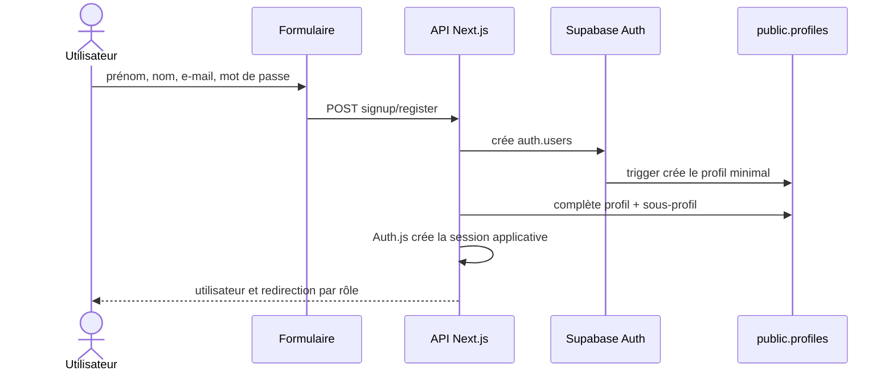

Règles :

- e-mail normalisé et unique ; mot de passe de 8 caractères minimum ;
- l’inscription publique autorise seulement `STUDENT` et `PARENT` ;
- les rôles `TUTOR` et `ADMIN` sont créés depuis l’administration ;
- si la création du profil métier échoue, l’identité Auth nouvellement créée est supprimée afin d’éviter un compte incomplet ;
- le trigger Auth ignore tout rôle fourni par le client et crée toujours un profil minimal `STUDENT`. Seul le serveur de confiance peut ensuite attribuer un autre rôle.

#### Demande de première séance (lead)

Entrées : `components/Booking/LeadCaptureModal.tsx`, `POST /api/leads`, `GET|POST /api/leads/first-session-slots`.

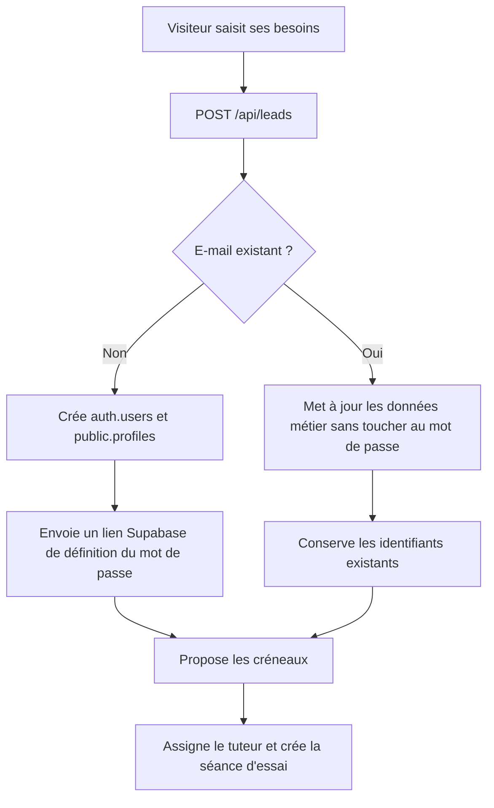

Un compte créé depuis un lead reçoit un mot de passe aléatoire non communiqué, puis un lien de récupération Supabase lui permet de choisir son propre mot de passe. Aucun mot de passe en clair n’est stocké, journalisé ou envoyé par e-mail.

#### Connexion et récupération

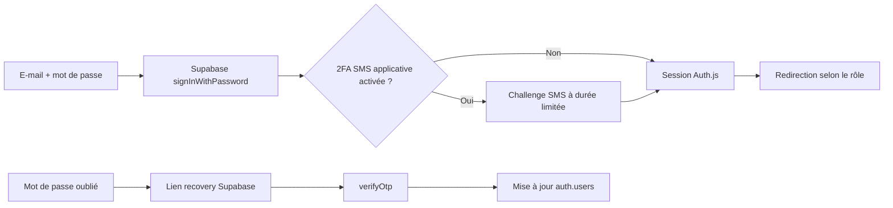

| Parcours            | Route                               | Garantie                                                                  |
| ------------------- | ----------------------------------- | ------------------------------------------------------------------------- |
| Connexion           | `POST /api/auth/login`              | Supabase vérifie le mot de passe, puis Auth.js ouvre la session           |
| Déconnexion         | `POST /api/auth/logout`             | Ferme la session Auth.js ; le client ferme aussi sa session Supabase      |
| Mot de passe oublié | `POST /api/auth/forgot-password`    | Réponse non énumérante et lien recovery natif Supabase                    |
| Réinitialisation    | `POST /api/auth/reset-password`     | Vérifie le token Supabase puis remplace le mot de passe dans `auth.users` |
| Vérification e-mail | `GET /api/auth/verify-email?token=` | Vérifie un token e-mail Supabase lorsqu’un flux non confirmé est utilisé  |

#### Tests de recette

- connecter un élève, un parent, un tuteur et un admin, puis vérifier la redirection de rôle ;
- vérifier qu’un compte inactif ou banni ne peut pas se connecter ;
- tester un mauvais mot de passe, un lien recovery expiré et un challenge 2FA expiré ;
- créer un compte public et un compte depuis l’administration, puis contrôler `auth.users`, `profiles` et le sous-profil ;
- vérifier que chaque bouton de déconnexion invalide les sessions Auth.js et Supabase.

**Limites actuelles :** le lead public préserve rôle/mot de passe, mais peut encore modifier nom/téléphone/adresse/besoins d’un compte existant sans preuve d’identité (TECH-016). `createApplicationUser` confirme l’e-mail administrativement ; ce n’est pas une preuve de contrôle de boîte. La protection SMS est partielle (TECH-013).

### 02 — Parent et élève lié

#### Objectif

Un parent utilise l’espace `/family` pour consulter et gérer les éléments pédagogiques de son élève lié. Les routes qui acceptent un élève ou parent résolvent l’élève effectif côté serveur.

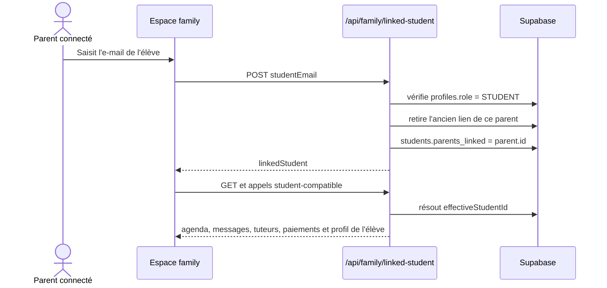

#### Règles d’accès

- `GET|POST /api/family/linked-student` exigent le rôle `PARENT`.
- Un parent ne peut lier qu’un compte dont le rôle est `STUDENT`.
- L’opération réinitialise le précédent lien de ce parent avant d’enregistrer le nouveau : un parent est donc associé à un seul élève à la fois dans l’implémentation actuelle.
- `lib/student-access.ts` autorise les routes élève compatibles à travailler pour le parent sur l’`effectiveStudentId`; l’absence de liaison retourne une erreur contrôlée.

#### Parcours rendus disponibles au parent

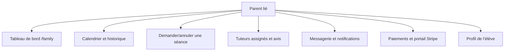

#### Points de vigilance

- La liaison repose sur la connaissance de l’e-mail élève : valider avec le métier si une confirmation, un code d’invitation ou une approbation est requis.
- Les actions de paiement et de réservation doivent toujours vérifier l’élève effectif au serveur, jamais seulement l’ID fourni par l’interface.

#### Tests de recette

- Parent sans élève lié : vérifier l’état vide et l’interdiction des actions nécessitant l’élève.
- Lier un compte élève existant, puis remplacer le lien : vérifier le résultat des deux côtés.
- Vérifier que le parent ne peut pas consulter un élève non lié via une URL ou un payload modifié.

**Cardinalité :** la base permet plusieurs élèves pour un parent ; le POST remplace ses liens et le helper ne lit que le premier. Un seed multi-enfants ne vaut pas support produit. Les deux écritures ne sont pas atomiques (TECH-014).

### 03 — Cycle de vie d’une séance

#### Objectif

Gérer la demande, la création par tuteur, confirmation/refus, modification administrative, annulation et passage automatique des statuts.

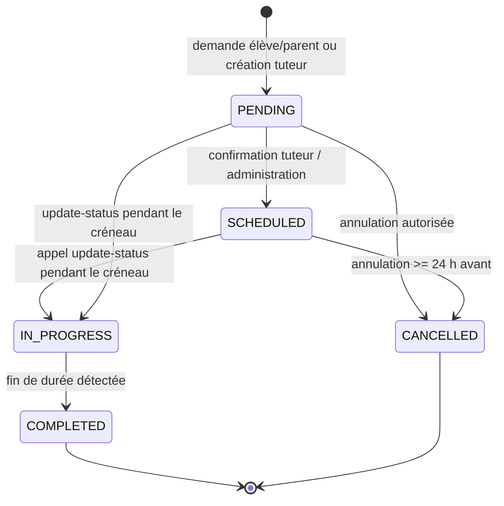

#### Création

| Initiateur      | Route                                 | Contrôles serveur                        | Résultat                                                          |
| --------------- | ------------------------------------- | ---------------------------------------- | ----------------------------------------------------------------- |
| Élève ou parent | `POST /api/sessions`                  | Élève effectif, tuteur assigné actif     | séance `PENDING`, notification/e-mail tuteur, publication Mercure |
| Tuteur ou admin | `POST /api/sessions`                  | Élève(s) participants assignés au tuteur | séance `PENDING` (repli `SCHEDULED`), participants synchronisés   |
| Lead public     | `POST /api/leads/first-session-slots` | Créneau, matière et disponibilité tuteur | séance gratuite `TRIAL`, assignation créée                        |

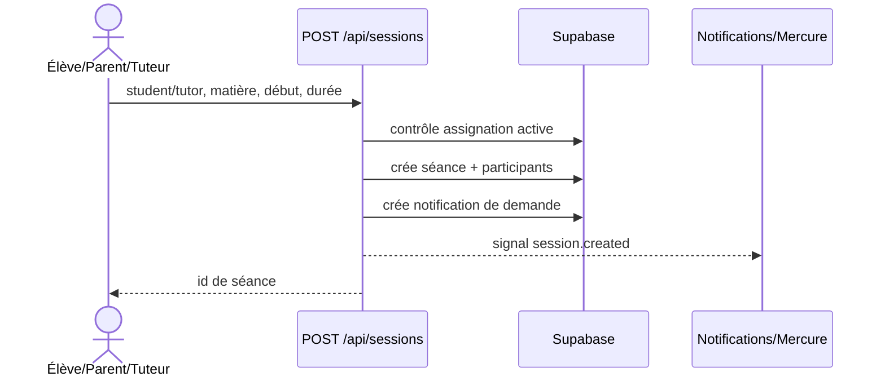

#### Confirmation, refus et modification

- Le tuteur agit via `PATCH /api/tutor/sessions/action` sur ses propres séances ; la page calendrier consomme `GET /api/tutor/sessions`.
- L’administration peut créer (`POST /api/admin/sessions`), modifier (`PUT /api/admin/sessions/:sessionId`) ou supprimer (`DELETE /api/admin/sessions/:sessionId`) une séance après contrôle admin.
- Une modification doit conserver la cohérence : tuteur/élève valides, participants synchronisés, date ISO, durée et matière valides, puis signaler le changement aux participants.

#### Annulation

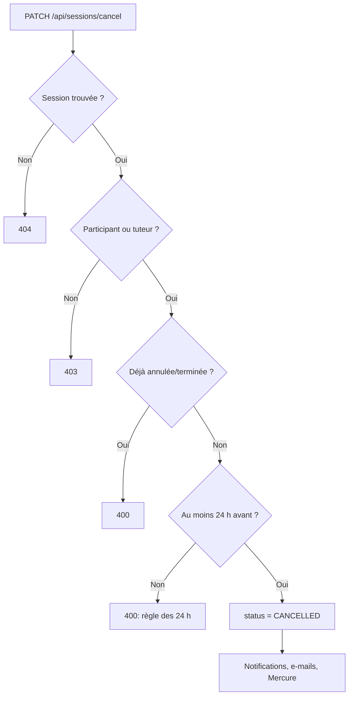

##### Règles implémentées

- Élève participant ou tuteur peuvent annuler ; les participants additionnels sont pris en compte.
- Une séance terminée ou déjà annulée ne peut pas être annulée.
- L’annulation à moins de 24 h est refusée par la route dédiée.
- Les e-mails sont envoyés aux autres participants et les notifications contiennent la raison quand elle est fournie.

#### Exécution et évaluation

- `POST /api/sessions/update-status` fait passer les séances en cours à `IN_PROGRESS` puis termine celles dont la durée est dépassée.
- Le tuteur peut enregistrer une évaluation via `POST /api/tutor/session-assessments`; l’élève consulte via `GET /api/student/assessments`.

#### Tests de recette

- Créer une séance depuis chaque rôle et vérifier le contrôle d’assignation.
- Tester confirmation/refus, modification admin, annulation à J-2/J-0 et participants multiples.
- Vérifier le basculement des statuts, l’historique et les notifications sur calendrier ouvert.

**Limite actuelle :** update-status est public et peut retourner avant de terminer les séances anciennes si aucune nouvelle séance ne démarre. Aucune planification serveur fiable ne découle de sa seule présence. La formalisation complète relève de TECH-015/TECH-019.

### 04 — Paiement, crédits et revenus

#### Objectif

Acheter une séance, un pack ou un abonnement, suivre les crédits, présenter les factures et rendre visibles les revenus tuteur/admin.

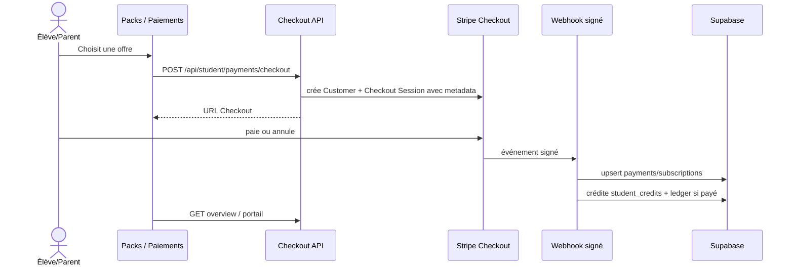

#### Checkout et crédits

- `POST /api/student/payments/checkout` exige un élève ou parent disposant d’un élève effectif et utilise le catalogue `lib/payments-catalog.ts`.
- La session Stripe transporte les métadonnées d’élève, plan, type, niveau et nombre de séances. Elles sont indispensables à la réconciliation webhook.
- `checkout.session.completed` enregistre le paiement. Pour `PACK` ou `SESSION`, les crédits sont ajoutés immédiatement ; pour `SUBSCRIPTION`, ils sont ajoutés à `invoice.paid`/`invoice.payment_succeeded`.
- `student_credit_ledger` garde la trace des variations ; `student_credits` porte le solde par niveau.

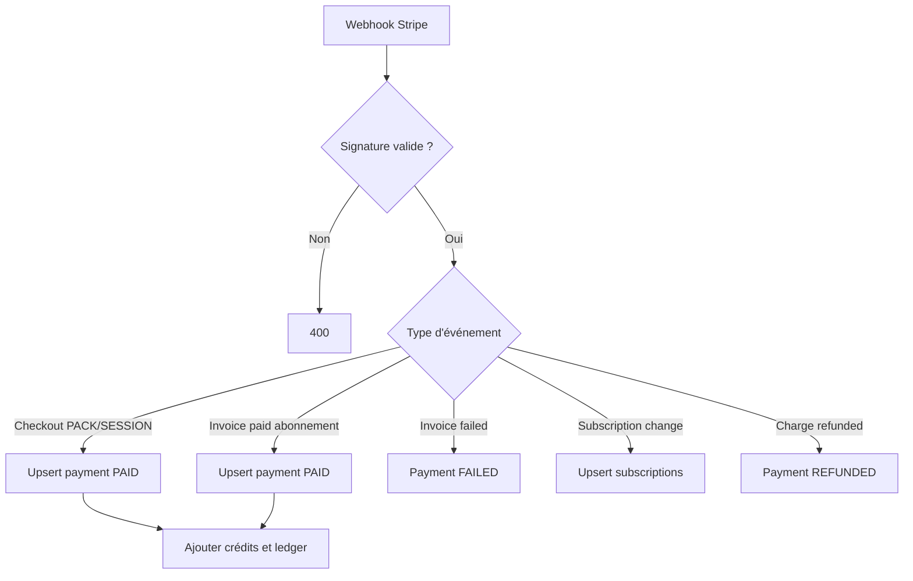

#### Consultation et gestion

| Acteur       | Routes                                                   | Résultat                                          |
| ------------ | -------------------------------------------------------- | ------------------------------------------------- |
| Élève/parent | `GET /api/student/payments/overview`                     | crédits, achats, abonnements et factures          |
| Élève/parent | `POST /api/student/payments/portal`                      | URL vers le portail Stripe de gestion             |
| Tuteur       | `GET /api/tutor/payments/history`, `/annual`, `/payouts` | historique, récapitulatif annuel et décaissements |
| Admin        | `GET /api/admin/payments`                                | supervision des données de paiement               |

#### Invariants et sécurité

- Le webhook Stripe est public mais refuse toute requête dont la signature HMAC est invalide.
- Les upserts ne garantissent pas l’idempotence des crédits : `addCredits` incrémente encore après replay ; l’unicité invoice manque dans les migrations. Voir TECH-002.
- Une exception remontée renvoie `500`, mais certaines erreurs DB sont seulement journalisées puis acquittées : TECH-002.
- Ne jamais créditer une séance depuis le retour navigateur : seul le webhook confirmé fait foi.

#### Tests de recette

- Tester checkout réussi, annulé, paiement échoué, remboursement, abonnement créé/mis à jour/annulé.
- Rejouer un même événement Stripe et vérifier qu’aucun crédit n’est ajouté deux fois.
- Vérifier les droits parent, élève, tuteur et admin sur chaque écran de paiement.

### 05 — Tuteur : gestion pédagogique

#### Objectif

Permettre au tuteur de maintenir son profil, consulter ses élèves assignés, planifier et traiter ses séances, évaluer les élèves et suivre ses paiements.

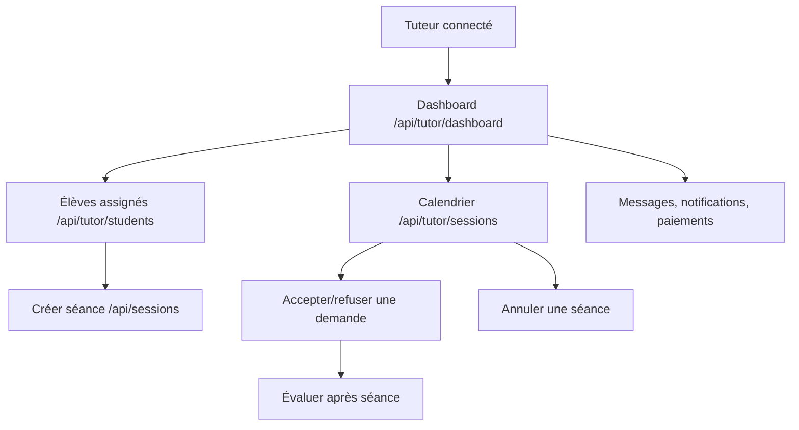

#### Gestion des élèves et séances

- Le tuteur voit uniquement ses élèves via `GET /api/tutor/students` et leurs séances via `GET /api/tutor/student-sessions`.
- Pour créer une séance, il fournit au moins un `studentId`; le serveur vérifie que tous les élèves (principal et additionnels) ont une assignation active avec ce tuteur.
- La demande ou création produit une notification et, quand disponible, un e-mail. Les participants de la séance sont synchronisés dans la table dédiée.
- Le tuteur utilise `PATCH /api/tutor/sessions/action` pour agir sur ses demandes ; toute transition nouvelle doit être ajoutée explicitement à ce workflow et testée.

#### Évaluations

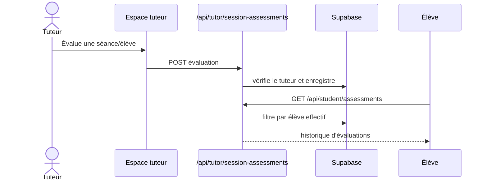

#### Profil et disponibilité

- `GET|PATCH|DELETE /api/tutor/profile` gèrent les informations et préférences; `POST /api/tutor/profile/avatar` charge l’avatar dans le bucket `avatars`.
- Les matières servent à l’éligibilité aux créneaux de première séance : les garder à jour est une condition opérationnelle de réservation publique.
- La disponibilité tuteur est consultée lors de la recherche de créneaux, puis les conflits de séances `PENDING`, `SCHEDULED`, `IN_PROGRESS` sont exclus.

#### Tests de recette

- Tuteur non assigné : création de séance refusée ; tuteur assigné : création et ajout de participants autorisés.
- Vérifier que les demandes apparaissent dans calendrier, notifications et e-mail.
- Créer/consulter une évaluation, modifier le profil/matières et tester l’upload d’avatar autorisé/refusé.

### 06 — Administration et assignations

#### Objectif

L’administration est accessible aux `ADMIN` et, selon la liste contrôlée de `lib/admin-permissions.ts`, à certains tuteurs administrateurs. Elle centralise les opérations sensibles sur utilisateurs, profils, assignations, séances, avis et paiements.

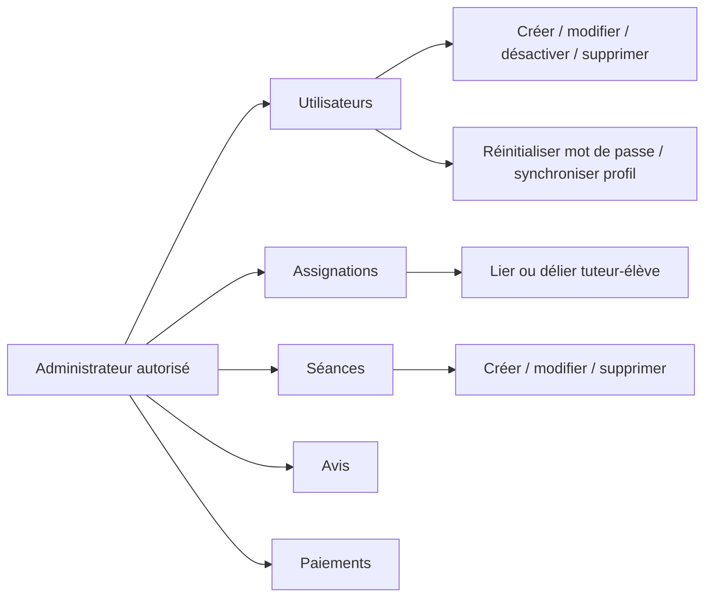

#### Gestion des comptes et profils

| Action                     | Route                                          | Effet                                                                                                           |
| -------------------------- | ---------------------------------------------- | --------------------------------------------------------------------------------------------------------------- |
| Lister                     | `GET /api/admin/users`, `/with-profiles`       | utilisateurs et profils associés                                                                                |
| Créer                      | `POST /api/admin/users`                        | compte d’un rôle autorisé ; documenter l’e-mail/identifiants remis                                              |
| Modifier / supprimer       | `PUT\|DELETE /api/admin/users/:userId`         | mise à jour ou suppression contrôlée                                                                            |
| Activer/désactiver         | `PATCH /api/admin/users/:userId/toggle-status` | état du compte                                                                                                  |
| Réinitialiser mot de passe | `POST /api/admin/users/:userId/reset-password` | mot de passe aléatoire appliqué dans Supabase Auth et renvoyé sous tempPassword ; aucun e-mail dans cette route |
| Gérer profil               | `PUT\|POST /api/admin/users/:userId/profile`   | données student/tutor                                                                                           |
| Réparer profils            | `POST /api/admin/sync-profiles`                | synchronise les profils manquants                                                                               |

#### Assignation tuteur–élève

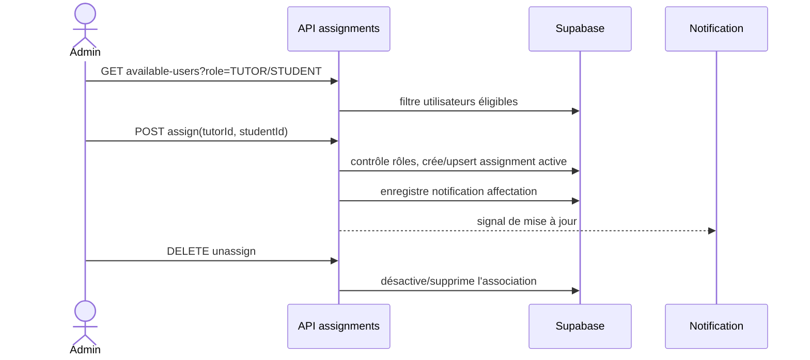

##### Règles

- Une assignation active est la condition préalable à la création de séance par l’élève/parent et par le tuteur.
- Toujours vérifier les rôles en base dans l’API, jamais seulement dans le modal admin.
- Les options disponibles doivent exclure les associations invalides ou inactives selon la route dédiée.

#### Séances, avis et exploitation

- `GET|POST /api/admin/sessions`, `PUT|DELETE /api/admin/sessions/:sessionId` : supervision et correction des séances.
- `GET /api/admin/reviews`, `PATCH|DELETE /api/admin/reviews/:reviewId` : modération des avis affichés publiquement.
- `GET /api/admin/payments` : lecture de supervision des transactions; le webhook Stripe reste la source d’écriture des paiements.
- `GET /api/admin/resend/health` : contrôle opérationnel de l’intégration e-mail.

#### Tests de recette

- Compte admin, tuteur standard et tuteur admin : vérifier précisément les droits.
- Créer un tuteur et un élève, compléter leurs profils, les assigner puis créer une séance.
- Désactiver un compte assigné, modifier/supprimer une séance et vérifier les effets de bord attendus.

### 07 — Messagerie, notifications et temps réel

#### Objectif

Fournir une messagerie entre élève/parent et tuteur, des notifications lisibles et une actualisation temps réel sans exposer les données de métier dans les événements Mercure.

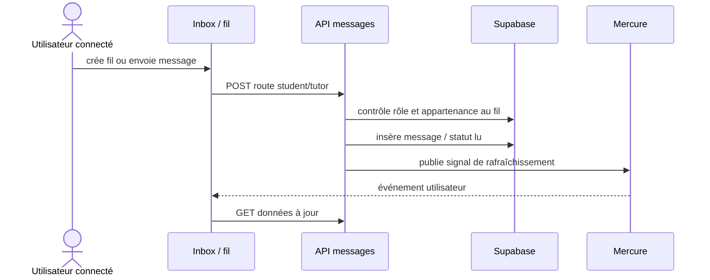

#### Messagerie

- Élève/parent : `GET|POST /api/student/messages`, puis `GET|POST|PATCH|DELETE /api/student/messages/:threadId`.
- Tuteur : `GET|POST /api/tutor/messages`, puis `GET|POST|PATCH|DELETE /api/tutor/messages/:threadId`.
- Le serveur doit toujours vérifier l’appartenance du participant avant lecture, écriture, édition ou suppression. Le parent passe par l’élève effectif selon `lib/student-access.ts`.
- Les hooks `useRealtimeMessageThreadsInbox` et `useRealtimeThreadMessages` rafraîchissent les données suite aux signaux.

#### Notifications

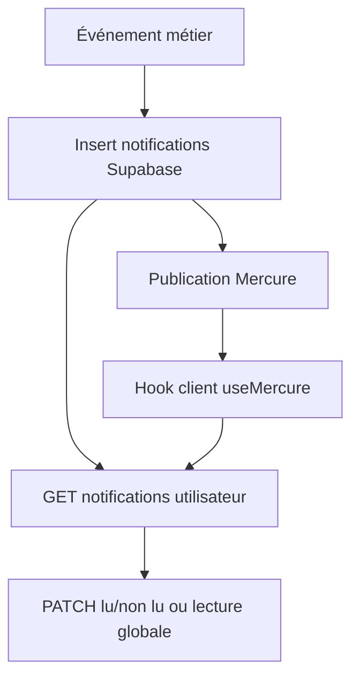

| Rôle         | Routes                                  | Événements principaux                       |
| ------------ | --------------------------------------- | ------------------------------------------- |
| Élève/parent | `GET\|PATCH /api/student/notifications` | réservation, profil, mot de passe, messages |
| Tuteur       | `GET\|PATCH /api/tutor/notifications`   | demande de séance, annulation, assignation  |
| Tous         | Mercure via `lib/mercure.ts`            | signal de changement à rafraîchir           |

#### Règles de sécurité

- Le hub Mercure est configuré pour diffuser des signaux de rafraîchissement : ne pas y mettre de contenu privé.
- Les e-mails sont complémentaires aux notifications in-app, ils ne remplacent pas les contrôles d’autorisation.
- Les opérations d’écriture doivent rester idempotentes ou protéger les doubles clics côté interface.

#### Tests de recette

- Ouvrir deux navigateurs appartenant à des rôles autorisés et vérifier la réception/réactualisation.
- Tenter d’ouvrir un fil avec un ID non autorisé et vérifier le refus.
- Marquer lu/non lu, annuler une séance et créer une assignation : vérifier badge et liste.

### 08 — Classe vidéo LiveKit

#### Objectif

Permettre aux seuls participants d’une séance d’obtenir un jeton LiveKit pour une salle déterministe et de rejoindre la classe vidéo.

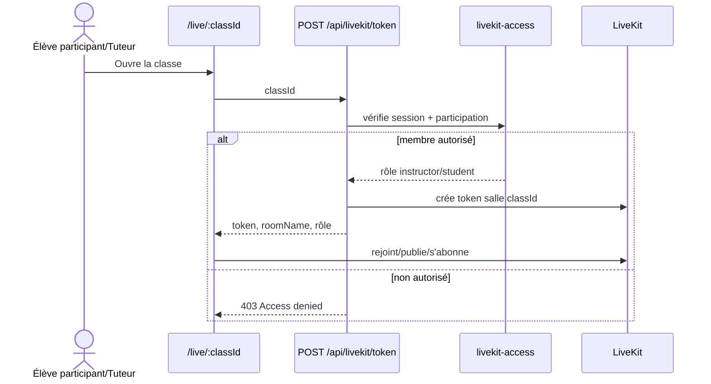

#### Règles

- `POST /api/livekit/token` exige une session et un `classId` non vide.
- `resolveLiveClassMembership` est l’autorité qui établit l’appartenance ; aucun token ne doit être construit depuis un rôle fourni par le navigateur.
- `buildClassRoomName` garantit un nom de salle cohérent pour la classe.
- Les tuteurs reconnus comme `instructor` reçoivent les droits d’administration de salle ; tous les membres autorisés peuvent publier, s’abonner et envoyer des données selon l’implémentation courante.

#### Tests de recette

- Élève assigné, parent lié, tuteur de la séance et utilisateur externe : vérifier les autorisations.
- Tester connexion/déconnexion, permissions micro/caméra, salon vide et jeton expiré.
- Vérifier que le lien d’une classe ne permet pas de rejoindre une autre salle.

**Écart actuel :** la route transmet directement `user.id` ; le parent lié n’est pas automatiquement participant. Le rôle retourné est `student`, pas `participant`. L’accès par statut/date reste à définir (TECH-017).

### 09 — Sika AI Tutor

#### Objectif

Permettre à l’élève (et au parent agissant pour l’élève lié) de créer, poursuivre, renommer et supprimer des conversations pédagogiques avec Sika AI.

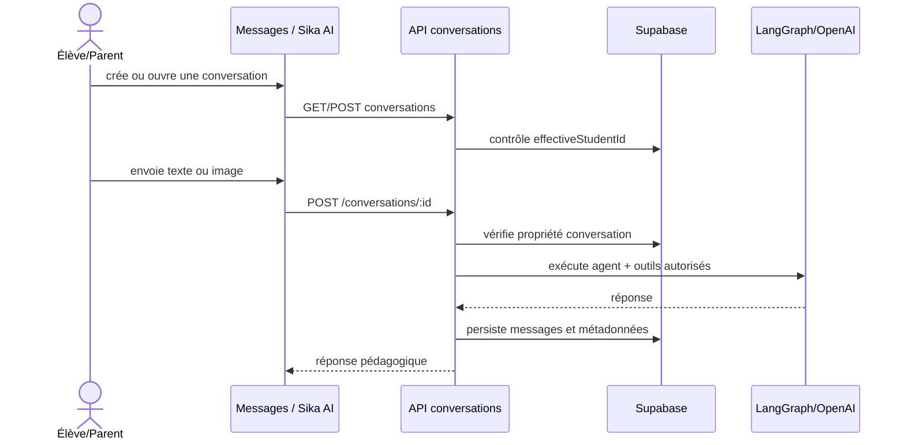

#### Routes et opérations

| Opération                          | Route                                                               |
| ---------------------------------- | ------------------------------------------------------------------- |
| Lister/créer une conversation      | `GET\|POST /api/student/ai-tutor/conversations`                     |
| Lire/envoyer dans une conversation | `GET\|POST /api/student/ai-tutor/conversations/:conversationId`     |
| Renommer/supprimer                 | `PATCH\|DELETE /api/student/ai-tutor/conversations/:conversationId` |

#### Règles

- La conversation appartient à l’élève effectif : un utilisateur ne peut pas deviner un ID pour accéder aux échanges d’un autre élève.
- Les prompts et outils sont définis sous `lib/ai-tutor/`; ne pas transmettre de secrets ni de données personnelles inutiles au fournisseur IA.
- Le serveur retient six URLs mais ne valide pas strictement MIME, origine ni taille : durcissement prévu TECH-018 ; la compression client ne suffit pas.
- La suppression doit éliminer ou rendre inaccessible l’historique conformément à la politique de rétention.

#### Tests de recette

- Créer, renommer, supprimer et rouvrir une conversation ; tester l’envoi de texte et image valide/invalide.
- Vérifier le refus entre deux élèves et l’accès via parent lié.
- Simuler erreur fournisseur et s’assurer que l’interface conserve la saisie et explique l’erreur.

### 10 — Profil, mot de passe et 2FA

#### Objectif

Permettre à chaque utilisateur de mettre à jour ses informations et de protéger son accès sans contourner les contrôles de session ou de rôle.

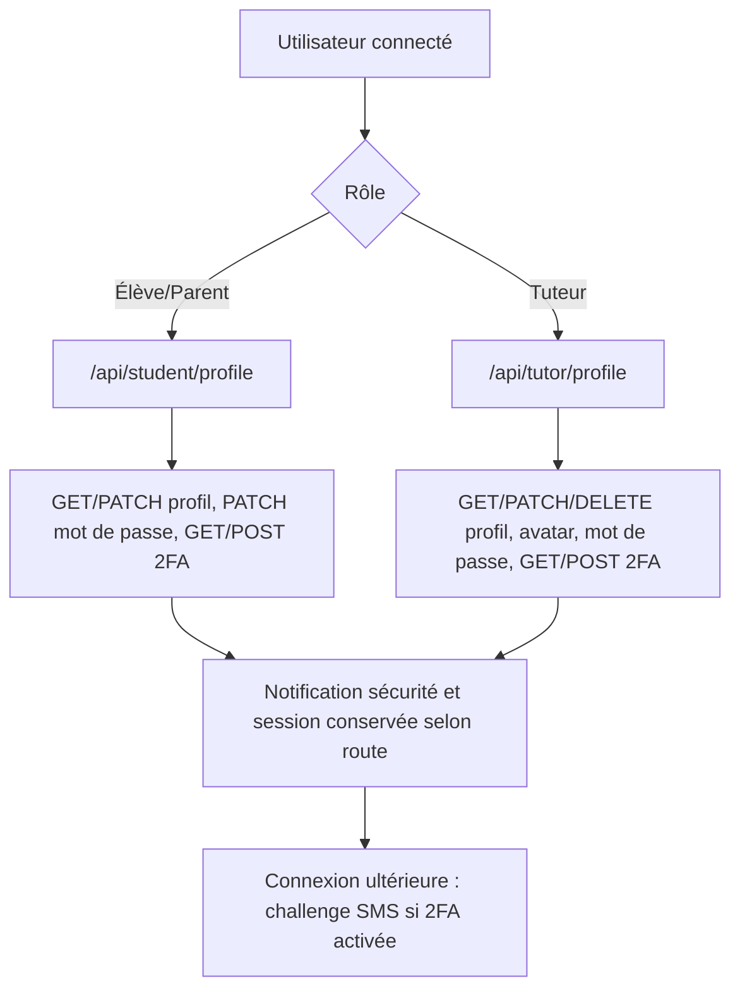

#### Opérations élève/parent

- `GET|PATCH /api/student/profile` lit/modifie le profil de l’élève effectif.
- `PATCH /api/student/profile/password` vérifie le mot de passe courant via Supabase Auth et remplace le mot de passe dans `auth.users`.
- `GET|POST /api/student/profile/2fa` expose et modifie l’activation SMS/numéro correspondant.
- Le profil pédagogique emploie l’élève effectif ; les routes password et 2fa emploient `user.id`, donc le compte parent lui-même.

#### Opérations tuteur

- `GET|PATCH|DELETE /api/tutor/profile` gère données professionnelles et préférences.
- `POST /api/tutor/profile/avatar` vérifie le fichier puis le stocke dans le bucket `avatars`.
- `PATCH /api/tutor/profile/password` et `GET|POST /api/tutor/profile/2fa` gèrent la sécurité de connexion.
- Les matières et la disponibilité doivent rester cohérentes avec la réservation publique et les assignations.

#### 2FA SMS

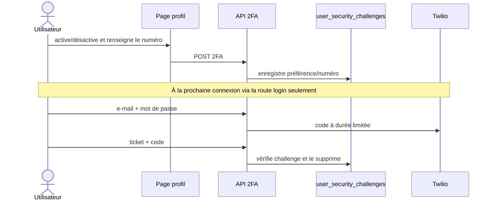

#### Tests de recette

- Modifier profil et mot de passe avec valeurs valides/invalides ; vérifier qu’un autre rôle est refusé.
- Activer 2FA avec Twilio configuré et non configuré, puis tester code erroné/expiré.
- Uploader avatar valide, type interdit et taille > limite ; vérifier le nettoyage et l’URL affichée.

## 5. Business rules de référence

| Sujet                 | Règle observée / limite                                                                                                                                                                            |
| --------------------- | -------------------------------------------------------------------------------------------------------------------------------------------------------------------------------------------------- |
| Séances               | Statuts DB PENDING, SCHEDULED, IN_PROGRESS, COMPLETED, CANCELLED ; ACCEPT/REJECT seulement sur PENDING et tuteur propriétaire                                                                      |
| Annulation            | Route dédiée : participant principal/additionnel ou tuteur ; interdit si terminée/annulée ou début dans moins de 24 h ; ne définit pas une politique de remboursement                              |
| Première séance       | GET : horizon 14 jours, lundi–samedi, départs 9 h–19 h, durée 60 min, au-delà de 2 h, maximum 24 résultats ; premier tuteur éligible ; calcul dans fuseau du serveur                               |
| Validation du créneau | POST exige seulement un début au-delà de 1 h et absence de conflit détecté ; n'impose pas toute la grille du GET ; recherche de conflits par début peut manquer une séance chevauchante antérieure |
| Parent dans le lead   | Le POST public accepte un profil PARENT et utilise son ID comme student_id, sans résolution de l'enfant ; incohérence à corriger avec TECH-003/TECH-014                                            |
| Crédits               | Solde par élève/niveau ; aucun débit intégré aux réservations identifié. Le ledger n'est pas une preuve d'atomicité financière                                                                     |
| Abonnement            | Catalogue de quatre séances mensuelles ; renouvellement crédité sur facture payée ; validité/report/annulation commerciale DECISION_REQUIRED                                                       |
| Remboursement         | charge.refunded marque payment REFUNDED ; compensation de crédits et distinction remboursement partiel non implémentées                                                                            |
| Assignations          | Paire tuteur/élève unique, drapeau is_active ; rôle vérifié dans chemins dédiés, contrôles à uniformiser                                                                                           |
| Évaluations           | Huit critères 1–5 (concentration, participation, preparation, improvement, retention, comprehension, time_management, collaboration) ; une évaluation par session selon contrainte actuelle        |
| Prix                  | lib/stripe.ts fait autorité au checkout ; CLIENT_PLANS duplique prix et IDs ; aucune nouvelle taxe/remise/politique ne doit être déduite de ces constantes                                         |

## 6. Exigences non fonctionnelles

| Exigence                 | État actuel et cible                                                                                                                                           |
| ------------------------ | -------------------------------------------------------------------------------------------------------------------------------------------------------------- |
| Sécurité                 | Auth/RLS/guards présents, failles et limites documentées ; prouver isolement inter-comptes et intégrité paiement avant lancement V2                            |
| Confidentialité          | Données de mineurs, photos, messages et factures ; minimisation, rétention et accès fournisseur IA à faire valider ; pas de conformité juridique auto-déclarée |
| Accessibilité            | Objectif WCAG 2.2 AA, avec recette clavier/lecteur d'écran/zoom ; aucun audit de conformité réalisé ici                                                        |
| Performance / responsive | Budgets V2 dans design ; mobile 320 px et plus, usages tactiles et clavier, aucune mesure actuelle annoncée                                                    |
| Disponibilité            | Dépend des services externes ; SLO, RTO et RPO DECISION_REQUIRED ; états dégradés et reprise requis                                                            |
| Observabilité            | Logs locaux, effets best-effort ; corrélation et suivi des échecs PLANNED                                                                                      |
| Maintenabilité           | TypeScript strict, contrats explicites, six documents ; tests/CI à construire                                                                                  |
| SEO                      | Contenu public indexable, domaine canonique à choisir ; pas de données privées indexables                                                                      |
| Internationalisation     | FR/EN côté client et HTML lang=fr ; URLs multilingues/hreflang non livrés                                                                                      |
| Navigateurs              | Matrice proposée : versions stables Chrome, Edge, Firefox, Safari/iOS ; vidéo et permissions à recetter par navigateur                                         |

## 7. Vision produit V2

La V2 est **spécifiée et planifiée, non implémentée**. Elle doit rendre immédiatement compréhensibles service, coût, intervenants et prochaine action, tout en conservant les contrats métier. Le site public accompagne la décision ; les dashboards privilégient prochaines séances, suivi, messages et facturation. Les nouvelles pages SEO, profils publics et besoins multi-enfants restent soumis aux données et arbitrages disponibles. Voir [direction et migration](./design.md) et [roadmap unique](./tasks.md).
