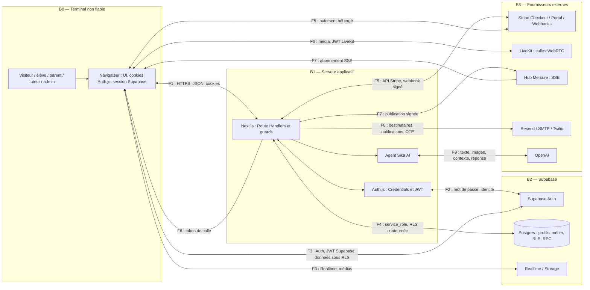

# Analyse STRIDE de SikaSchool

**Date : 16 novembre 2026 · Version : 1.0 · Révision analysée : `8c6ccc30f96461543a6b4abe93d732299a79b8f2`**

## Synthèse

La revue identifie **22 scénarios de menace : 6 P0, 12 P1 et 4 P2**. Les P0
concernent la messagerie tuteur sans authentification serveur, le rattachement
parent-élève sans preuve de relation, la mutation publique des statuts de séances,
l'écrasement de profils par un lead, la réservation au nom d'un tiers et le
contournement du second facteur SMS par le fournisseur Credentials d'Auth.js.

La RLS des tables métier et les contrôles des routes administrateur apportent des
protections réelles. Ils ne protègent pas une route qui utilise `service_role`
sans vérifier l'identité et les droits sur la ressource. La priorité est donc de
fermer ces chemins puis de vérifier leurs refus au niveau HTTP et PostgreSQL.

Ce livrable documente les risques et leur traitement proposé. **Aucun correctif
applicatif, changement de base ou déploiement n'est inclus.** Les priorités sont
des propositions techniques ; aucun risque n'est réputé accepté par le métier.
Le suivi d'exécution reste dans la [roadmap canonique](roadmap.md).

## Périmètre et méthode

La revue couvre le dépôt Next.js 16.4.6 / React 19 : `auth.ts`, `proxy.ts`, les
routes `app/api`, les helpers de droits, les migrations Supabase jusqu'à
`20261114154431_stripe_atomic_credits.sql`, les intégrations Stripe, LiveKit,
Mercure, e-mail/SMS et Sika AI, les uploads d'avatars, les tests et la CI.
Les guides Next.js installés sur les Route Handlers et la sécurité des données
ont été consultés avant la rédaction.

La méthode suit [STRIDE de Microsoft](https://learn.microsoft.com/en-us/azure/security/develop/threat-modeling-tool-threats) :

| Lettre | Menace | Propriété recherchée | Question pour SikaSchool |
| --- | --- | --- | --- |
| S | Usurpation d'identité | Authenticité | L'identité vient-elle d'une session vérifiée ? |
| T | Altération | Intégrité | Qui peut modifier un profil, une séance ou des crédits ? |
| R | Répudiation | Traçabilité | Peut-on attribuer et reconstituer une action sensible ? |
| I | Divulgation d'information | Confidentialité | Qui peut lire les messages, copies et données familiales ? |
| D | Déni de service | Disponibilité | Qu'est-ce qui borne les requêtes, coûts et effets secondaires ? |
| E | Élévation de privilèges | Autorisation | Une identité peut-elle acquérir des droits sur un tiers ? |

Les constats utilisent quatre niveaux de preuve :

- **C — code** : comportement ou absence de contrôle constaté dans les sources.
- **M — simulation** : chemin exercé hors ligne avec dépendances simulées ; preuve du comportement du handler, pas d'une exploitation déployée.
- **H — hypothèse** : exposition dépendant de l'hébergement, de la configuration ou d'un scénario non exécuté.
- **P — protection** : contrôle présent et/ou couvert par les tests existants ; son efficacité dépend aussi de son déploiement.

Les services de production n'ont pas été interrogés. Aucun message, SMS, e-mail,
paiement ou contenu IA n'a été envoyé. Aucune donnée réelle ni valeur de secret
n'a été extraite. Le schéma réellement déployé, les politiques Storage, la
configuration Auth cloud, les limites de l'hébergeur, le hub Mercure, les
sauvegardes, les contrats fournisseurs et les protections de branche restent à
vérifier. Ce document n'est ni un pentest ni une attestation de conformité.

## Actifs, acteurs et hypothèses

| Actif | Contenu / conséquence d'une compromission |
| --- | --- |
| A1 — Identités | Comptes Supabase Auth, cookies Auth.js, tokens navigateur Supabase, récupération et challenges SMS ; prise de compte et persistance d'accès. |
| A2 — Familles | Noms, contacts, adresse, date de naissance, lien parent-élève et données scolaires, potentiellement de mineurs. |
| A3 — Pédagogie | Affectations, séances, évaluations, devoirs et disponibilités ; altération du suivi et de l'accès aux cours. |
| A4 — Communications | Messages, participants, notifications et signaux temps réel ; lecture, usurpation et suppression de conversations. |
| A5 — Finance | Références Stripe, factures, abonnements, paiements, crédits et ledger ; fraude ou incohérence comptable. Les cartes sont saisies dans Stripe Checkout. |
| A6 — Médias et IA | Audio/vidéo, avatars, copies photographiées, historique et réponses IA ; confidentialité et coût d'exploitation. |
| A7 — Secrets et livraison | Clés serveur Supabase/Stripe/LiveKit/OpenAI/Mercure/Resend/Twilio/SMTP, GitHub et environnement de déploiement. |
| A8 — Disponibilité et preuves | Temps serveur, quotas fournisseurs, traces, sauvegardes et capacité de reprise. |

Acteurs légitimes : visiteur, élève, parent, tuteur, administrateur et opérateur.
Adversaires considérés : visiteur automatisé, utilisateur inscrit malveillant,
compte ou cookie volé, participant abusif à un cours, dépendance ou fournisseur
compromis. Un UUID, une adresse e-mail et une route cachée dans l'interface ne
constituent pas une preuve d'identité ou de relation.

Hypothèses de confiance à valider : HTTPS canonique, secrets serveur isolés du
navigateur et des previews non fiables, compte opérateur protégé, migrations
appliquées dans l'ordre, données de démonstration limitées au local. Le fichier
`supabase/config.toml` décrit le **local**, pas la configuration Auth cloud.

## Flux de données et frontières de confiance

Une cinquième frontière, **B4**, sépare le dépôt et la CI des environnements de
déploiement et de leurs secrets. Elle n'apparaît pas dans le flux d'exécution
ci-dessus. Au sein de B1, chaque relation entre comptes constitue aussi une
frontière d'autorisation : élève A/élève B, parent/enfant, tuteur/élève assigné,
utilisateur/admin et participant/non-participant.

| Flux | Contrôles observés | Limites principales |
| --- | --- | --- |
| F1/F2 | Auth.js JWT ; `getUserSession()` relit rôle et activation en base avec timeout 5 s. | `proxy.ts` exclut les API ; chaque handler doit vérifier ses droits. Deux chemins de login n'imposent pas les mêmes facteurs. |
| F3 | Client navigateur distinct ; RLS métier ; lecture des messages conditionnée à la participation. | Session Supabase distincte de la session Auth.js ; les policies de messages ne vérifient pas `profiles.is_active`. |
| F4 | Tables métier sous RLS ; RPC Stripe invoker réservée à `service_role`. | `supabaseAdmin` contourne la RLS ; un guard absent expose les données malgré les policies. |
| F5 | Catalogue serveur, signature Stripe sur corps brut, transaction et références uniques. | Réconciliation historique et contrepassation des crédits remboursés restent nécessaires. |
| F6 | Appartenance primaire ou `session_participants`, salle imposée côté serveur, grant admin réservé à l'instructeur. | Pas de contrôle d'horaire/statut dans la résolution ; token de 2 h et révocation des participants à recetter. |
| F7 | Signature du publisher ; payload limité à des signaux et identifiants. | Publication sans marqueur `private` ; hub local anonyme ; métadonnées observables si cette configuration est exposée. |
| F8 | Tokens de récupération Supabase ; OTP haché et expirant ; champs HTML d'e-mail échappés. | Limites d'envoi, contrôle de possession d'e-mail à l'inscription et réauthentification 2FA incomplets. |
| F9 | Propriété des conversations vérifiée ; historique limité à 40 messages ; six images maximum ; récursion de l'agent limitée à 12. | Nombre d'images limité, mais pas leur taille serveur ni le coût total ; texte et images quittent SikaSchool. |

## Contrôles à conserver

- [Session serveur](../lib/auth.ts#L15) et [droits admin](../lib/admin-permissions.ts#L3) : rôle persisté et compte actif ; les e-mails de notification n'accordent aucun privilège.
- [Inscription](../app/api/auth/register/route.ts#L18) : rôle public limité à `STUDENT` ou `PARENT`. Le [trigger Auth](../supabase/migrations/20260912143000_move_users_to_supabase_auth.sql) crée un profil `STUDENT` sans faire confiance au rôle de `user_metadata` ; [exécution directe des triggers révoquée](../supabase/migrations/20261109172829_restrict_auth_profile_trigger_execution.sql).
- [RLS métier](../supabase/migrations/20260502120000_enable_rls_public_tables.sql) : activée, généralement sans policy d'accès direct ; [profils](../supabase/migrations/20260912143000_move_users_to_supabase_auth.sql) lisibles seulement par leur titulaire, sans écriture navigateur autorisée. Les RPC d'affectation en invoker restent soumises aux droits du caller et à la RLS ; aucune élévation par leur seul nom public n'est démontrée.
- [Stripe](../app/api/webhooks/stripe/route.ts#L20) : corps original signé ; absence de secret → 503 ; signature invalide → 400 ; échec de traitement → 500. [RPC atomique](../supabase/migrations/20261114154431_stripe_atomic_credits.sql) : verrou transactionnel par source, unicité facture/événement/source, paiement + ledger + solde dans une transaction. Un checkout non réglé ne crédite pas de séances.
- [Conversations IA](../app/api/student/ai-tutor/conversations/[conversationId]/route.ts#L124) filtrées par utilisateur effectif ; l'historique envoyé au modèle exclut les rôles `system` et `tool` venant de la base. Les [outils IA](../lib/ai-tutor/tools.ts) produisent du texte, sans accès à SQL, au système de fichiers ou à une API métier.
- [Rendu IA](../app/student/messages/ai-tutor/[conversationId]/page.tsx#L65) : échappement de `&`, `<`, `>` avant transformation Markdown. La présence de `dangerouslySetInnerHTML` ne suffit donc pas à conclure à une XSS exploitable.
- [CI](../.github/workflows/quality.yml) : permissions `contents: read`, lint/tests/build/types, variables factices. [Lockfile](../package-lock.json) versionné ; fichiers `.env` locaux et certificats exclus par [`.gitignore`](../.gitignore). Cela ne prouve ni l'absence de secrets dans l'historique ni la protection effective de `main`.

## Cotation du risque résiduel actuel

La cotation **V × I**, de 1 à 25, tient compte des contrôles présents. Elle sert à
ordonner le travail et ne représente ni une probabilité mesurée ni un score CVSS.

| Valeur | V — vraisemblance | I — impact |
| --- | --- | --- |
| 1 | Conditions exceptionnelles et accès fort requis | Effet négligeable |
| 2 | Conditions peu courantes / plusieurs prérequis | Effet local et limité |
| 3 | Compte, session volée ou configuration particulière requis | Atteinte significative mais circonscrite |
| 4 | Chemin simple avec peu de prérequis | Données sensibles, coût ou service fortement affecté |
| 5 | Chemin public simple ou droits facilement obtenus | Confidentialité familiale étendue, usurpation privilégiée ou destruction de communications |

Seuils : **20–25 = P0 critique**, à traiter avant ouverture/exposition du parcours ;
**12–19 = P1 élevé**, lot de sécurité suivant ; **6–11 = P2 modéré**, durcissement
planifié ; **1–5 = P3 faible**. Aucun P3 n'est inscrit dans ce registre.
Une hypothèse H reste à valider même si son score est élevé. Les scores ne
s'additionnent pas ; plusieurs lignes partagent une cause ou une chaîne d'attaque.

## Registre des menaces

Chaque ligne décrit un risque encore ouvert dans la révision analysée. Les
contrôles listés plus haut n'équivalent pas à sa clôture.

| ID | STRIDE · actifs / flux | Scénario, prérequis et preuve | V × I · priorité | Traitement proposé et preuve de sortie |
| --- | --- | --- | --- | --- |
| TM-01 | S/T/R/I/E · A2/A4 · F1/F4 | Un visiteur fournit `tutorId` et/ou `threadId` aux routes de messagerie tuteur. Aucun contrôle de session ; lecture, faux expéditeur, renommage ou suppression possibles selon la méthode. **C/M**, détail ci-dessous. | 5 × 5 = **25 · P0** | Identité tirée de la session, rôle et participation contrôlés pour chaque méthode ; tests anonyme, élève, tuteur tiers et propriétaire, sans effets de bord sur refus. **TECH-006**. |
| TM-02 | S/T/I/E · A2/A3/A4/A6 · F1/F4 | Tout compte `PARENT` peut rattacher l'élève dont il connaît l'e-mail, remplacer son parent et hériter de son identité effective. **C/M**, détail ci-dessous. | 5 × 5 = **25 · P0** | Invitation à usage unique avec preuve d'accord appropriée ou validation admin ; transaction de rattachement ; parent tiers refusé, ancien lien préservé sur échec. **TECH-006**. |
| TM-03 | T/I/D/E · A3/A8 · F1/F4 | POST public de mise à jour globale des séances avec `service_role`, sans session ou secret de job. **C/M**, détail ci-dessous. | 5 × 4 = **20 · P0** | Job authentifié ou action admin, transitions métier explicites et bornées ; requête anonyme → 401/403, zéro lecture/écriture métier. **TECH-014**. |
| TM-04 | S/T · A2/A3 · F1/F4/F8 | POST public `/api/leads` avec l'e-mail d'un compte existant écrase ses noms/contacts et des données élève. **C/M**, détail ci-dessous. | 5 × 4 = **20 · P0** | Intake isolé du profil ; modification de compte après preuve de possession et autorisation ; soumission anonyme ne modifie aucune ligne du compte existant. **TECH-013**, suite de TECH-001. |
| TM-05 | S/T/D/E · A3/A8 · F1/F4/F8 | Réservation gratuite par e-mail seul ; affectation et séance créées pour un tiers. Vérification de chevauchement puis insertion séparées. **C**, [route](../app/api/leads/first-session-slots/route.ts#L150). | 5 × 4 = **20 · P0** | Token court lié à l'identité/créneau, preuve d'e-mail, limite d'essais et transaction avec verrou/contrainte de chevauchement. Deux réservations concurrentes : une seule création, autre réponse 409 ; pas de réservation au nom d'autrui. **TECH-003 / SK-011**. |
| TM-06 | S/E · A1/A7 · F1/F2 | Mot de passe connu : fournisseur Credentials accepte sans OTP alors que `/api/auth/login` peut en exiger un. **C/M**, détail ci-dessous. | 4 × 5 = **20 · P0** | Vérification MFA au point d'émission de toute session ; preuve de second facteur non falsifiable, consommée atomiquement. Callback direct sans facteur refusé, OTP rejoué refusé. **TECH-015**. |
| TM-07 | S/I/E · A1/A4 · F1/F3 | Cookie Auth.js volé potentiellement utilisable après reset de mot de passe ; JWT maxAge 7 jours sans version de session. Token Supabase navigateur distinct et policies messages sans test du profil actif. **C/H**, [Auth.js](../auth.ts#L25), [reset](../app/api/auth/reset-password/route.ts), [policies](../supabase/migrations/20260101120000_initial_schema.sql#L737). | 3 × 4 = **12 · P1** | Révocation des deux familles de sessions, version/instant d'invalidation et policies sensibles cohérentes avec désactivation ; rejouer les anciens cookies/tokens après reset, bannissement et déconnexion. Ne pas supposer qu'un reset Supabase invalide un JWT Auth.js. **TECH-006**. |
| TM-08 | S/T/D/E · A1/A8 · F2/F8 | OTP à six chiffres via `Math.random()`, aucun compteur d'échecs applicatif, secret de secours constant ; désactivation 2FA par simple session existante. **C**, [helper](../lib/sms-2fa.ts#L7), [étudiant](../app/api/student/profile/2fa/route.ts), [tuteur](../app/api/tutor/profile/2fa/route.ts). | 4 × 4 = **16 · P1** | Générateur cryptographique, secret obligatoire, essais/envois bornés, consommation atomique et réauthentification pour désactiver/changer le téléphone ; vérifier expiration, concurrence, verrouillage et absence d'abaissement MFA. **TECH-015**. |
| TM-09 | S/D · A1/A7/A8 · F1/F2/F8 | Bots sur inscription/leads/reset/SMS, création de comptes et coûts d'envoi. L'inscription confirme l'e-mail côté admin sans preuve de boîte ; aucun rate limiter applicatif trouvé. **C/H**, [création](../lib/user-management.ts#L27), [register](../app/api/auth/register/route.ts), [reset](../app/api/auth/forgot-password/route.ts). | 4 × 4 = **16 · P1** | Limites partagées IP/compte/destination, CAPTCHA adapté, contrôle de possession avant confiance en l'e-mail et plafonds fournisseurs ; dépassement → 429 sans appel externe ; vérifier le dispositif hébergeur réel. **TECH-016**. |
| TM-10 | T/I/E · A2–A7 · F4/B4 | Une route oubliée ou un secret serveur compromis donne accès transversal via `supabaseAdmin`. Le module partagé n'a pas de marqueur `server-only`. **C/H**, [client](../lib/supabase.ts#L11). Aucune fuite de clé navigateur démontrée. | 3 × 5 = **15 · P1** | DAL serveur, moindre privilège, guards/ownership systématiques ; RLS et grants vérifiés avec anon/authenticated/service ; import client d'un module privilégié interdit au build, rotation testée. **TECH-006 / TECH-010**. |
| TM-11 | S/T · A1/A3/A5 · F1 | Requêtes inter-origines sur handlers utilisant les cookies ; pas de vérification Origin/CSRF explicite dans les routes personnalisées. Le multipart avatar est un cas à examiner. **C/H**, [avatar](../app/api/tutor/profile/avatar/route.ts), [proxy](../proxy.ts). SameSite et comportement navigateur à mesurer : exploitation non démontrée. | 3 × 4 = **12 · P1** | Origine autorisée et/ou token CSRF sur mutations cookie, Content-Type vérifié ; test inter-site et sous-domaine same-site, JSON/formulaire/multipart. Ne pas transposer les protections automatiques des Server Actions aux Route Handlers. **TECH-006**. |
| TM-12 | I/D · A2/A4/A8 · F7 | Abonnement anonyme aux événements non privés : identifiants utilisateurs/fils/séances, activité et timestamps ; spam de rafraîchissement si publisher compromis. **C/H**, [publisher](../lib/mercure.ts#L53), [hub local](../docker-compose.mercure.yml), [client](../hooks/useMercure.ts). Aucun texte de message dans le payload observé. | 4 × 3 = **12 · P1** | Événements privés, JWT subscriber limité aux topics autorisés, TTL/rotation/limites SSE ; sans jeton ou avec topic tiers, aucun événement reçu. Vérifier wildcard et hub de production ; CORS seul n'est pas une autorisation. **TECH-006 / TECH-016**. |
| TM-13 | S/I/D/E · A3/A6/A8 · F6 | Participant légitime conserve/recrée l'accès à une salle hors horaire ou après annulation : membership sans statut/date, JWT de 2 h ; retrait DB seul ne prouve pas l'expulsion LiveKit. **C/H**, [membership](../lib/livekit-access.ts#L27), [TTL](../lib/livekit.ts#L32). | 3 × 4 = **12 · P1** | Fenêtre horaire et statuts admis, tokens courts, révocation/expulsion serveur et droits de publication justifiés ; ancien membre, séance annulée et token rejoué ne permettent pas de rejoindre selon la règle définie. **TECH-006**. |
| TM-14 | D · A6/A8 · F9 | Compte élève/parent envoie de longs textes et jusqu'à six images de taille arbitraire, multiplie les générations. Pas de quota/coût/token total ni de signal d'abandon transmis par le handler. **C**, [handler IA](../app/api/student/ai-tutor/conversations/[conversationId]/route.ts#L104), [agent](../lib/ai-tutor/agent.ts#L129). | 4 × 4 = **16 · P1** | Limites en octets/MIME et tokens, budget/concurrence par compte, timeout propagé, plafond fournisseur ; 413/429 avant appel modèle et arrêt effectif sur expiration. `maxDuration=60` et `recursionLimit=12` ne sont pas un budget. **TECH-016**. |
| TM-15 | I · A2/A6 · F9 | Copies et contexte potentiellement personnels envoyés au modèle et stockés en base ; URL d'image arbitraire acceptée. Durée de conservation, paramètres contractuels et accès opérateur non établis. **C/H**, [agent](../lib/ai-tutor/agent.ts#L66), [route](../app/api/student/ai-tutor/conversations/[conversationId]/route.ts#L106). | 3 × 4 = **12 · P1** | Minimiser données, politique de conservation/suppression et information utilisateur, vérifier contrat/région/rétention fournisseur ; valider images et URL. Prouver effacement et isolation entre deux élèves. Aucune SSRF exécutée par le serveur Next.js n'est démontrée ici. **TECH-016**, décision produit/données requise. |
| TM-16 | T/I · A6 · F9 | Texte ou image contenant des instructions détourne les réponses et peut encourager une divulgation par l'utilisateur. **C/H**, [prompts](../lib/ai-tutor/prompts.ts), [outils](../lib/ai-tutor/tools.ts). Pas d'outil privilégié permettant une action DB dans l'agent actuel. | 3 × 3 = **9 · P2** | Traiter entrées/sorties comme non fiables, garder les outils sans privilèges, tests d'injection et contenu hostile, échappement du rendu ; ne pas ajouter SQL, URL arbitraire ou secret au contexte. **TECH-016 / TECH-010**. |
| TM-17 | I · A1/A2/A7 · F1/F9 | Erreurs DB et `insertData` renvoyés par création de séance ; message fournisseur IA persisté dans une réponse ; inscription renvoie le mot de passe soumis. Logger ne masque que des clés au premier niveau. **C**, [séances](../app/api/sessions/route.ts#L149), [IA](../app/api/student/ai-tutor/conversations/[conversationId]/route.ts#L187), [register](../app/api/auth/register/route.ts#L48), [logger](../lib/logger.ts#L33). | 3 × 3 = **9 · P2** | Erreurs publiques génériques avec identifiant de corrélation, ne pas renvoyer le mot de passe, redaction récursive et logs allowlistés ; erreur DB/fournisseur imbriquée ne fuit ni secret, ni données de requête. **TECH-005**. |
| TM-18 | R · A3/A4/A5/A8 · F1/F4/F5 | Contestation de rattachement, suppression de fil, action admin ou changement de sécurité : notifications modifiables et console ne forment pas un journal d'audit durable. Logger info/warn ignoré en production. **C/H**, [logger](../lib/logger.ts#L57), [statut admin](../app/api/admin/users/[userId]/toggle-status/route.ts). | 4 × 4 = **16 · P1** | Trace serveur protégée : acteur réel et éventuel élève effectif, cible, action, résultat, horodatage, corrélation ; rétention et accès définis. Reconstituer une action sans texte privé, mot de passe, OTP ou token. **TECH-011 / TECH-010**. |
| TM-19 | T/R · A5 · F5 | Après remboursement total, statut financier mis à jour mais crédits non contrepassés ; règle partielle/litige non couverte. **C**, [handler](../lib/stripe-webhook.ts#L112). L'idempotence d'attribution ne résout pas ce cas. | 4 × 4 = **16 · P1** | Règle commerciale sur crédit consommé, remboursement partiel et litige ; ledger compensatoire atomique/idempotent, réconciliation Stripe ; replay/concurrence ne recréditent ni ne retirent deux fois. **SK-001**, coordination TECH-002. |
| TM-20 | T/I/D/E · A7/A8 · B4/F8 | Dépendance compromise/vulnérable ou pipeline modifié. Audit npm : 3 paquets high, 7 moderate, 0 critical. CI ne lance pas d'audit de dépendances. **C/H**, [package](../package.json), [workflow](../.github/workflows/quality.yml). Présence d'alerte ≠ exploitabilité de chaque chemin. | 3 × 4 = **12 · P1** | Mises à jour compatibles avec recette mail/Auth.js, triage documenté, audit en CI, revue des workflows et protection de branche ; aucune régression auth/mail, alertes résolues ou exception datée validée. **TECH-007 / TECH-010**. |
| TM-21 | I/T · A1/A2/A6 · F1 | CSP/HSTS absents de `next.config.js` ; affaiblissement de la défense face à une injection ou un premier accès HTTP. En-têtes éventuellement ajoutés par hébergement inconnus. **C/H**, [configuration](../next.config.js). | 3 × 3 = **9 · P2** | CSP adaptée à Stripe/LiveKit/Supabase, d'abord observée ; HTTPS canonique et HSTS après validation des sous-domaines ; vérifier les en-têtes réels et les parcours, sans considérer `X-XSS-Protection` comme une défense moderne suffisante. **TECH-007**. |
| TM-22 | I/D · A6/A8 · F3/F4 | Avatars tuteur dans bucket public ; MIME déclaré par le client, 5 Mo maximum mais nouveaux objets horodatés sans nettoyage apparent. **C/H**, [upload](../app/api/tutor/profile/avatar/route.ts#L6). Les ACL du bucket existant et l'usage des enregistrements S3 ne sont pas prouvés par le dépôt. | 3 × 3 = **9 · P2** | Décoder/réencoder images, quotas et suppression des anciens objets ; confirmer caractère public des avatars ; bucket d'enregistrement privé si fonction activée. Fichier déguisé refusé, aucun accès anonyme aux médias privés. **TECH-016 / TECH-006**. |

## Détails des six P0

### TM-01 — Messagerie tuteur sans identité serveur

Sources : [collection GET/POST](../app/api/tutor/messages/route.ts#L6),
[fil GET](../app/api/tutor/messages/[threadId]/route.ts#L6),
[POST](../app/api/tutor/messages/[threadId]/route.ts#L117),
[PATCH](../app/api/tutor/messages/[threadId]/route.ts#L237) et
[DELETE](../app/api/tutor/messages/[threadId]/route.ts#L280).

1. L'attaquant obtient un UUID tuteur ou fil. Le catalogue public de créneaux renvoie déjà des UUID de tuteurs ; un UUID n'est pas un secret d'accès.
2. La collection filtre sur le `tutorId` choisi par le client ; le détail ne vérifie pas la participation pour lire ou envoyer.
3. Le POST choisit l'expéditeur depuis le corps. PATCH/DELETE vérifient que le `tutorId` fourni appartient au fil, sans prouver que le demandeur possède cette identité.
4. Le client privilégié exécute ces requêtes malgré la RLS ; DELETE supprime le fil et ses messages par cascade. Le GET détail marque aussi les messages comme lus.

**Simulation hors ligne :** appel de GET avec une `Request` sans cookie et une
base simulée contenant un fil privé → HTTP 200, contenu privé retourné et
écriture `is_read=true` observée. Les autres méthodes sont établies par lecture
du code, sans suppression de données réelle. Le fallback de collection en cas de
table participants absente doit aussi être supprimé : il élargit la lecture à
tous les fils actifs au lieu de refuser l'accès.

**Sortie attendue :** les six handlers collection/détail prennent l'identité
exclusivement de `getUserSession()`, appliquent le rôle puis la participation sur
la ressource, et ne font aucune mutation lors d'un GET. Toute erreur du contrôle
de participation refuse l'accès. Les cas négatifs incluent un utilisateur
authentifié substituant l'identifiant d'un autre et les chemins de schéma dégradé.

### TM-02 — Prise de contrôle du rattachement familial

Sources : [rattachement](../app/api/family/linked-student/route.ts#L21),
[identité élève effective](../lib/student-access.ts#L35),
[inscription parent publique](../app/api/auth/register/route.ts#L18).

1. L'attaquant crée un compte `PARENT` et fournit l'e-mail d'un élève existant.
2. Le serveur vérifie le rôle du demandeur et de l'élève, puis affecte `parents_linked` au demandeur sans invitation, accord ni validation admin.
3. La mise à jour ne conditionne pas l'écriture à l'absence d'un autre parent. Les anciens liens du demandeur sont effacés dans une requête séparée.
4. Les routes utilisant `getEffectiveStudentAccess()` autorisent alors les données de cet élève : messages, évaluations, conversations IA, réservations et aperçu financier, selon chaque route. Cela ne démontre pas l'accès à la carte bancaire ou au portail Stripe d'un autre payeur, lequel reste lié au compte connecté.

**Simulation hors ligne :** session parent simulée et seul e-mail de la victime
→ HTTP 200 et écriture de `parents_linked` avec l'identifiant du parent demandeur.

**Sortie attendue :** le rôle parent seul ne suffit pas ; la relation est
approuvée par le parcours défini, vérifiée côté serveur et modifiée
atomiquement. Un parent non autorisé ne peut ni découvrir les données privées
ni déloger le parent existant. Un token d'invitation expiré/rejoué ou destiné à
un autre compte échoue sans supprimer un lien existant.

### TM-03 — Tâche globale de séances accessible au public

Source : [POST update-status](../app/api/sessions/update-status/route.ts#L6).
Le paramètre de requête est ignoré ; aucun cookie, rôle ou secret de job n'est
contrôlé. La route sélectionne toutes les séances arrivées à échéance, peut
faire passer des `PENDING` en `IN_PROGRESS`, puis d'autres séances en
`COMPLETED`/`CANCELLED`, et renvoie certains identifiants et horaires.

**Simulation hors ligne :** sans session et avec résultat DB vide, HTTP 200 après
accès au client privilégié. Les mutations globales dépendent des dates/statuts
des lignes ; elles ont été relevées dans le code, pas exécutées sur une base.
Les retours anticipés peuvent aussi empêcher le traitement d'autres états ; le
contrat de transition doit être revu avec l'autorisation.

**Sortie attendue :** job authentifié ou action administrative clairement
définie, transitions conditionnelles atomiques, lots bornés et audit. Un statut
`PENDING` ne constitue pas une acceptation du cours. Deux workers concurrents et
un appel anonyme doivent être couverts. Aucun débit financier n'est démontré
par ce handler ; l'impact financier indirect reste à qualifier.

### TM-04 — Lead anonyme modifiant un compte existant

Source : [branche compte existant](../app/api/leads/route.ts#L45). Le rôle et le
mot de passe ne sont plus modifiés, conformément à TECH-001. En revanche,
prénom, nom, téléphone et code postal du profil sont remplacés, puis un upsert
élève peut remplacer niveau, objectifs, contacts parent et intake et positionner
`students.is_active=true`. Le statut d'accès contrôlé par `profiles.is_active`
n'est pas réactivé par cette branche : aucune réactivation Auth n'est démontrée.

**Simulation hors ligne :** POST sans cookie avec l'e-mail d'un profil simulé
existant → HTTP 200, mise à jour de ses noms et upsert élève observés.

**Sortie attendue :** soumission d'une demande distincte, réponse générique, aucune
modification d'un compte existant avant preuve de possession et autorisation.
Tester les profils élève, parent, tuteur et admin, ainsi que le cas compte
désactivé ; conserver les protections de récupération existantes.

### TM-05 — Réservation pour autrui et concurrence

Source : [POST first-session-slots](../app/api/leads/first-session-slots/route.ts#L150).
Il suffit d'un e-mail existant et d'un UUID tuteur public pour créer une
affectation et une demande de séance. L'e-mail n'est ni signé ni lié à une
session ; aucune preuve de droit à un essai gratuit n'est exigée. La recherche
de séances occupées utilise leur heure de début dans la fenêtre proposée : une
séance commencée avant cette fenêtre peut échapper au contrôle. Même un
contrôle de chevauchement complet resterait vulnérable à deux insertions
concurrentes sans verrou/contrainte en base.

**Preuve :** lecture du handler et des migrations ; aucune course concurrente
n'a été exécutée pendant cette analyse. Les notifications et liens
tuteur-élève sont des effets privilégiés, même si la séance reste `PENDING`.

**Sortie attendue :** token vérifié et expirant, droits d'essai définis,
créneaux autorisés recalculés côté serveur, chevauchement évalué sur des
intervalles complets et transaction unique affectation/séance/participants.
Tester concurrence, créneau imbriqué dans un cours plus long, replay,
e-mail tiers et requête hors plage ; aucune double réservation ni affectation
résiduelle après échec.

### TM-06 — Second facteur absent du fournisseur Credentials

Sources : [login personnalisé](../app/api/auth/login/route.ts#L65),
[authorize Credentials](../auth.ts#L33),
[handlers Auth.js exposés](../app/api/auth/[...nextauth]/route.ts).
Le premier chemin exige éventuellement un challenge SMS, puis appelle
`signIn('credentials')`. Le fournisseur vérifie uniquement le mot de passe et
le profil actif. Il n'exige aucune preuve que le challenge a été accompli.
Un client qui suit le protocole normal de callback Auth.js peut donc viser le
point d'émission de session directement. Le jeton CSRF d'Auth.js n'est pas une
preuve de second facteur.

**Simulation hors ligne :** extraction de la configuration Auth.js avec un
provider et une autorité de mot de passe simulés ; `authorize({email,password})`
retourne un profil actif, y compris `ADMIN`, sans entrée OTP ni appel au helper
SMS. Le callback HTTP complet et l'émission d'un cookie n'ont pas été testés.

Le navigateur [ouvre aussi une session Supabase](../components/Auth/SimpleSignin.tsx#L194)
avec le mot de passe pour le Realtime. Le second facteur applicatif n'est donc
pas automatiquement imposé au flux Supabase direct. Ce point doit être traité
avec TM-07, en définissant les données accessibles à chaque niveau d'assurance.

**Sortie attendue :** aucune session pleinement autorisée n'est émise avant la
preuve MFA si elle est activée. L'état de challenge doit être vérifié au point
de confiance commun, sans booléen contrôlable par le client. Ajouter des tests
du callback direct, du login normal, de la désactivation MFA et du flux
Supabase direct ; préserver les connexions des comptes sans MFA selon la règle.

## Chaînes d'attaque à considérer ensemble

- **Identifiant public → communications privées :** F1 fournit un UUID tuteur dans le catalogue de créneaux ; TM-01 permet d'énumérer ses fils puis de lire, envoyer ou supprimer sous une identité choisie. TM-12 peut révéler davantage de métadonnées si le hub est exposé.
- **Inscription parent → accès à un élève :** rôle parent librement demandé à l'inscription → TM-02 → identité élève effective → lecture et modification des ressources déléguées. La vérification du rôle ne suffit pas à prouver la relation.
- **Mot de passe volé → contournement MFA → persistance :** TM-06 ouvre le chemin Credentials ; TM-08 permet d'abaisser le MFA d'une session acquise ; TM-07 peut conserver un accès après changement de mot de passe. Les sessions Auth.js et Supabase doivent être recettées séparément.
- **Automatisation publique → coûts et incohérence :** TM-04/TM-05 produisent notifications et écritures ; TM-09 amplifie les coûts ; TM-03 déclenche des transitions globales ; TM-18 réduit la capacité à attribuer l'incident.

## Traitement et responsabilités proposées

Le registre ci-dessus conserve les identifiants de menace ; la roadmap porte
les tâches, dépendances et cases d'exécution. Aucun responsable nominatif n'a
été attribué : les rôles ci-dessous sont à confirmer par l'équipe.

| Ordre | Menaces | Tickets de suivi | Responsable pressenti | Résultat attendu |
| --- | --- | --- | --- | --- |
| 1 | TM-01, TM-02 | TECH-006 porté à P0 | Backend/Auth + validation produit famille | Refus systématique des tiers ; relation familiale prouvée. |
| 1 | TM-03, TM-04 | TECH-014, TECH-013 | Backend + opérateur | Aucune mutation publique du métier ou d'un profil existant. |
| 1 | TM-05, TM-06 | TECH-003/SK-011, TECH-015 | Backend/Auth + produit réservation | Réservation autorisée et atomique ; MFA à tout point d'émission. |
| 2 | TM-07 à TM-15 | TECH-006, TECH-015, TECH-016 | Backend + plateforme ; produit/données pour TM-15 | Sessions révocables, quotas, confidentialité temps réel et IA. |
| 2 | TM-18, TM-19, TM-20 | TECH-011, SK-001, TECH-007/010 | Plateforme + finance/produit | Traces fiables, remboursements réconciliés, dépendances traitées. |
| 3 | TM-16, TM-17, TM-21, TM-22 | TECH-016, TECH-005, TECH-007, TECH-006 | Backend/frontend + plateforme | Défense IA, erreurs minimales, en-têtes et médias maîtrisés. |

Risque cible : viser **≤ 10** par scénario après correction et preuve négative,
sans promettre un score futur avant la recette. Pour fermer une ligne, consigner
commit/migration, tests exécutés, environnement, configuration déployée, score
réévalué et décision du responsable. Une acceptation doit préciser un propriétaire,
une justification, une échéance et les mesures compensatoires ; aucune n'est
enregistrée ici.

## Vérifications effectuées et limites des résultats

| Vérification au 16 novembre 2026 | Résultat | Portée |
| --- | --- | --- |
| Lecture des sources et migrations versionnées | Constats et liens de preuve ci-dessus | Pas de garantie d'identité entre dépôt et production. |
| `npm.cmd test` | **63 réussis, 0 échec, 0 ignoré** | Régressions existantes avec mocks ; ne couvrent pas les six P0 de cette analyse. |
| Cinq sondes ponctuelles hors ligne via `scripts/test-module.mjs` | **5 chemins observés** : TM-01 lecture/marquage, TM-02 rattachement, TM-03 accès DB anonyme, TM-04 écrasement de profil, TM-06 authorize sans OTP | Mocks de DB, session, providers et envois ; pas de HTTP réseau, pas de données réelles, pas de test d'exploitabilité en production. Sondes non ajoutées à la suite CI ; observations de l'état vulnérable, pas critères de conformité. |
| `npm.cmd audit --json` avec accès au registre npm | **0 critical, 3 high, 7 moderate** ; sortie 1 car alertes présentes | Rapport du graphe installé/lockfile, pas dix vulnérabilités indépendantes ni dix exploits prouvés. |
| Inventaire Git des fichiers d'environnement/certificats | Modèles `.env` versionnés ; certificats et `.env` locaux exclus | Pas de scan exhaustif de l'historique Git ou des bundles déployés. |

Les paquets classés high sont `nodemailer`, `@auth/core` et `next-auth` : les
deux derniers héritent d'alertes de leur dépendance mail. Les sept moderate
concernent `minimatch` et la chaîne TypeScript-ESLint. Le chemin SMTP observé
construit ses propres champs `from/to/subject/html` ; il ne reçoit pas un objet
`raw` arbitraire du client. L'exploitabilité doit donc être évaluée par avis et
par chemin, sans assimiler toutes les alertes à une lecture de fichier possible.
Les mises à jour majeures proposées par npm ne doivent pas être appliquées
aveuglément ; certaines suggestions sur Auth.js sont des changements de branche
de version. Les [avis Nodemailer mainteneur](https://github.com/nodemailer/nodemailer/security/advisories)
et le [suivi des avis npm](https://docs.npmjs.com/cli/v11/commands/npm-audit)
servent au triage, avec tests de compatibilité.

Environnement de cette vérification : Windows, Node.js **v26.8.2**, npm
**12.0.2**. Le dépôt et sa CI ciblent Node.js **24.x** ; les 63 tests réussis ici
ne remplacent pas leur exécution dans cette version cible.

### Recette à exécuter pour les corrections

1. **Matrice d'autorisation :** visiteur, élève A/B, parent non lié/lié, tuteur assigné/non assigné et admin, sur chaque méthode de route sensible ; vérifier statut et absence d'effets secondaires.
2. **Identité et sessions :** login/callback direct MFA, OTP expiré/rejoué/concurrent, reset, désactivation, changement de rôle, cookies Auth.js et jetons Supabase anciens.
3. **Intégrité :** conflits de réservation, rattachements concurrents et rollback des participants/notifications ; remboursements, webhooks dupliqués et paiements historiques.
4. **Confidentialité/abus :** topics Mercure tiers, salle LiveKit annulée/ancienne, erreurs DB imbriquées, images trop lourdes, quotas IA/SMS/mail, bucket privé et accès anonyme.
5. **Déploiement/reprise :** comparer migrations/RLS/grants au cloud, contrôler HTTPS/cookies/CSP/HSTS, plafonds, journaux/alertes et protection de branche ; restaurer une sauvegarde en environnement isolé et tester la rotation de clés. Définir RPO/RTO avec l'opérateur.

Les tests DB et navigateur documentés dans le dépôt n'ont pas été relancés pour
cette mission documentaire. Un nouveau build n'apporterait pas de preuve aux
scénarios STRIDE : aucun code exécutable n'est modifié. Les contrôles de liens
et de diff du livrable complètent la revue documentaire.

## Références et maintenance

- [Microsoft — définition STRIDE](https://learn.microsoft.com/en-us/azure/security/develop/threat-modeling-tool-threats), consultée le 16 novembre 2026.
- [Supabase — Row Level Security](https://supabase.com/docs/guides/database/postgres/row-level-security) : modèle d'accès et clés privilégiées ; [securing your API](https://supabase.com/docs/guides/api/securing-your-api), à utiliser pour la recette des grants réels.
- [Supabase changelog](https://supabase.com/changelog.md), consulté le 16 novembre : évolution CLI v3 relevée ; ce dépôt reste épinglé en CLI 2.117.0. Aucun changement CLI ou schéma n'a été effectué.
- Guides correspondant au Next.js installé : `node_modules/next/dist/docs/01-app/01-getting-started/15-route-handlers.md` et `node_modules/next/dist/docs/01-app/02-guides/data-security.md` ; version publique de [Data Security](https://nextjs.org/docs/app/guides/data-security).
- [Politique de sécurité](../SECURITY.md), [audit technique historique](TECHNICAL_AUDIT.md), [workflows](WORKFLOWS.md), [recette du 14 novembre](ROADMAP_VERIFICATION_2026-11-14.md) et [roadmap](roadmap.md). Les conclusions du présent modèle portent sur la révision indiquée ; elles ne réécrivent pas les résultats datés des audits précédents.

Réexaminer ce modèle lors de toute évolution des rôles, rattachements familiaux,
policies RLS/Storage, sessions/MFA, flux de paiement, outils de l'agent IA,
enregistrement vidéo ou architecture de déploiement, ainsi qu'après un incident.
