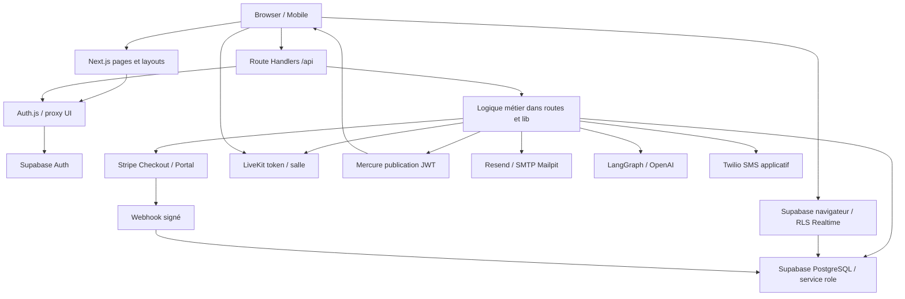
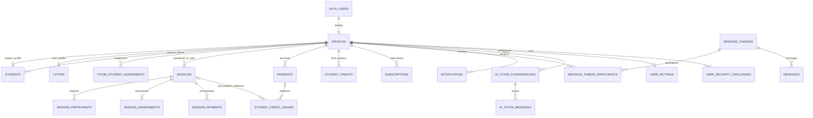

# SikaSchool — Architecture technique

> SikaSchool — Documentation de référence

**Last updated:** 2026-10-10
**Status:** Active
**Source of truth:** implémentation locale, contrats API, données, intégrations et exploitation ; aucun état de production n’est attesté.

## Navigation

[Product](./PRD.md) · [Architecture](./architecture.md) · [Rules](./Rules.md) · [Design](./design.md) · [Tasks](./tasks.md) · [Memory](./memory.md)

## 1. Architecture globale

Monolithe Next.js App Router, UI publique et portails connectés, Route Handlers Node.js, accès serveur Supabase service role. Référence Git `main`, commit initial `e637788` ; audit de l'arbre de travail incluant trois modifications utilisateur préexistantes. Ce document distingue code local et environnement déployé.



## 2. Stack et versions constatées

`package.json` décrit les plages autorisées ; `package-lock.json` les résolutions. Les versions installées ci-dessous ont été lues dans `node_modules`, pas déduites des plages. Node **24.x** est requis par engines et `.nvmrc` ; le poste exécute **26.8.2**, npm **12.0.2** : les vérifications de cette mission ne valent pas recette Node 24.

| Dépendance                         | Déclarée         | Lockfile      | Installée     |
| ---------------------------------- | ---------------- | ------------- | ------------- |
| `@langchain/core`                  | `^1.1.40`        | 1.2.11        | 1.2.11        |
| `@langchain/langgraph`             | `^1.2.9`         | 1.4.15        | 1.4.15        |
| `@langchain/openai`                | `^1.4.4`         | 1.5.13        | 1.5.13        |
| `@livekit/components-react`        | `^2.9.14`        | 2.9.24        | 2.9.24        |
| `@livekit/components-styles`       | `^1.1.6`         | 1.2.0         | 1.2.0         |
| `@stripe/stripe-js`                | `^9.2.0`         | 9.16.0        | 9.16.0        |
| `@supabase/supabase-js`            | `^2.38.0`        | 2.116.0       | 2.116.0       |
| `framer-motion`                    | `^12.0.6`        | 12.43.0       | 12.43.0       |
| `langchain`                        | `^1.3.3`         | 1.5.11        | 1.5.11        |
| `livekit-client`                   | `^2.15.7`        | 2.22.3        | 2.22.3        |
| `next`                             | `16.3.4`         | 16.3.4        | 16.3.4        |
| `next-auth`                        | `^5.0.0-beta.32` | 5.0.0-beta.32 | 5.0.0-beta.32 |
| `next-themes`                      | `^0.2.1`         | 0.2.1         | 0.2.1         |
| `nodemailer`                       | `^8.0.11`        | 8.0.11        | 8.0.11        |
| `react`                            | `19.0.0`         | 19.0.0        | 19.0.0        |
| `react-dom`                        | `19.0.0`         | 19.0.0        | 19.0.0        |
| `react-hot-toast`                  | `^2.4.1`         | 2.6.0         | 2.6.0         |
| `resend`                           | `^6.12.2`        | 6.28.0        | 6.28.0        |
| `stripe`                           | `^22.0.2`        | 22.6.2        | 22.6.2        |
| `swiper`                           | `^12.1.3`        | 12.2.0        | 12.2.0        |
| `zod`                              | `^4.1.11`        | 4.6.2         | 4.6.2         |
| `@tailwindcss/postcss`             | `^4.1.3`         | 4.3.3         | 4.3.3         |
| `@types/node`                      | `^20.8.9`        | 20.19.43      | 20.19.43      |
| `@types/nodemailer`                | `^8.0.0`         | 8.0.1         | 8.0.1         |
| `@types/react`                     | `19.0.8`         | 19.0.8        | 19.0.8        |
| `@types/react-dom`                 | `19.0.3`         | 19.0.3        | 19.0.3        |
| `@typescript-eslint/eslint-plugin` | `^8.44.1`        | 8.70.0        | 8.70.0        |
| `@typescript-eslint/parser`        | `^8.44.1`        | 8.70.0        | 8.70.0        |
| `critters`                         | `^0.0.23`        | 0.0.23        | 0.0.23        |
| `eslint`                           | `^9.24.0`        | 9.39.5        | 9.39.5        |
| `eslint-config-next`               | `^16.3.4`        | 16.3.4        | 16.3.4        |
| `eslint-plugin-security`           | `^2.1.1`         | 2.1.1         | 2.1.1         |
| `livekit-server-sdk`               | `^2.13.3`        | 2.19.0        | 2.19.0        |
| `postcss`                          | `^8.4.31`        | 8.5.28        | 8.5.28        |
| `prettier`                         | `^3.0.3`         | 3.9.6         | 3.9.6         |
| `prettier-plugin-tailwindcss`      | `^0.6.11`        | 0.6.14        | 0.6.14        |
| `supabase`                         | `2.117.0`        | 2.117.0       | 2.117.0       |
| `tailwindcss`                      | `^4.1.3`         | 4.3.3         | 4.3.3         |
| `typescript`                       | `^5.2.2`         | 5.9.3         | 5.9.3         |

PostgreSQL local 17, Supabase CLI 2.117.0, LiveKit Docker v1.13.7, Mercure v0.16, Mailpit non épinglé. `livekit-server-sdk` est en devDependencies malgré son usage serveur : vérifier l'installation des dépendances au build. ESLint security est installé mais non activé comme plugin dans la configuration actuelle. Aucun runner de tests ni pipeline `.github` détecté.

## 3. Arborescence et responsabilités

| Dossier / fichier                  | Responsabilité                                                                         |
| ---------------------------------- | -------------------------------------------------------------------------------------- |
| app/(site)                         | Marketing, pages d'offres, auth, confidentialité, erreur publique                      |
| app/student, app/family, app/tutor | Espaces par rôle ; administration imbriquée dans tutor                                 |
| app/api                            | Contrats HTTP, autorisation, accès DB et effets secondaires souvent co-localisés       |
| app/live, app/class                | Deux entrées vers classe virtuelle                                                     |
| components                         | Sections marketing, Auth, Booking, layouts Student/Tutor, primitives Common, LiveClass |
| context                            | AuthContext, LanguageContext, ToastContext                                             |
| hooks                              | Session/auth et rafraîchissement Mercure/Supabase                                      |
| lib                                | Intégrations, catalogue, permissions, participants, auth, e-mail, AI                   |
| types                              | Types métier et types/supabase.ts consommé par les clients                             |
| supabase                           | 14 migrations ordonnées, seed local et configuration CLI                               |
| public, image                      | Assets, logos, portraits, illustrations ; droits des visuels à vérifier                |
| scripts                            | security-check.js délègue à npm audit                                                  |
| pages/500.tsx                      | Page d'erreur héritée ; coexistence avec App Router                                    |
| markdown/docs                      | Cinq MDX hérités du template, hors documentation canonique ; conservés hors docs       |
| auth.ts, proxy.ts                  | Auth.js Credentials/session et filtre UI ; API exclues du matcher                      |
| docs                               | Six références ; aucune documentation supplémentaire à créer ici                       |

## 4. Architecture frontend

RootLayout importe globals.css et Inter via next/font/google, HTML `lang="fr"`. Le groupe site enveloppe ses pages dans ClientProviders : ThemeProvider (light par défaut, système désactivé), LanguageProvider FR/EN, ErrorBoundary, SkipLink, Header/Footer, ToastContext et LeadCaptureModal. Hero possède aussi une modale et écoute `lead:open` : doublon confirmé UX-001. Le layout public et plusieurs pages imbriquent des `<main>` (A11Y-001).

Les pages peuvent exporter metadata côté serveur, mais beaucoup de sections marketing portent `use client`. Les dashboards chargent les données par fetch/useEffect et état React ; AuthContext met en cache `/api/auth/me` 30 secondes dans le module. Pas de magasin d'état tiers global ni bibliothèque de formulaires identifiée. Validation serveur mêle Zod et contrôles ad hoc ; erreurs/toasts et skeletons ne sont pas uniformes.

`StudentLayout`, `TutorLayout`, `SectionHeader`, `ConfirmDialog`, `EmptyState`, `Skeleton`, `MobileFooterNav` sont réutilisables. Les pages family réemploient des pages étudiant, avec basePath dépendant du rôle. Les tokens actuels et états V2 vivent dans [design](./design.md). LanguageContext conserve fr/en dans localStorage ; ce n'est pas une architecture SEO multilingue côté serveur. La langue HTML reste française.

## 5. Backend et contrats API

Une route doit traiter identité, rôle et propriété avant chaque lecture/écriture avec `supabaseAdmin`, car la clé service role contourne RLS. Le proxy n'autorise pas les API à leur place. Le code combine souvent parsing, métier, mapping DB et notifications. Il n'existe pas de transaction globale couvrant plusieurs appels Supabase ; les compensations de création de compte ne constituent pas une transaction distribuée.

| Contrat critique                             | Entrée et sortie                                                                      | Gardes / erreurs observées                                                                              |
| -------------------------------------------- | ------------------------------------------------------------------------------------- | ------------------------------------------------------------------------------------------------------- |
| POST /api/auth/register et signup            | email, password, firstName, lastName, phone?, role ; success/user/supabaseCredentials | public ; 400 champs/longueur, 409 compte existant, 500 ; mot de passe soumis renvoyé, TECH-013          |
| POST /api/auth/login                         | email/password + twoFactorCode/twoFactorTicket? ; user ou challenge                   | 202 challenge, 401 mauvais accès, 403 inactif/profil absent, 503 erreur profil dans modification locale |
| POST /api/leads                              | identité/coordonnées, level, subject, goal, accountType, campaign? ; success          | public ; 400 requis, 500 ; rôle/mot de passe existant préservés mais coordonnées modifiables            |
| GET /api/leads/first-session-slots           | subject ; slots[tutorId,tutorName,startedAt,duration]                                 | public ; 400 matière, 500 ; grille décrite PRD                                                          |
| POST même route                              | email, subject, tutorId UUID, startedAt, campaign? ; success/sessionId                | public ; 400, 404, 409 ; pas de preuve e-mail ni verrou DB                                              |
| POST /api/sessions                           | IDs participants, matière, début, durée selon schéma Zod                              | session/rôle/assignation ; multi-participants synchronisés ; repli de statut historique                 |
| PATCH /api/tutor/sessions/action             | sessionId, action ACCEPT/REJECT ; success/action                                      | tuteur propriétaire et PENDING ; 401/404/400/500                                                        |
| PATCH /api/sessions/cancel                   | sessionId, raison selon route ; success                                               | session + participant/tuteur ; règle 24 h ; 401/403/404/400                                             |
| POST /api/sessions/update-status             | aucun paramètre d'autorisation                                                        | public, écrit avec service role ; TECH-015                                                              |
| POST /api/family/linked-student              | studentEmail ; linkedStudent                                                          | PARENT, rôle cible STUDENT ; recherche par e-mail ; TECH-014                                            |
| POST /api/student/payments/checkout          | planId ; url/sessionId                                                                | STUDENT/PARENT + élève effectif ; prix serveur ; 400 plan, 404 lien, 500 intégration                    |
| POST /api/student/payments/portal            | compte connecté ; url                                                                 | Customer du compte payeur ; vérifier configuration Portal                                               |
| POST /api/livekit/token                      | classId ; token, role, roomName                                                       | session + user.id participant ; 400/401/403/500                                                         |
| POST /api/student/ai-tutor/conversations/:id | content, attachments[{url,mimeType?,name?}]                                           | élève effectif + ownership ; 400 vide, 404 propriétaire ; six URLs retenues                             |

Les formes d'erreurs ci-dessus reflètent l'existant, pas un contrat uniforme déjà livré. Proposition TECH-005 : `{ok:true,value}` ou `{ok:false,code,message,fieldErrors?}` au niveau service, puis mapping HTTP. Messages d'erreur sûrs, sans détail DB ou fournisseur.

### Inventaire complet des handlers

Les méthodes suivantes sont extraites des exports du code. Le tableau est un index de surface ; le fichier reste la référence du payload, du filtre et de l'autorisation. Les méthodes Auth.js et les réexports sont indiqués séparément.

| Route                                                  | Méthodes                     | Source                                                                                  |
| ------------------------------------------------------ | ---------------------------- | --------------------------------------------------------------------------------------- |
| `/api/admin/assignments/assign`                        | POST                         | [assign](../app/api/admin/assignments/assign/route.ts)                                  |
| `/api/admin/assignments/available-users`               | GET                          | [available-users](../app/api/admin/assignments/available-users/route.ts)                |
| `/api/admin/assignments/unassign`                      | DELETE                       | [unassign](../app/api/admin/assignments/unassign/route.ts)                              |
| `/api/admin/assignments/user/[userId]`                 | GET                          | [[userId]](../app/api/admin/assignments/user/[userId]/route.ts)                         |
| `/api/admin/payments`                                  | GET                          | [payments](../app/api/admin/payments/route.ts)                                          |
| `/api/admin/resend/health`                             | GET                          | [health](../app/api/admin/resend/health/route.ts)                                       |
| `/api/admin/reviews/[reviewId]`                        | PATCH, DELETE                | [[reviewId]](../app/api/admin/reviews/[reviewId]/route.ts)                              |
| `/api/admin/reviews`                                   | GET                          | [reviews](../app/api/admin/reviews/route.ts)                                            |
| `/api/admin/sessions/[sessionId]`                      | PUT, DELETE                  | [[sessionId]](../app/api/admin/sessions/[sessionId]/route.ts)                           |
| `/api/admin/sessions`                                  | GET, POST                    | [sessions](../app/api/admin/sessions/route.ts)                                          |
| `/api/admin/sync-profiles`                             | POST                         | [sync-profiles](../app/api/admin/sync-profiles/route.ts)                                |
| `/api/admin/users/[userId]/profile`                    | PUT, POST                    | [profile](../app/api/admin/users/[userId]/profile/route.ts)                             |
| `/api/admin/users/[userId]/reset-password`             | POST                         | [reset-password](../app/api/admin/users/[userId]/reset-password/route.ts)               |
| `/api/admin/users/[userId]`                            | PUT, DELETE                  | [[userId]](../app/api/admin/users/[userId]/route.ts)                                    |
| `/api/admin/users/[userId]/toggle-status`              | PATCH                        | [toggle-status](../app/api/admin/users/[userId]/toggle-status/route.ts)                 |
| `/api/admin/users`                                     | GET, POST                    | [users](../app/api/admin/users/route.ts)                                                |
| `/api/admin/users/with-profiles`                       | GET                          | [with-profiles](../app/api/admin/users/with-profiles/route.ts)                          |
| `/api/auth/[...nextauth]`                              | GET, POST (handlers Auth.js) | [[...nextauth]](../app/api/auth/[...nextauth]/route.ts)                                 |
| `/api/auth/forgot-password`                            | POST                         | [forgot-password](../app/api/auth/forgot-password/route.ts)                             |
| `/api/auth/login`                                      | POST                         | [login](../app/api/auth/login/route.ts)                                                 |
| `/api/auth/logout`                                     | POST                         | [logout](../app/api/auth/logout/route.ts)                                               |
| `/api/auth/me`                                         | GET                          | [me](../app/api/auth/me/route.ts)                                                       |
| `/api/auth/register`                                   | POST                         | [register](../app/api/auth/register/route.ts)                                           |
| `/api/auth/reset-password`                             | POST                         | [reset-password](../app/api/auth/reset-password/route.ts)                               |
| `/api/auth/signup`                                     | POST (réexport register)     | [signup](../app/api/auth/signup/route.ts)                                               |
| `/api/auth/verify-email`                               | GET                          | [verify-email](../app/api/auth/verify-email/route.ts)                                   |
| `/api/family/linked-student`                           | GET, POST                    | [linked-student](../app/api/family/linked-student/route.ts)                             |
| `/api/faqs`                                            | GET                          | [faqs](../app/api/faqs/route.ts)                                                        |
| `/api/leads/first-session-slots`                       | GET, POST                    | [first-session-slots](../app/api/leads/first-session-slots/route.ts)                    |
| `/api/leads`                                           | POST                         | [leads](../app/api/leads/route.ts)                                                      |
| `/api/livekit/token`                                   | POST                         | [token](../app/api/livekit/token/route.ts)                                              |
| `/api/sessions/cancel`                                 | PATCH                        | [cancel](../app/api/sessions/cancel/route.ts)                                           |
| `/api/sessions`                                        | POST                         | [sessions](../app/api/sessions/route.ts)                                                |
| `/api/sessions/update-status`                          | POST                         | [update-status](../app/api/sessions/update-status/route.ts)                             |
| `/api/student/ai-tutor/conversations/[conversationId]` | GET, POST, PATCH, DELETE     | [[conversationId]](../app/api/student/ai-tutor/conversations/[conversationId]/route.ts) |
| `/api/student/ai-tutor/conversations`                  | GET, POST                    | [conversations](../app/api/student/ai-tutor/conversations/route.ts)                     |
| `/api/student/assessments`                             | GET                          | [assessments](../app/api/student/assessments/route.ts)                                  |
| `/api/student/assigned-tutors`                         | GET                          | [assigned-tutors](../app/api/student/assigned-tutors/route.ts)                          |
| `/api/student/dashboard`                               | GET                          | [dashboard](../app/api/student/dashboard/route.ts)                                      |
| `/api/student/messages/[threadId]`                     | GET, POST, PATCH, DELETE     | [[threadId]](../app/api/student/messages/[threadId]/route.ts)                           |
| `/api/student/messages`                                | GET, POST                    | [messages](../app/api/student/messages/route.ts)                                        |
| `/api/student/notifications`                           | GET, PATCH                   | [notifications](../app/api/student/notifications/route.ts)                              |
| `/api/student/payments/checkout`                       | POST                         | [checkout](../app/api/student/payments/checkout/route.ts)                               |
| `/api/student/payments/overview`                       | GET                          | [overview](../app/api/student/payments/overview/route.ts)                               |
| `/api/student/payments/portal`                         | POST                         | [portal](../app/api/student/payments/portal/route.ts)                                   |
| `/api/student/profile/2fa`                             | GET, POST                    | [2fa](../app/api/student/profile/2fa/route.ts)                                          |
| `/api/student/profile/password`                        | PATCH                        | [password](../app/api/student/profile/password/route.ts)                                |
| `/api/student/profile`                                 | GET, PATCH                   | [profile](../app/api/student/profile/route.ts)                                          |
| `/api/student/reviews`                                 | GET, POST, DELETE            | [reviews](../app/api/student/reviews/route.ts)                                          |
| `/api/student/sessions`                                | GET                          | [sessions](../app/api/student/sessions/route.ts)                                        |
| `/api/testimonials`                                    | GET                          | [testimonials](../app/api/testimonials/route.ts)                                        |
| `/api/tutor/dashboard`                                 | GET                          | [dashboard](../app/api/tutor/dashboard/route.ts)                                        |
| `/api/tutor/messages/[threadId]`                       | GET, POST, PATCH, DELETE     | [[threadId]](../app/api/tutor/messages/[threadId]/route.ts)                             |
| `/api/tutor/messages`                                  | GET, POST                    | [messages](../app/api/tutor/messages/route.ts)                                          |
| `/api/tutor/notifications`                             | GET, PATCH                   | [notifications](../app/api/tutor/notifications/route.ts)                                |
| `/api/tutor/payments/annual`                           | GET                          | [annual](../app/api/tutor/payments/annual/route.ts)                                     |
| `/api/tutor/payments/history`                          | GET                          | [history](../app/api/tutor/payments/history/route.ts)                                   |
| `/api/tutor/payments/payouts`                          | GET                          | [payouts](../app/api/tutor/payments/payouts/route.ts)                                   |
| `/api/tutor/profile/2fa`                               | GET, POST                    | [2fa](../app/api/tutor/profile/2fa/route.ts)                                            |
| `/api/tutor/profile/avatar`                            | POST                         | [avatar](../app/api/tutor/profile/avatar/route.ts)                                      |
| `/api/tutor/profile/password`                          | PATCH                        | [password](../app/api/tutor/profile/password/route.ts)                                  |
| `/api/tutor/profile`                                   | GET, PATCH, DELETE           | [profile](../app/api/tutor/profile/route.ts)                                            |
| `/api/tutor/session-assessments`                       | POST, GET                    | [session-assessments](../app/api/tutor/session-assessments/route.ts)                    |
| `/api/tutor/sessions/action`                           | PATCH                        | [action](../app/api/tutor/sessions/action/route.ts)                                     |
| `/api/tutor/sessions`                                  | GET                          | [sessions](../app/api/tutor/sessions/route.ts)                                          |
| `/api/tutor/student-sessions`                          | GET                          | [student-sessions](../app/api/tutor/student-sessions/route.ts)                          |
| `/api/tutor/students`                                  | GET                          | [students](../app/api/tutor/students/route.ts)                                          |
| `/api/tutor-subjects`                                  | GET                          | [tutor-subjects](../app/api/tutor-subjects/route.ts)                                    |
| `/api/webhooks/stripe`                                 | POST                         | [stripe](../app/api/webhooks/stripe/route.ts)                                           |

<a id="6-supabase-et-modele-de-donnees"></a>

## 6. Supabase et modèle de données

Le schéma final est la composition des **14 migrations**, pas la baseline seule. `public.users` est renommée `public.profiles` par la migration Auth ; les FK gardent les UUID. Les alias PostgREST `users:user_id(...)` sont des noms de résultat, pas nécessairement une table users obsolète. Valider leur résolution contre une base migrée.



Diagramme conceptuel : un profil n'a pas obligatoirement de sous-profil student/tutor ; l'association parent est scalaire par enfant, non unique côté parent. Tables complémentaires : reviews (modération, student_id/tutor_id optionnels) et faqs (is_active/order). Les évaluations ont huit notes 1–5 et session_id unique. Les participations et assignations ont une contrainte unique sur leur paire. `student_credits` est unique par student_id/level. Le ledger a payment_id/session_id optionnels mais `addCredits` ne les remplit pas.

| Migration                                                  | Effet dans l'ordre                                                                                                                                           |
| ---------------------------------------------------------- | ------------------------------------------------------------------------------------------------------------------------------------------------------------ |
| 20260101120000_initial_schema                              | Baseline, anciens catalogues, sessions, messagerie/RLS/Realtime, Stripe, IA, triggers                                                                        |
| 20260502120000_enable_rls_public_tables                    | RLS sur tables exposées                                                                                                                                      |
| 20260502140000_graphql_privileges_and_function_search_path | Révocations et privilèges limités, search_path                                                                                                               |
| 20260502150000_revoke_anon_select_catalog_reads            | Retire lectures anon restantes ; API publiques service role                                                                                                  |
| 20260520120000_add_subject_to_sessions                     | Matière directement sur sessions                                                                                                                             |
| 20260520153000_cleanup_unused_catalog_tables               | Retire courses, lessons, enrollments, progress, assignments, submissions, bookings, availabilities, purchases, plans, pricing_rules, subjects et FK héritées |
| 20260522120000_drop_remote_legacy_tables                   | Retire assignment_submissions/tutor_availability héritées                                                                                                    |
| 20260605120000_add_missing_sessions_ended_at               | Timestamp de fin                                                                                                                                             |
| 20260605123000_add_parent_role                             | Enum PARENT                                                                                                                                                  |
| 20260605124500_add_parent_link_to_students                 | parents_linked FK et validation rôle                                                                                                                         |
| 20260605130000_add_review_avatar_urls                      | Avatars de témoignages                                                                                                                                       |
| 20260605131500_link_reviews_to_students                    | FK student/tutor des avis                                                                                                                                    |
| 20260611120000_replace_public_testimonials                 | Remplacement de contenus d'avis ; migration de données, pas preuve de consentement                                                                           |
| 20260912143000_move_users_to_supabase_auth                 | Identités Auth, profiles, user_settings, user_security_challenges, triggers sûrs                                                                             |

RLS : profiles lisible par son propriétaire authenticated, écritures serveur ; user_settings a policy own ; messagerie filtre participation et auth.uid(). Après révocation, une policy seule n'accorde pas de privilège SQL. Les API publiques FAQ/avis utilisent service role et doivent filtrer is_active/is_approved elles-mêmes. Les tables sans policy utilisable ne sont pas directement accessibles au navigateur ; ceci ne protège pas une route serveur mal gardée.

Triggers : timestamps updated_at, mise à jour conversation sur message, vérification rôle parent, création profil STUDENT depuis Auth sans confiance dans rôle client, synchronisation e-mail confirmé. La migration Auth conserve les hashes bcrypt/UUID, refuse les collisions d'e-mail avec UUID différents et doublons de sous-profils ; elle retire password_hash et anciens tokens publics. Les défis SMS restent volontairement dans user_security_challenges.

**Types :** clients importent `types/supabase.ts`, alors que `npm run supabase:types` écrit `lib/database.types.ts`. Générer ne suffit donc pas à actualiser les types utilisés (TECH-005/TECH-010). Ne pas versionner un second type concurrent sans décider de la cible.

**Seed :** uniquement local, données fictives, dates relatives NOW(), comptes et rôles disponibles dans [supabase/README](../supabase/README.md). Le ledger du seed peut être équilibré sans que le webhook réel le soit. Les liens multi-enfants du seed excèdent le helper actuel. Aucun reset, db push ni lecture de production effectué pendant cette mission.

<a id="securite"></a>

## 7. Sécurité : garanties et limites

Supabase Auth vérifie email/password. Auth.js utilise Credentials, JWT de session sur 7 jours, secret `AUTH_SECRET || NEXTAUTH_SECRET`, et cookies gérés par Auth.js (HttpOnly ; comportement Secure dépendant de l'environnement, à vérifier sur déploiement). `JWT_SECRET` n'est plus le secret de session Auth.js ; il reste un fallback OTP. Le navigateur conserve aussi une session Supabase pour Realtime/RLS. Déconnexion ferme les deux.

`authorize` contrôle profil actif et rôle à la connexion, puis le callback JWT mémorise le rôle. Revalidation des sessions existantes après désactivation/changement de rôle à tester. Le proxy UI (`proxy.ts`, non middleware.ts) exclut `/api`. `lib/admin-permissions.ts` accorde ADMIN et certains TUTOR par e-mail codé en dur ; aucun droit ne doit être inféré du seul menu.

Le reset administratif remplace le mot de passe par un secret aléatoire et renvoie `tempPassword` à l'administrateur ; il diffère du recovery public par lien. Son remplacement ou encadrement relève de TECH-013.

Risques confirmés par lecture, sans exploitation ni correction pendant cette mission :

| ID       | Constat                                                                                                                                                                                 | Limite de preuve / priorité                                            |
| -------- | --------------------------------------------------------------------------------------------------------------------------------------------------------------------------------------- | ---------------------------------------------------------------------- |
| TECH-002 | Credits read-modify-write, ledger sans référence unique ; invoice_id non unique mais utilisé en onConflict ; erreurs DB souvent avalées                                                 | P0 intégrité financière ; replay/concurrence à reproduire en local     |
| TECH-003 | Créneau public réservé par e-mail sans preuve ni rate limit ; validation GET/POST divergente, conflits et écritures non atomiques                                                       | P0 ; configuration anti-abus externe inconnue                          |
| TECH-013 | SMS vérifié par /api/auth/login mais pas par authorize du Credentials accessible via handlers Auth.js ; OTP Math.random et fallback secret ; inscription renvoie le mot de passe soumis | P0 ; absence de contrôle confirmée, exploitation complète non exécutée |
| TECH-014 | Liaison parent par simple e-mail, remplace potentiellement autre parent, puis accès aux données de l'élève                                                                              | P0 confidentialité ; invitation/consentement à définir                 |
| TECH-015 | POST update-status public avec service role ; retours précoces bloquent clôture ; PENDING peut démarrer sans acceptation                                                                | P0 mutation publique ; cron/contrat à définir                          |
| TECH-016 | Lead peut modifier nom/coordonnées/besoins d'un compte existant sans vérification                                                                                                       | P0 intégrité/PII ; TECH-001 ne corrigeait que rôle/mot de passe        |
| TECH-006 | Droits par e-mail, guards dispersés et JWT de rôle potentiellement ancien                                                                                                               | P1 ; matrice exhaustive de tests nécessaire                            |
| TECH-017 | Parent non résolu dans token LiveKit ; statut/date non contrôlés ; retour Checkout /student pour PARENT                                                                                 | P1 cohérence des permissions/parcours                                  |
| TECH-018 | IA : URLs acceptées sans validation taille/MIME stricte, historique premiers 40, erreurs fournisseur persistées                                                                         | P1 confidentialité, coût et continuité                                 |

En-têtes locaux dans next.config.js : X-DNS-Prefetch-Control=on, X-XSS-Protection=1; mode=block, X-Frame-Options=SAMEORIGIN, X-Content-Type-Options=nosniff, Referrer-Policy=origin-when-cross-origin ; poweredByHeader=false. **Pas de CSP ou HSTS explicite** dans ce fichier. Le fichier modifié avant mission contient deux allowedDevOrigins, la seconde propriété remplaçant la première ; laissé intact. En-têtes réels du CDN/hébergeur `TO_VERIFY`.

Pas de rate limiter applicatif identifié sur auth/lead/IA. `lib/env.ts` ne valide pas toutes les intégrations. Aucun secret d'environnement réel n'est reproduit ici. Les logs console peuvent contenir détails DB/fournisseur malgré logger.ts : pas de garantie globale de redaction. Ne pas assimiler `npm audit` à un audit d'autorisation.

<a id="stripe"></a>

## 8. Stripe

Checkout lit `PLANS` dans lib/stripe.ts, crée price_data à la volée, mode payment pour PACK/SESSION ou subscription. Customer lié au payeur via profiles.stripe_customer_id ; metadata `sikaschool_user_id`, `sikaschool_student_id`, `plan_id`, `plan_kind`, `plan_level`, `sessions_count`. allow_promotion_codes=true, locale=fr, facture activée pour paiement unique. CLIENT_PLANS est une copie client ; modifications futures à synchroniser et tester. Pas de Stripe Connect automatique identifié ; pages revenus/payouts ne prouvent pas un transfert bancaire.

| Niveau    | Séance 60 min | Basic 4 séances | Eco 8 séances | Abonnement 4/mois |
| --------- | ------------- | --------------- | ------------- | ----------------- |
| COLLEGE   | 25 €          | 88 €            | 144 €         | 79 €              |
| LYCEE     | 30 €          | 108 €           | 176 €         | 99 €              |
| SUPERIEUR | 38 €          | 128 €           | 224 €         | 119 €             |

Montants du code en EUR, pas validation commerciale/fiscale. IDs : session_<niveau>, pack_basic_<niveau>, pack_eco_<niveau>, sub_<niveau> (niveau minuscule). Validité, TVA et remboursement : arbitrages, aucune règle nouvelle déduite ici.

Le webhook lit le **body brut** avec req.text() puis constructEvent(signature, secret). Signature absente/invalide 400 ; exception handler 500 ; événement ignoré 200. Les erreurs Supabase retournées en objet ne deviennent pas toutes des exceptions : l'acquittement peut précéder une écriture complète.

| Événement                                     | Effet actuel                                                                                                                                    |
| --------------------------------------------- | ----------------------------------------------------------------------------------------------------------------------------------------------- |
| checkout.session.completed                    | PACK/SESSION : payment PAID puis crédit sans vérifier explicitement payment_status ; SUBSCRIPTION : trace, pas de crédit                        |
| invoice.paid / invoice.payment_succeeded      | Récupère subscription metadata, upsert paiement facture puis crédits ; les deux événements d'une même facture doivent être dédupliqués ensemble |
| invoice.payment_failed                        | Marque FAILED une ligne existante                                                                                                               |
| customer.subscription.created/updated/deleted | Synchronise projection et période/cancel_at_period_end                                                                                          |
| charge.refunded                               | Marque REFUNDED par payment_intent, pas de compensation ledger ni distinction partiel                                                           |

`stripe_checkout_session` est UNIQUE, `stripe_subscription_id` est UNIQUE dans subscriptions ; **stripe_invoice_id ne l'est pas dans les migrations lues**. TECH-002 exige transaction/RPC, unicité de l'attribution métier (pas seulement event.id), contrôle état payé, propagation erreurs et réconciliation. Le retour success n'est pas une preuve d'attribution. Consommation/annulation des crédits : TECH-019, non reliée actuellement au cycle des séances.

### Configuration et recette locale Stripe

Configurer STRIPE_SECRET_KEY, STRIPE_WEBHOOK_SECRET, NEXT_PUBLIC_STRIPE_PUBLISHABLE_KEY si utilisé côté client et NEXT_PUBLIC_APP_URL cohérente avec HTTPS local. Créer les tables par migrations CLI, **pas par copie d'un extrait SQL**. Activer Customer Portal séparément en test puis production. En test :

```powershell
stripe login
stripe listen --forward-to https://localhost:3000/api/webhooks/stripe --skip-verify
```

`--skip-verify` est réservé au certificat local auto-signé ; jamais sur une destination de production. Reporter le secret affiché dans l'environnement local et redémarrer Next. Syntaxe vérifiée dans [Stripe CLI listen](https://docs.stripe.com/cli/listen).

Connecter STUDENT puis PARENT lié, acheter un pack, vérifier payment/ledger/solde et facture ; tester retour annulé, abonnement, replay, concurrence, échec et remboursement. Cartes **test uniquement** : 4242 4242 4242 4242 succès ; 4000 0025 0000 3155 authentification ; 4000 0000 0000 9995 fonds insuffisants ; 4000 0000 0000 0002 refus générique. L'ancien guide inversait les deux refus. Date future/CVC de test ; [référence officielle](https://docs.stripe.com/testing).

La checklist de préparation production est migrée vers OPS-001 dans tasks ; elle ne donne pas autorisation de déploiement ni de paiement réel. Apple Pay/Google Pay/Link dépendent de configuration/éligibilité et ne sont pas garantis par le seul code. Prices persistants, Connect, SEPA et paiement fractionné restent options à arbitrer (OPT-002).

<a id="livekit"></a>

## 9. LiveKit

POST /api/livekit/token est Node.js force-dynamic, Zod classId non vide, session Auth.js puis resolveLiveClassMembership(user.id,classId). Primary student, tutor ou session_participants admis ; rôle `instructor` ou `student`. Salle `class_<classId>`, TTL 7200 s, canPublish/canSubscribe/canPublishData=true ; roomAdmin seulement instructor. Pas de résolution parent ni contrôle statut/date dans ce helper.

`lib/livekit-egress.ts` propose EgressClient, enregistrement composite MP4 grille vers S3 compatible, prefix recordings/<classId>/ et stopEgress. Aucun appelant trouvé : **PARTIAL**, pas une fonctionnalité enregistrée en production. Nécessiterait service Egress, stockage, accès et consentement validés.

Local : image livekit/livekit-server:v1.13.7 épinglée ; `docker compose -f docker-compose.livekit.yml pull` une fois avec réseau, puis `npm run livekit`. Ports loopback 7880 signalisation/API, 7881 TCP ICE, 7882 UDP ; livekit.local.yaml annonce 127.0.0.1. Les identifiants de démonstration sont dans le fichier local versionné, exclusivement pour cette instance. Conserver l'image pour travailler hors ligne ; npm cache clean ne l'efface pas, docker image prune -a peut l'effacer.

Production : NEXT_PUBLIC_LIVEKIT_SERVER_URL wss, LIVEKIT_API_KEY/SECRET propres à l'environnement, LIVEKIT_HTTP_URL facultative (sinon conversion ws→http/wss→https). Réseau WebRTC, TLS et TURN selon hébergement à recetter. Ne pas réutiliser le YAML local sur un serveur public. Timeout : URL/réseau/pare-feu/ports ; token invalide : clés, salle, expiration ; mobile : loopback du téléphone n'est pas celui du PC. Tester caméra/micro, déconnexion/reconnexion, utilisateur étranger et expiration.

## 10. Mercure et temps réel

lib/mercure.ts publie vers MERCURE_URL ou NEXT_PUBLIC_MERCURE_URL ; JWT préfourni MERCURE_PUBLISHER_JWT ou HS256 dérivé MERCURE_JWT_SECRET, publish=[*], expiration 60 s. Topics `https://sikaschool.app/realtime/users/<id>` et `/realtime/messages/threads/<id>` ; types message/notification/session, action, IDs et timestamp. Ces URLs sont des identifiants de topic, pas nécessairement des pages HTTP.

useMercure utilise EventSource avec credentials, topics dédupliqués, fermeture au cleanup et reconnexion navigateur. Hooks useRealtimeSessions/ThreadMessages/MessageThreadsInbox et badges déclenchent relecture API ; Supabase navigateur sert aussi les subscriptions Realtime sous RLS. Une indisponibilité du hub peut être ignorée ; pas d'outbox/retry durable identifié.

Le Compose local autorise anonymous et CORS **http://localhost:3000**, alors que npm dev utilise **https** : alignement d'origine et mixed content à vérifier (OPS-002). Un topic contenant un UUID ne constitue pas un contrôle d'accès ; les signaux n'incluent pas le contenu des messages mais exposent encore des métadonnées. Ne pas ajouter de PII ; étudier abonnements privés/observabilité avant usage sensible. Une publication échouée ne doit pas conduire à répéter l'écriture métier.

## 11. Sika AI

lib/ai-tutor/agent.ts appelle ChatOpenAI via createReactAgent LangGraph, modèle du code SIKA_AI_MODEL ou gpt-4o-mini, temperature=0.3, maxRetries=2, recursionLimit=12. Ceci est un constat de configuration, pas une recommandation de modèle/prix actuel. Les outils solve_homework_step_by_step, correct_student_work, generate_revision_sheet et explain_concept structurent la réponse pédagogique ; ils ne constituent pas un moteur de calcul ou de recherche externe vérifié.

API conversations : GET/POST liste/création ; GET/POST/PATCH/DELETE par ID, ownership user_id=effectiveStudentId. POST exige texte ou attachment, retient six objets ayant une URL string. Route maxDuration=60 ; appel agent.invoke non streamé. Le client compresse les photos vers JPEG qualité .85, dimension max 1600 ; cette mesure n'impose pas une limite serveur. Images data URL en JSONB, metadata tools/model ; trigger touche conversation.updated_at.

Le chargement `order(created_at, ascending:true).limit(40)` prend les **40 premiers**, contrairement à l'ancien guide « 40 derniers ». Messages user/assistant transmis, system prompt personnalise nom/niveau/matière. Sans clé ou sur erreur, une réponse d'indisponibilité est persistée et peut contenir un extrait d'erreur ; sanitisation nécessaire. Pas de quota/coût plafonné/rétention automatique identifié. Les copies et données de mineurs vont au fournisseur externe ; politique à faire valider avant extension. Streaming, recherche pgvector, Storage à URLs signées et export PDF sont `PLANNED`, décision OPT-001.

## 12. E-mails

lib/registration-emails.ts centralise notifications d'inscription, recovery, nouvelle demande, décision et annulation. MAIL_PROVIDER peut forcer smtp/resend ; défaut développement SMTP/Mailpit, production Resend. MAIL_FROM_EMAIL puis RESEND_FROM_EMAIL ; URL applicative NEXT_PUBLIC_APP_URL puis VERCEL_URL puis fallback. Listes ADMIN_NEW_STUDENT_NOTIFY_EMAILS / ADMIN_NOTIFY_EMAILS à configurer sans diffuser de contacts privés dans les documents.

SMTP_HOST/PORT/SECURE/USER/PASS ; défaut local 127.0.0.1:1025, UI Mailpit 8025 (`npm run mailpit`, service séparé de Next). Supabase expose aussi son UI mail locale 54324. Resend nécessite RESEND_API_KEY et domaine expéditeur validé ; santé via /api/admin/resend/health. Plusieurs envois sont `void`/best-effort : succès HTTP ne prouve pas livraison. Observabilité TECH-011 ; outbox optionnelle après mesures, pas une obligation préalable inventée.

<a id="developpement-local"></a>

## 13. Développement local reproductible

Utiliser Node 24 et Docker. `.env.example` est absent ; `.env.development.local.example` existe. Copier uniquement le modèle local, contrôler noms/valeurs sans publier les secrets, puis comparer `supabase:status` à la configuration de l'instance. Les `.env` du poste n'ont pas été lus pendant la mission. Ne pas présumer qu'un nouveau clone dispose déjà d'un fichier local ou des certificats.

```powershell
npm ci --legacy-peer-deps
Copy-Item .env.development.local.example .env.development.local
npm run supabase:start
npm run supabase:status
# Seulement sur une base locale jetable : efface puis recrée ses données.
npm run supabase:reset
npm run mailpit
npm run mercure
npm run livekit
npm run dev
```

Ces commandes constituent le runbook, elles n'ont pas été exécutées lors de cette mission. Si installation incompatible, diagnostiquer le lockfile avant toute mise à jour. `dev` exige explicitement certificates/localhost-key.pem et localhost.pem ; l'ancien README annonçait à tort une génération automatique. Fournir des certificats de développement approuvés localement avant lancement. `.env.development.local` prévaut en développement sur `.env.local` pour les mêmes clés ; éviter deux configurations contradictoires. Redémarrer après changement.

| Intégration    | Variables à vérifier, jamais de valeurs de production dans Git                                                                 |
| -------------- | ------------------------------------------------------------------------------------------------------------------------------ |
| Auth           | AUTH_SECRET ou NEXTAUTH_SECRET ; NEXT_PUBLIC_SUPABASE_URL/ANON_KEY, SUPABASE_SERVICE_ROLE_KEY                                  |
| SMS            | TWO_FA_OTP_SECRET, TWILIO_ACCOUNT_SID/AUTH_TOKEN/FROM_PHONE ; JWT_SECRET est seulement un fallback hérité                      |
| App            | NEXT_PUBLIC_APP_URL, éventuellement VERCEL_URL                                                                                 |
| Stripe         | STRIPE_SECRET_KEY, STRIPE_WEBHOOK_SECRET, NEXT_PUBLIC_STRIPE_PUBLISHABLE_KEY                                                   |
| LiveKit        | NEXT_PUBLIC_LIVEKIT_SERVER_URL, LIVEKIT_API_KEY/SECRET, LIVEKIT_HTTP_URL                                                       |
| Egress partiel | EGRESS_S3_BUCKET/ACCESS_KEY/SECRET_KEY/REGION/ENDPOINT                                                                         |
| Temps réel     | NEXT_PUBLIC_MERCURE_URL, MERCURE_URL, MERCURE_JWT_SECRET ou MERCURE_PUBLISHER_JWT                                              |
| Mail           | MAIL_PROVIDER, MAIL_FROM_EMAIL/RESEND_FROM_EMAIL, RESEND_API_KEY, SMTP_*, ADMIN_NEW_STUDENT_NOTIFY_EMAILS, ADMIN_NOTIFY_EMAILS |
| IA             | OPENAI_API_KEY, SIKA_AI_MODEL facultative                                                                                      |
| CLI Supabase   | SUPABASE_DB_PASSWORD pour db pull ; Google OAuth déclaré via GOOGLE_CLIENT_ID/SECRET, intégration UI complète TO_VERIFY        |

Supabase local : API 54321, DB 54322, Studio 54323, mail 54324, shadow 54320 ; PostgreSQL 17 ; auth site_url HTTP et redirect additionnel HTTPS localhost. Pas de garantie de fonctionnement mobile avec ces loopbacks. Pour tester sur téléphone : même réseau, npm run dev -- -H 0.0.0.0, `ipconfig`, choisir l'IPv4 Wi-Fi actuelle (pas une ancienne IP de README), vérifier certificat/origines/pare-feu. Le serveur LiveKit loopback n'est pas accessible au téléphone sans configuration spécifique autorisée.

### Scripts disponibles

| Script npm        | Commande réelle                                                                                                                                  |
| ----------------- | ------------------------------------------------------------------------------------------------------------------------------------------------ |
| `dev`             | `next dev --experimental-https --experimental-https-key ./certificates/localhost-key.pem --experimental-https-cert ./certificates/localhost.pem` |
| `mailpit`         | `docker compose -f docker-compose.mailpit.yml up -d`                                                                                             |
| `mailpit:down`    | `docker compose -f docker-compose.mailpit.yml down`                                                                                              |
| `mercure`         | `docker compose -f docker-compose.mercure.yml up -d`                                                                                             |
| `mercure:down`    | `docker compose -f docker-compose.mercure.yml down`                                                                                              |
| `livekit`         | `docker compose -f docker-compose.livekit.yml up -d`                                                                                             |
| `livekit:down`    | `docker compose -f docker-compose.livekit.yml down`                                                                                              |
| `livekit:logs`    | `docker compose -f docker-compose.livekit.yml logs -f`                                                                                           |
| `build`           | `next build`                                                                                                                                     |
| `start`           | `next start`                                                                                                                                     |
| `lint`            | `eslint .`                                                                                                                                       |
| `lint:fix`        | `eslint . --fix`                                                                                                                                 |
| `type-check`      | `tsc --noEmit`                                                                                                                                   |
| `security:audit`  | `npm audit`                                                                                                                                      |
| `security:fix`    | `npm audit fix`                                                                                                                                  |
| `security:check`  | `node scripts/security-check.js`                                                                                                                 |
| `format`          | `prettier --write .`                                                                                                                             |
| `format:check`    | `prettier --check .`                                                                                                                             |
| `supabase:start`  | `supabase start`                                                                                                                                 |
| `supabase:stop`   | `supabase stop`                                                                                                                                  |
| `supabase:reset`  | `supabase db reset --local`                                                                                                                      |
| `supabase:status` | `supabase status`                                                                                                                                |
| `supabase:types`  | `supabase gen types typescript --local > lib/database.types.ts`                                                                                  |

`security:fix`, lint:fix et format modifient des fichiers ; ne pas les exécuter aveuglément. `.prettierignore` exclut les Markdown et `.next` mais pas tous les dossiers `.next*` ; deux configurations Prettier existent. Une vérification documentaire ciblée est nécessaire.

## 14. Build, migrations et déploiement

Build `npm run build`, démarrage production locale `npm run start`. Next peut charger variables d'environnement et télécharger les polices ; un build n'est pas une recette d'intégrations. Aucun workflow CI, vercel.json ou cron versionné détecté. Git mentionne Vercel/Node 24 et README sikaschool.app, mais l'hébergeur effectif, variables, sauvegardes et versions de production ne sont pas attestés ici.

Migrations distantes : uniquement dans une intervention explicitement autorisée. Procédure : sauvegarde restaurable → comparaison historique/schéma → recette staging → fenêtre coordonnée code/DB → contrôle par rôle. Le détail des commandes db push, db pull et migration repair reste dans [supabase/README](../supabase/README.md) ; repair change **l'historique**, ne restaure pas le SQL. Ne jamais déclarer une migration appliquée sans comparer le schéma ; ne pas rejouer une baseline sur production à l'aveugle. Seed exclusivement local.

Rollback proposé, non automatisé : conserver commit et configuration connus, vérifier compatibilité du code précédent avec DB migrée ; en migration destructive, restauration de sauvegarde répétée en staging, avec décision sur pertes admissibles RPO/RTO. Ne pas supprimer la migration Auth pour simuler un rollback. Journaliser résultat et responsables de la mise en production dans memory, jamais les secrets.

## 15. Dette technique et patterns retenus pour étude

Les tickets TECH-001 à TECH-012 viennent de l'audit du 12 septembre. Les nombres historiques (15 vulnérabilités, 351 accès Supabase, 598 types faibles, longueurs de fichiers) sont des mesures datées et ne décrivent pas le dépôt courant. L'audit npm n'a pas été relancé pour établir une nouvelle exposition. Les preuves actuelles et limites de sécurité sont au §7 ; les actions et critères sont dans tasks.

| Pattern                                | Application proposée                                                                                        | Coût / limite                                                                   | Tickets              |
| -------------------------------------- | ----------------------------------------------------------------------------------------------------------- | ------------------------------------------------------------------------------- | -------------------- |
| Service applicatif étroit + adaptateur | route → Zod/DTO → BookTrialSession/CreateSessionRequest/ApplyStripeEvent → SQL/RPC                          | Extraction progressive ; pas de repository générique pour une lecture simple    | TECH-002/003/004/005 |
| Machine d'états légère                 | Union/reducer details, slotsLoading, slotSelected, booking, confirmed, error ; table métier des transitions | Ne pas installer une bibliothèque ni l'imposer à chaque menu                    | UX-003, TECH-019     |
| Result applicatif                      | ok/value ou code/message/fieldErrors ; HTTP à la frontière                                                  | Pas de hiérarchie d'exceptions artificielle ; unknown pour entrées externes     | TECH-005/006         |
| Primitives composables                 | Button, Card, Field, Dialog, Alert, Section, Container/PageHeader                                           | Réutiliser Common/Student avant création ; migration par écran                  | UI-001, A11Y-001/002 |
| Outbox légère                          | Événement transactionnel puis traitement des mails/signaux                                                  | Proposition différée après P0 et mesures ; worker/cron a un coût d'exploitation | TECH-011, OPT-003    |

Les adaptateurs externes lib, providers React, gardes RBAC, layouts et hooks observer existent déjà. Les endpoints contiennent encore beaucoup de responsabilités ; types faibles et appels répétés limitent testabilité. Réduire composants client et cascades après baseline PERF-001, pas en introduisant un cache aveugle sur des données privées. SEO/domaine : TECH-012. Les fonctionnalités de cours/catalogue/devoirs retirées par migrations sont DEPRECATED ; ne pas les recréer depuis la baseline historique.
