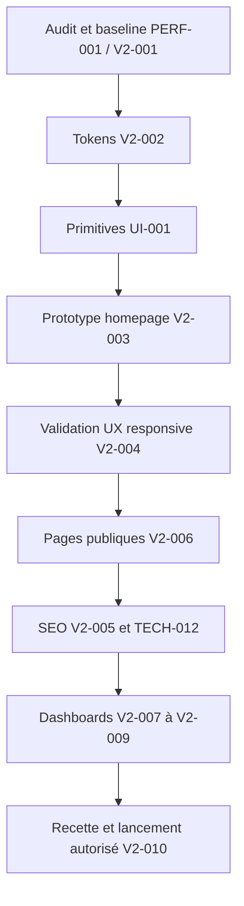

# SikaSchool — Design et frontend V2

> SikaSchool — Documentation de référence

**Last updated:** 2026-10-10
**Status:** Active
**Source of truth:** identité observée, exigences UX et proposition V2 ; aucun composant V2 n’a été implémenté.

## Navigation

[Product](./PRD.md) · [Architecture](./architecture.md) · [Rules](./Rules.md) · [Design](./design.md) · [Tasks](./tasks.md) · [Memory](./memory.md)

## 1. Identité actuelle et inventaire

Inspection du code/assets, sans recette visuelle navigateur de l'application. Header utilise `/images/logo/logo-light.svg` dans les deux thèmes ; `sika-light.svg` existe aussi. Les logos d'établissements présents ne prouvent aucun partenariat. Préserver le signe de marque ; vérifier lisibilité/contraste des variantes avant nouvelle composition.

Inter est chargé par next/font/google dans app/layout.tsx ; Caveat 600/700 par import CSS externe et .font-handwritten. Lucide n'est pas installé : SVG inline et assets constituent l'iconographie actuelle. Framer Motion anime beaucoup de sections, Lines comporte des animations infinies, Swiper gère des avis. next-themes supporte clair/sombre avec défaut light sur le public. Ne pas présenter responsive, contraste ou mouvement réduit comme déjà validés.

### Tokens réels extraits de app/globals.css

| Token existant         | Valeur déclarée                             |
| ---------------------- | ------------------------------------------- |
| `--font-inter`         | `Inter, sans-serif`                         |
| `--color-current`      | `currentColor`                              |
| `--color-transparent`  | `transparent`                               |
| `--color-stroke`       | `#eeeeee`                                   |
| `--color-strokedark`   | `#2d2f40`                                   |
| `--color-hoverdark`    | `#252a42`                                   |
| `--color-titlebg`      | `#adfff8`                                   |
| `--color-titlebg2`     | `#ffeac2`                                   |
| `--color-titlebgdark`  | `#46495a`                                   |
| `--color-btndark`      | `#292e45`                                   |
| `--color-white`        | `#ffffff`                                   |
| `--color-black`        | `#181c31`                                   |
| `--color-blackho`      | `#2c3149`                                   |
| `--color-blacksection` | `#1c2136`                                   |
| `--color-primary`      | `#006bff`                                   |
| `--color-primaryho`    | `#0063ec`                                   |
| `--color-meta`         | `#20c5a8`                                   |
| `--color-waterloo`     | `#757693`                                   |
| `--color-manatee`      | `#999aa1`                                   |
| `--color-alabaster`    | `#fbfbfb`                                   |
| `--color-zumthor`      | `#edf5ff`                                   |
| `--color-socialicon`   | `#d1d8e0`                                   |
| `--text-metatitle`     | `12px, 20px`                                |
| `--text-sectiontitle`  | `14px, 22px`                                |
| `--text-regular`       | `16px, 26px`                                |
| `--text-metatitle3`    | `18px, 26px`                                |
| `--text-metatitle2`    | `20px, 32px`                                |
| `--text-para2`         | `22px, 35px`                                |
| `--text-itemtitle`     | `26px, 32px`                                |
| `--text-itemtitle2`    | `24px, 32px`                                |
| `--text-hero`          | `44px, 58px`                                |
| `--text-sectiontitle3` | `44px, 55px`                                |
| `--text-sectiontitle2` | `40px, 52px`                                |
| `--text-sectiontitle4` | `34px, 48px`                                |
| `--container-c-1390`   | `86.875rem`                                 |
| `--container-c-1315`   | `82.188rem`                                 |
| `--container-c-1280`   | `80rem`                                     |
| `--container-c-1235`   | `77.188rem`                                 |
| `--container-c-1154`   | `72.125rem`                                 |
| `--container-c-1016`   | `63.5rem`                                   |
| `--shadow-solid-l`     | `0px 10px 120px 0px rgba(45, 74, 170, 0.1)` |
| `--shadow-solid-2`     | `0px 2px 10px rgba(122, 135, 167, 0.05)`    |
| `--shadow-solid-3`     | `0px 6px 90px rgba(8, 14, 40, 0.04)`        |
| `--shadow-solid-4`     | `0px 6px 90px rgba(8, 14, 40, 0.1)`         |
| `--shadow-solid-5`     | `0px 8px 24px rgba(45, 74, 170, 0.08)`      |
| `--shadow-solid-6`     | `0px 8px 24px rgba(10, 16, 35, 0.08)`       |
| `--shadow-solid-7`     | `0px 30px 50px rgba(45, 74, 170, 0.1)`      |
| `--shadow-solid-8`     | `0px 12px 120px rgba(45, 74, 170, 0.06)`    |
| `--shadow-solid-9`     | `0px 12px 30px rgba(45, 74, 170, 0.06)`     |
| `--shadow-solid-10`    | `0px 8px 30px rgba(45, 74, 170, 0.06)`      |
| `--shadow-solid-11`    | `0px 6px 20px rgba(45, 74, 170, 0.05)`      |
| `--shadow-solid-12`    | `0px 2px 10px rgba(0, 0, 0, 0.05)`          |
| `--shadow-solid-13`    | `0px 2px 19px rgba(0, 0, 0, 0.05)`          |

Ces valeurs sont des déclarations source : les tokens text à virgule hérités doivent être vérifiés en CSS calculé, pas interprétés comme une échelle V2 validée. Les couleurs hors tokens et classes arbitraires restent nombreuses.

| Conserver                                                     | Moderniser                                                             | Retirer après validation                                                                             | Concevoir                                                                                             |
| ------------------------------------------------------------- | ---------------------------------------------------------------------- | ---------------------------------------------------------------------------------------------------- | ----------------------------------------------------------------------------------------------------- |
| Logo, bleu #006bff, noir bleuté #181c31, tonalité pédagogique | Hiérarchie Inter, surfaces, cartes, espaces, navigation et formulaires | Faux calendrier, doubles modales, faux liens, contenu Solid, campagnes expirées, preuves sans source | Tokens sémantiques, primitives, profils publics consentis, parcours progressif, navigation dashboards |

## 2. Benchmark daté et limites

Consultation des pages publiques le 10 octobre 2026. Les observations portent sur contenu, navigation et architecture éditoriale accessibles par extraction Web. **Typographie exacte, animations, comportement responsive, focus, vitesse et tunnel complet non testés** chez ces références. Aucune performance commerciale déduite du design.

| Référence et source                           | Observation vérifiée                                                                        | Adaptation proposée SikaSchool                                                                                  |
| --------------------------------------------- | ------------------------------------------------------------------------------------------- | --------------------------------------------------------------------------------------------------------------- |
| [GoStudent](https://www.gostudent.org/fr-fr/) | Navigation matières/niveaux, explication en trois étapes, classe en ligne, CTA essai et FAQ | Expliquer avant réservation le déroulement et le rôle du tuteur ; ne reprendre ni chiffres ni promesses         |
| [Acadomia](https://www.acadomia.fr/)          | Entrées par niveau/matière, tarifs, conseil et modalités d'accompagnement                   | Arborescence SEO structurée et assistance identifiable ; éviter une navigation trop vaste pour l'offre actuelle |
| [Les Sherpas](https://sherpas.com/)           | Profils/approche personnalisée, méthode, application et accompagnement pédagogique          | Montrer les intervenants réels et comment le suivi est organisé ; ne pas copier leurs garanties                 |
| [Preply](https://preply.com/fr/)              | Entrée trouver un professeur, langues et profils, sélection langue/devise                   | Carte tuteur lisible et critères utiles, uniquement si sélection libre validée pour SikaSchool                  |
| [Wyzant](https://www.wyzant.com/)             | Recherche matière, choisir tuteur → objectifs → cours, témoignages contextualisés           | Réduire la charge avant réservation et contextualiser les avis autorisés                                        |
| [Superprof](https://www.superprof.fr/)        | Accès automatique refusé HTTP 405                                                           | TO_VERIFY : recherche et comparaison de professeurs à inspecter ultérieurement                                  |
| [Khan Academy](https://fr.khanacademy.org/)   | Aucun texte exploitable dans l'outil                                                        | TO_VERIFY : progression et pédagogie à inspecter ultérieurement                                                 |

Les références Dribbble/Medium fournies dans la demande donnent une intention (hero premium, profils de confiance, dashboards lisibles, design system). Les URLs de proxy d'images ne permettent pas ici d'attester la source ni les interactions : inspiration non vérifiée, aucune copie d'asset. Une planche visuelle originale et une recette responsive seront produites lors de V2-003.

## 3. Direction artistique proposée

**Premium, éducation, confiance, interface moderne et présence humaine.** Conserver le bleu de marque comme accent d'action, employer davantage de surfaces claires et d'espace, titres nets en Inter avec rythme éditorial et une touche Caveat réservée à une annotation pédagogique ponctuelle. Pas de nouvelle police requise à ce stade ; variante expressive éventuelle à comparer seulement si elle apporte lisibilité et personnalité.

Hero : une promesse compréhensible, deux actions hiérarchisées et un visuel authentique de tutorat autorisé ou une illustration pédagogique originale. Ne pas inventer de professeur, salle, note ou bilan client. Une composition asymétrique sur desktop peut devenir un ordre de lecture unique sur mobile. Les formes géométriques reprennent l'idée d'un cahier/repère pédagogique, sans décor permanent.

Surfaces blanches et bleu très pâle, dégradé subtil optionnel hors texte, bordures légères, ombre courte ; cartes aux mêmes rayons selon fonction. Une grille bento est utile pour expliquer des capacités distinctes, pas pour fragmenter un raisonnement ou masquer les prix. Les portraits réels soutiennent la confiance ; pas d'avatars stock présentés comme les auteurs des avis.

Micro-interactions de 120–200 ms, transform/opacity, feedback de clic et transitions d'étape sans déplacer le focus. Exclure glassmorphism massif, 3D gratuite, carrousels automatiques envahissants, animation en boucle et esthétique infantilisante. Dark mode conservé pour les espaces, déclinaisons marketing à valider avec les assets réels.

## 4. Design system V2 — PLANNED

### Tokens proposés, distincts de l'existant

| Usage / token proposé              | Clair                                                          | Sombre / règle                                                 |
| ---------------------------------- | -------------------------------------------------------------- | -------------------------------------------------------------- |
| action.primary                     | #006bff                                                        | Garder marque ; tester contraste et texte associé              |
| action.primary.hover               | #0063ec                                                        | Reprendre primaryho                                            |
| text.primary                       | #181c31                                                        | #ffffff                                                        |
| text.secondary                     | #46495a                                                        | #d1d8e0 ; vérifier contraste réel                              |
| surface.canvas / raised            | #fbfbfb / #ffffff                                              | #181c31 / #1c2136                                              |
| surface.accent                     | #edf5ff                                                        | Surface dérivée sombre à valider                               |
| border.subtle                      | #eeeeee                                                        | #2d2f40 ; pas seule limite d'un champ si contraste insuffisant |
| feedback.success / warning / error | #166534 / #92400e / #b91c1c, propositions                      | Icône + texte systématiques ; déclinaisons sombres à tester    |
| focus                              | 3 px primary, offset 3 px                                      | Contraste sur chaque surface, jamais masqué                    |
| spacing                            | 4, 8, 12, 16, 24, 32, 48, 64, 96 px                            | Même échelle, densité variable par usage                       |
| radius                             | 8 px contrôles, 16 px cartes, 24 px blocs majeurs, pill badges | Ne pas tout arrondir en pilule                                 |
| shadow.card                        | 0 8px 24px rgba(45,74,170,.08)                                 | Bordure privilégiée en sombre                                  |
| motion                             | 120 ms feedback, 200 ms transition, ease-out                   | Reduced motion : suppression déplacements/entrées              |

Bleu/texte blanc et états disabled doivent être mesurés, pas supposés AA. Les couleurs sémantiques proposées ne changent pas la palette de marque sans revue. Une couleur ne doit jamais être l'unique indication d'état.

### Typographie et grille

Proposition : H1 clamp(36px,5vw,60px), ligne 1.08 ; H2 28–40 px/1.2 ; H3 22–28 px/1.3 ; corps 16–18 px/1.6 ; label 14–16 px/1.4 ; meta 12–14 px, réservé aux détails secondaires. Poids 400/500/600/700, pas de capitales pour longs textes. Largeur de lecture 60–70ch, prix et chiffres tabulaires si disponibles.

Conteneur marketing max 1280 px, gutters 16/24/32 px ; sections verticales 48 mobile, 80–96 desktop. Grilles 1/2/3 colonnes selon contenu et largeur ; application plus dense avec navigation latérale desktop et accès mobile explicite. Breakpoints proposés compatibles Tailwind : 640, 768, 1024, 1280, 1536 px ; 320 px demeure le minimum de recette. Ne pas réduire le corps de texte pour faire rentrer une carte.

### Primitives, états et accessibilité

| Composant                   | Contrat visuel et interaction                                                                                                                                                    |
| --------------------------- | -------------------------------------------------------------------------------------------------------------------------------------------------------------------------------- |
| Button / Link               | primary, secondary, text, destructive ; hover contraste, active discret, focus visible, disabled explicite, loading avec texte conservé/aria-busy, error communiqué hors couleur |
| Field / Select / Textarea   | Label persistant, requis/facultatif, aide, erreur aria-describedby ; valeur conservée ; focus et disabled distincts ; form/submit natifs                                         |
| Dialog / Sheet              | Nom accessible, aria-modal, focus initial/piège/retour, Échap ; scroll interne mobile et action toujours accessible                                                              |
| Card / TutorCard / PlanCard | Ordre titre→détail→preuve→action ; même nature = même structure ; prix total/unitaire/durée/conditions                                                                           |
| Badge / Status              | Libellé lisible + couleur sémantique ; aucune ressemblance entre statut séance et statut paiement                                                                                |
| Navigation / Tabs           | aria-current ; lien versus bouton selon fonction ; menu mobile clavier ; tabs seulement pour panneaux locaux                                                                     |
| Alert / Toast               | Message actionnable, aria-live selon urgence, persistance suffisante ; pas seulement toast pour erreur financière                                                                |
| Skeleton / EmptyState       | Géométrie réservée ; vide explique raison et prochaine action ; retry après erreur ; pas de données fictives                                                                     |
| Calendar / Table            | Liste alternative mobile/clavier, date/fuseau clairs ; colonnes essentielles puis détail ; pas de défilement horizontal obligatoire pour action critique                         |

Icônes : conserver un petit vocabulaire SVG avec épaisseur et viewBox homogènes ; décoratives aria-hidden, boutons icône nommés. Les animations et accordéons respectent préférence de mouvement. Cibles visées 44×44 ; objectif AA selon [WCAG 2.2](https://www.w3.org/TR/WCAG22/). Focus Appearance est un critère AAA, ne pas le présenter comme obligation AA ; Focus Not Obscured (minimum), focus visible et target size minimum restent à vérifier.

## 5. Homepage V2 — architecture éditoriale

Proposition conditionnée aux contenus disponibles ; les sections sans preuve sont omises jusqu'à validation. CTA principal proposé « Réserver ma séance d'essai gratuite » uniquement si l'offre reste validée, secondaire « Voir les tarifs ». Pas de champ e-mail dans le hero.

| Section             | Objectif et message                                       | Informations / composants                                                     | Mobile / interactions                                           | SEO / accessibilité                                    | Hypothèse de conversion      |
| ------------------- | --------------------------------------------------------- | ----------------------------------------------------------------------------- | --------------------------------------------------------------- | ------------------------------------------------------ | ---------------------------- |
| Header              | Orienter : méthode, tarifs, tuteurs si publiés, connexion | Logo, nav, CTA unique                                                         | Menu simple, focus/Échap, action visible                        | nav nommé, liens réels/aria-current                    | Réduire hésitation           |
| Hero                | Expliquer cours en ligne et niveaux couverts              | Un H1 explicite, texte court, CTA, visuel autorisé                            | Texte puis visuel, aucun carrousel ; CTA vers contrôleur unique | H1 unique, alt utile ou vide                           | Compréhension immédiate      |
| Réassurance         | Expliquer ce qui est inclus, sans chiffre inventé         | 2–3 faits vérifiés, politique essai validée                                   | Ligne repliable, pas d'animation permanente                     | Liste sémantique, contraste                            | Lever objections initiales   |
| Niveaux et besoins  | Aider à se reconnaître                                    | Collège/lycée/supérieur confirmés, matières disponibles                       | Cartes lisibles sans swipe obligatoire                          | Liens vers pages utiles existantes/futures validées    | Orienter le bon public       |
| Fonctionnement      | Besoin → tuteur/créneau → cours et suivi                  | Trois étapes réelles, statut demande versus confirmation                      | Liste verticale, retour au CTA                                  | Liste ordonnée, intitulés concrets                     | Réduire incertitude          |
| Tuteurs / méthode   | Montrer qui accompagne et comment                         | Photos/droits, formations prouvées, sélection réelle, bilan exemple anonymisé | Cartes empilées, profil seulement si route disponible           | Titres, alt portrait, pas fausse certification         | Confiance dans l'intervenant |
| Tarifs              | Comparer séance/pack/abonnement                           | Catalogue exact, total EUR, durée, unité, conditions                          | Comparaison verticale ; détails sans cacher coût                | Tableau accessible ou cartes nommées                   | Éviter surprise au checkout  |
| Témoignages         | Donner un contexte réel                                   | Avis autorisés avec niveau/matière/date si consentis                          | Statique ou commande manuelle nommée                            | Aucun faux AggregateRating ; identité minimisée        | Réassurance vérifiable       |
| FAQ                 | Répondre aux objections concrètes                         | Essai, réservation, vidéo, annulation, paiement, suivi                        | Accordéon clavier, réponses courtes                             | Contenu rendu/indexable ; balisage seulement pertinent | Réduire friction finale      |
| CTA final et footer | Donner prochaine étape/support                            | Même CTA, contact délivrable, confidentialité, liens utiles                   | Footer en groupes simples, pas faux href                        | Landmarks et liens descriptifs                         | Continuité de parcours       |

Avantages/différenciation sont intégrés à méthode et réassurance pour éviter répétition. La campagne saisonnière devient une variante datée secondaire, sans dicter la structure. Contact sert l'aide, sans concurrencer la réservation. Aucun gain chiffré de conversion n'est promis ; mesurer clics, abandon et compréhension.

## 6. Pages publiques et architecture SEO proposée

Inventaire actuel : `/`, `/about`, `/how-to`, `/packs`, `/book-online`, `/booking`, `/support`, `/donnees-personnelles`, `/error`, `/auth/signin`, `/auth/signup`, `/auth/reset-password`, `/auth/verify-email`. Pages privées listées dans architecture/PRD ; aucune page publique matière ou profil tuteur dédiée trouvée.

| Route existante        | Évolution proposée                                                                                  |
| ---------------------- | --------------------------------------------------------------------------------------------------- |
| /about                 | Équipe réelle, mission et méthode de sélection prouvée ; portraits authentiques                     |
| /how-to                | Parcours en trois étapes, exigences vidéo et suivi, FAQ opérationnelle                              |
| /packs et /book-online | Comparaison cohérente, catalogue unique présenté clairement ; conserver IDs checkout                |
| /booking               | Retirer mock ou connecter au vrai parcours après TECH-003, pas de V2 fondée sur fausse confirmation |
| /support               | Besoin d'assistance, champs minimaux, erreurs et consentement explicites                            |
| /donnees-personnelles  | Actualiser selon traitements réels et validation responsable, sans inventer politique               |
| /auth/* et /error      | Labels, récupération, états et vocabulaire de marque ; hors acquisition SEO                         |

Pages futures **DECISION_REQUIRED** : hub `/cours-particuliers`, `/soutien-scolaire` seulement si intention distincte, enfants `/cours-particuliers/mathematiques`, `/francais`, `/physique-chimie`, `/anglais` ; `/niveaux/college`, `/lycee`, `/superieur` ; primaire uniquement si offre validée ; `/preparation-examens`, `/methodologie`, `/tuteurs/[slug]` selon contenu/consentement. Aucun chemin créé. Éviter un produit cartésien matière × niveau × ville sans contenu ni offre différenciée.

## 7. Dashboards V2

| Espace | Hiérarchie proposée                                                              | Limites à préserver/résoudre                                                                 |
| ------ | -------------------------------------------------------------------------------- | -------------------------------------------------------------------------------------------- |
| Élève  | Prochaine séance/action rejoindre, demandes, bilan récent, messages, crédits, AI | Ne pas promettre crédit consommable tant que TECH-019 non validé                             |
| Parent | Identité de l'élève effectif visible, agenda, progrès, paiement, communication   | Pas de sélecteur multi-enfants avant arbitrage et backend ; sécurité propre au compte parent |
| Tuteur | Demandes à traiter, agenda, élèves, bilans à rédiger, revenus, messages          | Ne pas transformer is_available en planning hebdomadaire fictif                              |
| Admin  | Alertes/opérations, utilisateurs, assignations, séances, avis, finances          | Actions destructrices explicites, privilèges vérifiés au serveur                             |

Socle commun : PageHeader, cartes séance, filtres, états vides, notifications, navigation active ; densité application distincte du marketing. Mobile : actions prioritaires accessibles, liste agenda alternative, détail de facture séparé, panneau messages lisible avec clavier virtuel ; classe vidéo priorité à média/permissions plutôt qu'animations. AI doit distinguer réponse en cours, échec et contenu potentiellement erroné.

## 8. SEO technique et éditorial

Constats : metadata par page présentes, head hérité pointe `.com` alors que README cite `.app`, pas de metadataBase/canonical/sitemap.ts/robots.ts identifiés. TECH-012 nécessite domaine officiel puis redirections permanentes, URLs absolues OG/canonical, index des seules pages publiques canoniques et exclusion des espaces sensibles. Le domaine du topic Mercure n'est pas à changer automatiquement avec une canonical marketing.

Stratégie proposée : une intention principale par page ; titre précis (« Cours particuliers de mathématiques en ligne | SikaSchool », exemple non publié), description factuelle sur niveau/méthode/offre réelle, H1 distinct, liens matière↔niveau↔méthode↔tarifs. Ressources pédagogiques originales relues par un tuteur, date/propriétaire de contenu, pas de pages générées pauvres. Définir langues/URLs réellement maintenues avant hreflang ; FR/EN localStorage seul ne suffit pas.

Schema.org : Organization et Service selon données réelles, BreadcrumbList pour vraie hiérarchie ; Person pour profils publics validés. Ne pas créer faux Review/AggregateRating ou promettre un résultat enrichi FAQ. Une FAQ utile est d'abord du contenu visible ; valider l'éligibilité actuelle avant tout balisage. Les données structurées doivent correspondre au contenu public ; [Google Search Central](https://developers.google.com/search/docs/appearance/structured-data/intro-structured-data).

Mesurer indexation, pages concurrentes, couverture, erreurs et trafic qualifié ; aucun classement Google garanti. Les ancres et URLs existantes doivent avoir une table de redirection avant remplacement. Les intentions proposées ne remplacent pas une recherche de demande réelle (V2-005).

## 9. Budgets frontend — objectifs V2, aucune mesure actuelle

| Mesure                    | Objectif proposé                                                             | Validation                                                    |
| ------------------------- | ---------------------------------------------------------------------------- | ------------------------------------------------------------- |
| LCP                       | ≤ 2,5 s au p75 mobile                                                        | RUM si disponible ; Lighthouse labo séparé                    |
| INP                       | ≤ 200 ms au p75                                                              | Interactions réelles réservation/menu/formulaire              |
| CLS                       | ≤ 0,1 au p75                                                                 | Images, fonts, skeletons et avis réservant leur espace        |
| JavaScript public initial | ≤ 200 KiB gzip, budget de départ à confronter à baseline                     | Build/analyse réseau, par route, distinguer code tiers        |
| Images hero               | ≤ 200 KiB ressource matricielle, formats responsives ; SVG évalué séparément | Contrôler ressource LCP et tailles téléchargées               |
| Polices                   | ≤ 100 KiB transférés sur entrée publique                                     | Réutiliser Inter, limiter graisses et dépendance Caveat       |
| Hydratation               | Pas de nouveau use client sur section purement statique                      | Revue composants + traces CPU ; budget chiffré après baseline |
| Animation                 | 120–200 ms ; aucune boucle décorative nécessaire                             | Reduced motion, main thread et appareils modestes             |
| Accessibilité             | WCAG 2.2 AA visée, aucun blocage clavier sur parcours critique               | Revue manuelle + outil lors d'une future mission équipée      |

Les seuils CWV suivent [Web Vitals](https://web.dev/articles/vitals), les budgets d'assets sont des propositions internes. Recette à 320/375/390/430, 768, 1024, 1440 px, zoom 200 %, clair/sombre, tactile/clavier, réseau lent. Une bonne note Lighthouse ne prouve pas l'expérience au p75.

## 10. Conversion, confiance et mesure

Chaque promesse doit avoir source, date, définition et responsable métier ; avis/portrait doit avoir consentement/droits. Expliquer prix total, nombre/durée des séances, renouvellement et règles validées avant paiement. Dire « demande enregistrée » lorsque PENDING, pas « cours confirmé ». Les signaux de sécurité doivent décrire des mécanismes réels, sans badge de certification inventé.

Événements envisagés : homepage_view, booking_cta_click, booking_started, level_selected, subject_selected, slot_selected, contact_completed, booking_completed, checkout_started, payment_completed. Ne pas inclure e-mail, téléphone ou copie d'exercice ; consentement et rétention à définir avant fournisseur. TECH-011 détient l'instrumentation ; tests qualitatifs proposés avec environ cinq utilisateurs représentatifs, sans prétendre à une validité statistique. Tarifs transparents et reprise après erreur précèdent l'optimisation d'A/B tests.

## 11. Migration progressive

Le prototype peut être conçu pendant la préparation des P0 ; aucune mise en production V2 avant sécurisation des parcours critiques. Migration par page sur branche séparée, contrats inchangés, captures comparatives et retour arrière possible. Prochaine étape concrète de conception : baseline et inventaire d'écrans, puis planche tokens + wireframes homepage mobile/desktop et revue du contenu prouvé. Aucun code frontend V2 livré ici.

## 12. Constats UX historiques conservés et actualisés

UX-001 : double modale confirmé. UX-002 : trois représentations d'offre et réduction non dérivée, conditions manquantes. UX-003 : coordonnées nombreuses avant créneau et soumission onClick. UX-004 : ordre actuel commence bien par Hero puis Testimonial, contrairement à l'ancienne roadmap ; pas de section tuteurs structurée. UX-005 : chiffres 5+/200+/95 % sans preuve interne fournie, avatars Pexels à ne pas assimiler aux auteurs. UX-006 : glossaire et liens footer à harmoniser.

UI-001 : tokens présents mais boutons/cartes non mutualisés. A11Y-001 : main imbriqués confirmés ; l'affirmation historique « LeadCaptureModal sans piège de focus » est obsolète (focus/Échap/restauration présents), leur robustesse avec double modale reste à recetter. A11Y-002 : erreurs, skeletons et mouvement réduit à unifier ; page error héritée. PERF-001 : baseline absente, sections client et images externes à mesurer. Tous les critères historiques et 50 items de l'ancienne feuille UX sont fusionnés dans tasks avec alias traçables.
