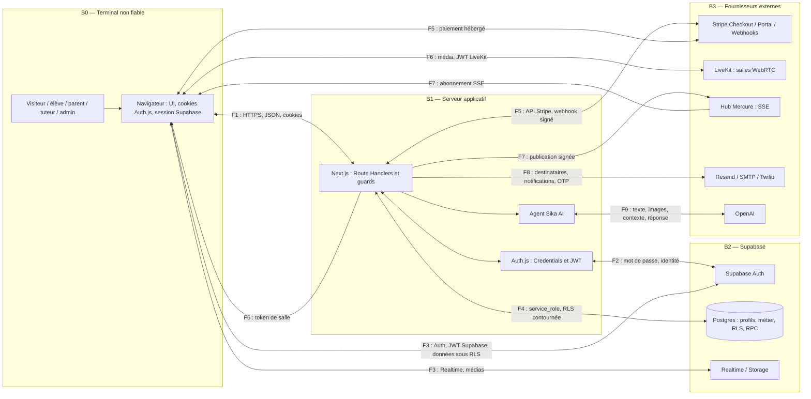

# Roadmap SikaSchool

**Mise à jour documentaire : 16 novembre 2026.** Cette roadmap regroupe les
priorités, les tâches et l'analyse STRIDE. Chaque tâche possède un seul
emplacement et conserve son identifiant, son état et ses critères d'acceptation.
La priorité P0/P1/P2 détermine l'ordre d'exécution ; les phases organisent les
thèmes. Les résultats historiques ne prouvent pas l'état de production.

## Priorités et navigation

| Ordre | Lot | Tâches de référence | Responsable pressenti, à confirmer |
| --- | --- | --- | --- |
| P0 — accès | Fermer les accès tiers à la messagerie et aux données familiales | [TECH-006](#tech-006) — TM-01, TM-02 | Backend/Auth et produit famille |
| P0 — intégrité | Protéger les transitions de séances et les profils existants | [TECH-014](#tech-014), [TECH-013](#tech-013) — TM-03, TM-04 | Backend et opérateur |
| P0 — identité/réservation | Imposer le MFA et réserver avec une identité vérifiée, sans course concurrente | [TECH-015](#tech-015), [TECH-003](#tech-003), [SK-011](#sk-011) — TM-05, TM-06 | Backend/Auth et produit réservation |
| P0 — continuité | Finaliser les paiements, la disponibilité et les autres blocages de parcours | [SK-001](#sk-001), [SK-008](#sk-008), [SK-003](#sk-003), [TECH-007](#tech-007) | Backend, plateforme et finance/produit |
| P1 — durcissement | Révocation des sessions, quotas, flux IA/médias, traces et chaîne de livraison | [TECH-006](#tech-006), [TECH-015](#tech-015), [TECH-016](#tech-016), [TECH-011](#tech-011), [TECH-010](#tech-010) | Backend et plateforme ; produit/données pour la conservation |
| Selon priorité du ticket | UX, accessibilité, design system, architecture et acquisition | Phases 1 à 6 et [demandes produit](#backlog-complémentaire-sikaschool--demandes-du-17-octobre-2026) | Responsables produit/design/tech à attribuer |

L'analyse conserve **22 menaces ouvertes : 6 P0, 12 P1 et 4 P2**, cotées sur le
code de la révision `8c6ccc3`. Aucun risque n'est réputé accepté ni corrigé par
cette réorganisation. TECH-001 et TECH-002 restent clos sur leur périmètre livré.

- [Matrice impact / effort](#matrice-impact--effort) — vue d'ensemble, identifiants cliquables vers chaque tâche.
- [Corrections critiques](#phase-0--corrections-critiques) — accès, identité et intégrité en premier.
- [Tests, CI et observabilité](#phase-6--tests-ci-et-observabilité) — preuves et suivi.
- [Analyse STRIDE intégrée](#analyse-stride) — méthode, diagramme, registre, preuves et validation dans des sections dépliables.
- [Risques de régression](#risques-de-régression) et [Definition of Done](#definition-of-done) — conditions de clôture.
- [Historique](#historique-documentaire) — lots et décisions antérieurs conservés à part de la lecture opérationnelle.

## Règles de suivi et sources

- Une case n'est cochée que sur une preuve vérifiable ; propriétaire et date restent à attribuer pour les risques ouverts.
- Les demandes SK complètent les tâches techniques ; leurs dépendances évitent de créer un second chantier pour le même changement.
- Les décisions commerciales, légales, de conservation et de campagne restent à valider par leurs responsables ; documenter un parcours ne vaut pas publication ni dépense autorisée.
- Pour clore une menace, consigner le commit ou la migration, les tests, l'environnement, le risque résiduel et la décision du responsable dans le ticket concerné.

| Besoin | Référence |
| --- | --- |
| Priorités, actions et modèle de menaces courant | Cette roadmap, dont [STRIDE](#analyse-stride) |
| Identité visuelle à appliquer, logo existant conservé | [Charte officielle V2](BRAND_IDENTITY_V2.md) |
| Constat UX et audit technique historiques | [UX_UI_AUDIT.md](UX_UI_AUDIT.md), [TECHNICAL_AUDIT.md](TECHNICAL_AUDIT.md) |
| Justification des patterns et carte des acteurs/états | [DESIGN_PATTERNS.md](DESIGN_PATTERNS.md), [WORKFLOWS.md](WORKFLOWS.md) |
| Recettes déjà réalisées et limites | [Lot du 14 novembre](ROADMAP_VERIFICATION_2026-11-14.md), [recette V2](BRAND_V2_VERIFICATION.md) |

## Matrice impact / effort

| ID | Amélioration | Impact | Effort | Risque | Priorité |
| --- | --- | ---: | ---: | ---: | --- |
| [TECH-001](#tech-001) | Supprimer la réinitialisation de mot de passe par lead | High | Medium | High | P0 |
| [TECH-002](#tech-002) | Idempotence et transaction des crédits Stripe | High | High | High | P0 |
| [TECH-003](#tech-003) | Sécuriser la réservation publique | High | Medium | High | P0 |
| [TECH-006](#tech-006) | Autoriser chaque ressource et prouver les liens familiaux | High | High | High | P0 |
| [TECH-013](#tech-013) | Isoler le lead des profils existants | High | Medium | High | P0 |
| [TECH-014](#tech-014) | Protéger les transitions globales de séances | High | Medium | High | P0 |
| [TECH-015](#tech-015) | Imposer le second facteur à toute émission de session | High | High | High | P0 |
| [TECH-016](#tech-016) | Borner les abus et protéger les flux IA/médias | High | High | High | P1 |
| [UX-001](#ux-001) | Unifier l'ouverture de la modale de réservation | High | Low | Medium | P0 |
| [A11Y-001](#a11y-001) | Landmarks et modales accessibles | High | Medium | Medium | P0 |
| [UX-002](#ux-002) | Tarifs exacts, comparables et conditions | High | Medium | Medium | P0 |
| [UX-003](#ux-003) | Réservation progressive et formulaires | High | High | Medium | P0 |
| [TECH-007](#tech-007) | Mettre à niveau les vulnérabilités critiques | High | Medium | Medium | P0 |
| [TECH-008](#tech-008) | Remplacer le calendrier mock | High | Medium | Medium | P1 |
| [UX-004](#ux-004) | Réordonner la homepage | High | Medium | Low | P1 |
| [UX-005](#ux-005) | Prouver contenus, tuteurs et chiffres | High | Medium | Low | P1 |
| [UX-006](#ux-006) | Normaliser navigation et liens | Medium | Low | Low | P1 |
| [UI-001](#ui-001) | Fondations V2 et primitives du design system | High | High | Medium | P0 |
| [A11Y-002](#a11y-002) | États, erreurs et mouvement réduit | Medium | Medium | Low | P1 |
| [TECH-004](#tech-004) | Services et extraction des écrans monolithiques | High | High | Medium | P1 |
| [TECH-005](#tech-005) | Contrats Zod/DTO/erreurs | High | Medium | Medium | P1 |
| [TECH-010](#tech-010) | Tests, CI, env et types DB | High | High | Low | P1 |
| [TECH-009](#tech-009) | Hydratation/fetch/cache | Medium | Medium | Medium | P2 |
| [TECH-011](#tech-011) | Observabilité et funnel | Medium | Medium | Low | P2 |
| [TECH-012](#tech-012) | SEO et domaine canonique | Medium | Low | Low | P2 |
| [PERF-001](#perf-001) | Baseline et budgets Core Web Vitals | Medium | Medium | Low | P2 |
| [SK-001](#sk-001) | Finaliser Stripe et sa recette globale (atomicité : TECH-002) | High | High | High | P0 |
| [SK-002](#sk-002) | Homogénéiser les statuts français | Medium | Medium | Medium | P1 |
| [SK-003](#sk-003) | Diagnostiquer et corriger la 404 depuis un tuteur | High | Medium | High | P0 |
| [SK-004](#sk-004) | Préparer les futurs stages et les accès sociaux | High | Medium | Medium | P1 |
| [SK-005](#sk-005) | Produire la vidéo des stages | Medium | Medium | Medium | P2 |
| [SK-006](#sk-006) | Actualiser et recetter le site | High | High | Medium | P1 |
| [SK-007](#sk-007) | Planifier YouTube Ads sans lancement automatique | Medium | Medium | High | P2 |
| [SK-008](#sk-008) | Surveiller la disponibilité DB et préparer la reprise | High | Medium | High | P0 |
| [SK-009](#sk-009) | Préparer une future offre de rentrée -15 % | High | Medium | High | P1 |
| [SK-010](#sk-010) | Préparer le carrousel Canva de rentrée | Medium | Low | Medium | P2 |
| [SK-011](#sk-011) | Permettre le choix différé sécurisé du premier créneau | High | High | High | P0 |

## Phase 0 — Corrections critiques

Les accès non autorisés et les mutations publiques sont traités avant les autres
chantiers. Les réalisations déjà prouvées figurent en fin de phase ; leurs preuves
datées sont conservées dans l'[historique](#historique-documentaire).

- [ ] **[P0][SECURITY][ARCH][TECH-006] Centraliser les guards et vérifier les droits sur chaque ressource**
  - Impact : élevé ; Effort : élevé ; Risque : élevé
  - Dépendances : matrice permissions validée
  - Fichiers concernés : `auth.ts`, `lib/{auth,admin-permissions,student-access}.ts`, `app/api/**`
  - Travail : supprimer liste e-mails admin, guards cohérents, ownership au niveau service.
  - Lot du 14 novembre : suppression des deux exceptions d'e-mail administrateur ; contrôle du rôle `ADMIN` persisté et du profil actif à chaque session serveur, lecture bornée à 5 s. Matrice négative des guards/Checkout/sonde et révocation immédiate vérifiées au navigateur. Aucun compte existant n'a été promu ; les anciens tuteurs admis par e-mail doivent recevoir un rôle explicite s'ils doivent administrer. L'inventaire d'ownership de tous les services reste ouvert.
  - Analyse STRIDE du 16 novembre : TM-01/TM-02 justifient P0. Les routes de messagerie tuteur prennent l'identité du client sans session ; le rattachement parent-élève repose sur l'e-mail seul. Étendre le traitement aux risques TM-07/TM-10/TM-11/TM-12/TM-13/TM-22 : révocation Auth.js et Supabase, séparation serveur/service role, CSRF, topics privés et droits de salle/médias. Les constats et recettes sont dans l'[analyse STRIDE](#analyse-stride).
  - Critères d'acceptation :
    - [x] Privilèges administrateur uniquement issus du rôle persisté ; exceptions d'e-mail supprimées et révocation d'un JWT ADMIN existant vérifiée.
    - [ ] Matrice rôle × action couverte par tests négatifs.
    - [ ] Chaque méthode de messagerie refuse visiteur et tiers avant tout effet ; identité d'expéditeur issue de la session, participation prouvée et aucune mutation dans GET.
    - [ ] Rattachement familial approuvé par preuve ou validation autorisée, atomique, non usurpable par connaissance d'e-mail et sans effacement d'un ancien lien sur échec.
    - [ ] Reset/désactivation révoquent les accès sensibles dans les deux systèmes de session ; Origin/CSRF, SSE tiers, grants/RLS et accès LiveKit hors statut/horaire sont recettés.

- [ ] **[P0][SECURITY][TECH-013] Isoler les leads des modifications de comptes existants**
  - Impact : élevé ; Effort : moyen ; Risque : élevé
  - Menace : [TM-04](#tm-04--lead-anonyme-modifiant-un-compte-existant) ; complément de TECH-001, dont la suppression du reset par lead reste acquise.
  - Fichiers concernés : `app/api/leads/route.ts`, `lib/user-management.ts`, tests lead
  - Travail : conserver l'intake dans une demande distincte ; exiger preuve de possession et autorisation avant modification du profil ou des données élève ; réponse publique générique.
  - Critères d'acceptation :
    - [ ] Un lead anonyme ne modifie aucune donnée d'un compte existant, quel que soit son rôle ou son état actif.
    - [ ] Création de lead, compte existant et récupération sont testés séparément sans fuite de mot de passe ni régression de TECH-001.

- [ ] **[P0][SECURITY][TECH-014] Authentifier et borner les transitions globales de séances**
  - Impact : élevé ; Effort : moyen ; Risque : élevé
  - Menace : [TM-03](#tm-03--tâche-globale-de-séances-accessible-au-public).
  - Fichiers concernés : `app/api/sessions/update-status/route.ts`, futur service de transitions, tests négatifs et concurrence
  - Travail : réserver la tâche à un job authentifié ou une action admin définie ; transitions métier explicites, mises à jour conditionnelles, lots bornés et traces serveur.
  - Critères d'acceptation :
    - [ ] Appel anonyme ou utilisateur ordinaire : 401/403 et aucun accès métier privilégié ni effet secondaire.
    - [ ] Une séance en attente ne devient pas acceptée implicitement ; horaire/statut et concurrence de deux workers sont testés.

- [ ] **[P0][SECURITY][TECH-015] Imposer et sécuriser le second facteur à chaque émission de session**
  - Impact : élevé ; Effort : élevé ; Risque : élevé
  - Menaces : [TM-06](#tm-06--second-facteur-absent-du-fournisseur-credentials), TM-08 ; coordination TECH-006 pour les deux systèmes de session.
  - Fichiers concernés : `auth.ts`, `app/api/auth/**`, `lib/sms-2fa.ts`, routes `profile/2fa`, flux navigateur Supabase
  - Travail : contrôle MFA au point d'émission de session, preuve de challenge non falsifiable et consommation atomique ; OTP cryptographique, secret obligatoire, limite d'essais/envois, réauthentification pour désactiver ou remplacer le facteur.
  - Critères d'acceptation :
    - [ ] Callback Auth.js direct et login personnalisé sans OTP valide ne créent aucune session pleinement autorisée si MFA activé ; expiration, replay et concurrence testés.
    - [ ] Le niveau d'assurance requis est défini et vérifié sur le flux Supabase direct ; changer/désactiver le facteur exige une preuve récente et ne laisse pas un chemin de contournement.

- [ ] **[P0][SECURITY][TECH-003] Lier la réservation gratuite à un token vérifié et empêcher le double booking**
  - Impact : élevé
  - Effort : moyen
  - Risque : élevé
  - Dépendances : TECH-001, politique de vérification e-mail et limitation de débit
  - Fichiers concernés : `app/api/leads/**`, `components/Booking/LeadCaptureModal.tsx`, migration sessions/holds si retenue
  - Travail : token opaque court, rate limit IP/e-mail, verrou/contrainte transactionnelle de créneau, réponse 409 récupérable.
  - Critères d'acceptation :
    - [ ] Une personne ne réserve pas pour une autre via son e-mail.
    - [ ] Deux demandes simultanées ne créent jamais deux séances identiques.

- [ ] **[P0][SECURITY][DX][TECH-007] Réduire les vulnérabilités critiques et aligner les en-têtes documentés**
  - Impact : élevé
  - Effort : moyen
  - Risque : moyen
  - Dépendances : environnement de preview/build pour les mises à jour majeures
  - Fichiers concernés : `package.json`, `package-lock.json`, `next.config.js`, `SECURITY.md`
  - Travail : mise à jour compatible prioritaire de Next.js, audit des alertes restantes, tests de régression, inventaire CSP/HSTS.
  - Lot du 14 novembre : Next.js et ESLint config 16.4.6, Zod 4.6.6, correctifs transitifs compatibles. Dernier audit : 0 critique, 3 hautes (Nodemailer et sa chaîne de dépendances Auth.js), 7 modérées (outils de développement). `SECURITY.md` décrit les en-têtes configurés et l'absence de CSP/HSTS versionnés ; vérification en production encore nécessaire.
  - Critères d'acceptation :
    - [x] Aucune vulnérabilité critique connue ne reste dans le lockfile validé (audit npm du 14 novembre, build et régressions locaux).
    - [ ] `SECURITY.md` décrit les en-têtes réellement déployés.

- [ ] **[P0][A11Y][A11Y-001] Corriger landmarks, skip link et dialogs**
  - Impact : élevé
  - Effort : moyen
  - Risque : moyen
  - Dépendances : UX-001
  - Fichiers concernés : `app/(site)/layout.tsx`, pages publiques, `components/Accessibility/SkipLink.tsx`, `components/Booking/**Modal.tsx`
  - Travail : un seul main, cible de skip link focalisable, dialog standard avec focus trap/Échap/retour focus/titre annoncé.
  - Lot UX/UI : `Common/Dialog` natif partagé par réservation, choix du tuteur et menu mobile ; arrière-plan inerte via la top layer, piège Tab/Maj+Tab, défilement mobile et retour focus. Landmarks publics conservés. Le choix du tuteur est un composant historique non monté dans le parcours actuel ; son contrôle est statique, celui du composant partagé est exécuté au navigateur.
  - Lot du 14 novembre : récupération du mot de passe, alertes et confirmations migrées vers ce dialog partagé, titres/descriptions associés, Échap et focus testés ; captures mobile/desktop et clair/sombre. La recette lecteur d'écran reste ouverte.
  - Critères d'acceptation :
    - [x] Aucun focus n'atteint l'arrière-plan des modales publiques testées (réservation et menu mobile) ; le choix du tuteur utilise la même primitive.
    - [ ] La navigation par landmarks/titres est valide au lecteur d'écran.

- [ ] **[P0][UX][UI][UX-002] Rendre prix, économie et conditions comparables**
  - Impact : élevé
  - Effort : moyen
  - Risque : moyen
  - Dépendances : validation commerciale et juridique des conditions
  - Fichiers concernés : `components/{Pricing,Packs,BookOnline}/**`, `lib/{payments-catalog,stripe}.ts`, FAQ/légal
  - Travail : une présentation de plan unique ; afficher TTC, durée, prix/séance, économie dérivée ; distinguer pack/abonnement/séance.
  - Lot UX/UI : `PlanCard` commun à accueil/packs/séances, TTC et économie en euros dérivée du tarif unitaire du même niveau. `lib/stripe.ts` construit ses offres depuis `CLIENT_PLANS` sans changement de montants/IDs. Les assertions « Sans engagement » non définies sont retirées des cartes. Erreur Checkout visible et réessayable, retour de connexion vers la page d’origine.
  - Critères d'acceptation :
    - [x] Les prix publics et les `price_data` du Checkout proviennent du même catalogue ; test de non-régression. La configuration réelle du compte Stripe reste à recetter dans SK-001.
    - [ ] « Sans engagement », validité et annulation sont définis avant paiement.

### Réalisations vérifiées sur leur périmètre

- [x] **[P0][SECURITY][TECH-001] Supprimer toute réinitialisation de mot de passe déclenchée par un lead**
  - Impact : élevé
  - Effort : moyen
  - Risque : élevé
  - Dépendances : décision de création de compte (lien de définition de mot de passe ou compte après essai)
  - Fichiers concernés : `app/api/leads/route.ts`, `components/Booking/LeadCaptureModal.tsx`, `lib/registration-emails.ts`
  - Travail : séparer lead, compte existant et récupération de mot de passe ; rendre les réponses non-énumérantes ; supprimer `initialPassword` et le mot de passe prévisible.
  - Critères d'acceptation :
    - [x] Aucune réponse/log/e-mail ne contient un mot de passe généré.
    - [x] Un lead ne peut pas modifier le rôle ni le mot de passe d'un compte existant.

- [x] **[P0][SECURITY][TECH-002] Rendre l'attribution de crédits Stripe atomique et idempotente**
  - Impact : élevé
  - Effort : élevé
  - Risque : élevé
  - Dépendances : migration SQL/RPC et stratégie de réconciliation
  - Fichiers concernés : `app/api/webhooks/stripe/route.ts`, `supabase/migrations/**`, `docs/workflows/04-payments.md`
  - Travail : ajouter référence unique d'événement au ledger, transactionner paiement/ledger/solde et faire retourner le chemin déjà appliqué.
  - Réalisé le 14 novembre : RPC `apply_stripe_payment` invoker réservée au service role, unicité événement/source/facture, verrou transactionnel et incrément SQL atomique. Paiement/ledger/solde sont annulés ensemble en cas d'erreur ; le webhook renvoie 500 pour retry. Paiements différés crédités seulement après règlement ; première facture d'abonnement comptabilisée une fois. Les paiements historiques sans référence fiable sont bloqués pour réconciliation documentée.
  - Critères d'acceptation :
    - [x] Un replay d'événement ne crédite pas deux fois : 12 replays concurrents et 2 événements distincts d'une même facture testés sur PostgreSQL local.
    - [x] Les totaux correspondent au ledger après concurrence et retry : 10 achats distincts concurrents, rollback forcé après écritures et relance réussie, fixtures nettoyées.

- [x] **[P0][UX][A11Y][UX-001] Donner un unique propriétaire à la modale de réservation**
  - Impact : élevé
  - Effort : faible
  - Risque : moyen
  - Dépendances : aucune
  - Fichiers concernés : `components/Hero/index.tsx`, `app/(site)/ClientProviders.tsx`, `components/Header/index.tsx`, `components/StagePromo/index.tsx`
  - Travail : retirer l'instance doublée, remplacer l'événement DOM par une action typée et tester les sources CTA.
  - Réalisé localement le 20 octobre : un seul `LeadCaptureModal` dans `ClientProviders`, `BookingContext/useBooking`, transmission matière/e-mail/campagne ; `lead:open` reste un adaptateur de compatibilité.
  - Critères d'acceptation :
    - [x] Une seule instance de modale et de formulaire est rendue pour les cinq entrées testées ; aucune soumission doublée possible par duplication du composant.
    - [x] Le focus revient au lanceur desktop ou au bouton du menu mobile lorsque son CTA disparaît. Recette Chromium dans `BRAND_V2_VERIFICATION.md` ; aucune écriture backend effectuée.

## Phase 1 — UX et conversion

- [ ] **[P1][UX][WORKFLOW][UX-003] Recomposer le parcours de réservation par étapes**
  - Impact : élevé ; Effort : élevé ; Risque : moyen
  - Dépendances : TECH-001 à TECH-003, UX-001
  - Fichiers concernés : `components/Booking/LeadCaptureModal.tsx`, `app/api/leads/**`
  - Travail : niveau → matière → créneau → coordonnées minimales → confirmation ; états réessayables et valeurs conservées.
  - Lot UX/UI (partiel) : besoins → coordonnées → créneau selon le contrat actuel du backend ; formulaire natif, groupes annoncés, focus sur le titre, validations et erreurs conservant la saisie. Indicatif pays natif, retry des créneaux, état vide, conflit 409 et demande en attente clairement distincte d’une confirmation tuteur. FR/EN et contrats `PARENT`/`STUDENT` simulés au navigateur. L’ordre cible, le token vérifié TECH-003 et la reprise sécurisée restent à traiter avant de solder le ticket.
  - Critères d'acceptation :
    - [x] Chaque étape de l’interface actuelle est annoncée et exploitable au clavier/mobile (recette navigateur).
    - [x] Une erreur n’efface pas les choix antérieurs ; retour arrière et fermeture/réouverture conservent le brouillon pendant la session.

- [ ] **[P1][UX][UI][UX-004] Réorganiser la homepage autour de la décision**
  - Impact : élevé ; Effort : moyen ; Risque : faible
  - Dépendances : contenus tuteurs/preuves approuvés, analytics baseline
  - Fichiers concernés : `app/(site)/page.tsx`, sections homepage
  - Travail : Hero → réassurance → avis → fonctionnement → signature → tuteurs → tarifs → FAQ/contact → CTA final ; campagne isolée/configurable.
  - Réalisé localement le 20 octobre : composition V2, matières accessibles depuis le catalogue réel, trois étapes conformes au formulaire actuel, signature éditoriale, équipe et avis existants, CTA réels ; promotion périmée retirée de la homepage.
  - Lot V2.1 du 21 octobre : service et niveaux explicites dans le Hero, accompagnement adapté aux besoins, essai gratuit et hiérarchie CTA ; `Reassurance` factuelle, ordre narratif demandé réellement appliqué, alternance blanc/neutre/bleu et ancres header/footer synchronisées. Les quatre premières matières disponibles sont des raccourcis, sans affirmation de popularité ; toutes les autres restent accessibles. Une seule valeur radio est transmise à `useBooking`, avec choix différé autorisé.
  - Recette V2.1 :
    - [x] Un H1, offre/niveaux/essai visibles, CTA de réservation distinct du lien vers les tarifs, FR/EN.
    - [x] Dix sections dans l’ordre cible, sans duplication ; quatre ancres desktop/mobile et état actif cohérents.
    - [x] Sept largeurs 320/375/390/430/768/1024/1440 px, clair/sombre et FR/EN, sans défilement horizontal ; zoom 200 %.
    - [x] Réservation depuis Hero, matière, header, CTA final et menu mobile : modale unique, préremplissage, Échap et retour du focus.
    - [ ] Évaluer la compréhension et la conversion auprès des familles ; aucune hausse de conversion mesurée à ce stade.
  - Critères d'acceptation :
    - [x] Chaque section a un objectif clair et ne concurrence pas le CTA primaire, vérifié visuellement sur la V2.1 ; son effet sur la conversion reste à mesurer.
    - [x] Menu/ancres suivent l’ordre réel V2.1 : fonctionnement → équipe → avis → tarifs, état actif synchronisé au scroll et ancres sous le header. L’ordre V2 antérieur était avis → fonctionnement → équipe → tarifs.
  - Campagnes : configuration centralisée dans `lib/campaigns.ts`, désactivée sans période future approuvée ; dates zonées, fin exclusive et tests des bornes. `StagePromo` reste masqué en l’absence de campagne active, sans supprimer l’attribution historique des leads.

- [ ] **[P1][UX][UI][UX-005] Publier seulement des preuves vérifiables**
  - Impact : élevé ; Effort : moyen ; Risque : faible
  - Dépendances : validation métier, consentements et droits logos
  - Fichiers concernés : `components/{FunFact,Testimonial,Brands}/**`, `lib/{translations,homepage-testimonials}.ts`, `public/images/logo/**`
  - Travail : registre de source pour chiffres, avis contextualisés, cartes/profils tuteurs, mention non partenariale si vraie.
  - Lot UX/UI : mention non justifiée de « tuteurs qualifiés » retirée du footer FR/EN. Les droits et sources des portraits/avis restent à obtenir.
  - Lot V2.1 : `TutorCard` avec portraits, identités et rôle déjà présents dans `components/AboutPage/index.tsx`, sans diplôme, matière individuelle ni certification inférés. Conseil de Daniel conservé en français et identifié comme tel en EN ; principes documentés d’écoute, explication et adaptation, et encart parents sur la première séance et le rôle du tuteur.
  - Sources et validations V2.1 :
    - [x] Droits du portrait de **Ruudy Mbouza-Bayonne** confirmés explicitement par le propriétaire dans cette session du 21 octobre 2026. Portrait de **Daniel Verton** sélectionné par le propriétaire le 14 novembre 2026 pour l’accueil. Cette confirmation ne vaut pas autorisation des autres portraits ni des témoignages.
    - [ ] Valider avec chaque tuteur sa fiche : matières, niveaux, parcours, qualifications et justificatifs, expérience datée, méthodologie individuelle, citation et traduction approuvées. **Bloquant pour enrichir les cartes** ; aucun champ fictif n’est rendu.
    - [ ] Obtenir les sources originales, consentements, dates et contexte de publication des témoignages existants ; aucune nouvelle note ni preuve sociale ajoutée.
    - [ ] Faire relire les réponses dynamiques de `/api/faqs` et son repli historique (diplômes/sélection et annulation) par le responsable métier : données conservées sans nouvelle promesse ni modification d’API, mais leur approbation n’est pas démontrée par une réponse HTTP 200.
    - [x] Intégration mobile des deux portraits inspectée, cartes lisibles, aucun faux badge ni lien vers une fiche inexistante. Relecture métier des profils détaillés toujours bloquée ci-dessus.
  - Critères d'acceptation :
    - [ ] Chaque statistique possède période/définition/source.
    - [ ] Aucun logo ne suggère un partenariat non prouvé.

- [x] **[P1][UX][A11Y][UX-006] Normaliser navigation, copy et liens**
  - Impact : moyen ; Effort : faible ; Risque : faible
  - Dépendances : glossaire FR/EN
  - Fichiers concernés : `components/{Header,Footer}/**`, `lib/translations.ts`
  - Travail : `À la séance`, `Qui sommes-nous ?`, CTA/ancres stables, suppression de `href="#"`.
  - Lot UX/UI : navigation typée FR/EN, quatre destinations d’accueil et logo vers `/`, menu mobile dialog avec noms localisés, libellés corrigés. La page Comment ça marche reprend les étapes réelles, les noms de niveaux et le CTA commun. Destinations du header/footer recettées en HTTP et ancres vérifiées.
  - Critères d'acceptation :
    - [x] Les destinations publiques du header/footer et les pages d’offres migrées ont une formulation cohérente.
    - [x] Les liens du header/footer ont une destination utile, sans `href="#"` ; pages et ancres vérifiées.

## Phase 2 — Design system

- [ ] **[P0][UI][A11Y][UI-001] Appliquer la charte V2 et établir les primitives UI**
  - Impact : élevé ; Effort : élevé ; Risque : moyen
  - Dépendances : inventaire des écrans ; addendum officiel V2 prioritaire, logo existant conservé
  - Fichiers concernés : `app/globals.css`, `components/Common/**`, écrans touchés
  - Travail : tokens spacing/type/surfaces et `Button`, `Card`, `Field`, `Alert`, `Dialog`, `Section`, `Container` progressifs.
  - Lot UX/UI : sept primitives React partagées, adoptées sur les offres publiques, le header, le formulaire et Comment ça marche ; variantes, boutons en attente/désactivés, champs avec labels/aide/erreur et alertes sémantiques. Le ticket reste ouvert pour la poursuite de migration et la validation display/supports signalée dans l’addendum.
  - Réalisé localement le 20 octobre : palette officielle et alias compatibles, Poppins/Archivo Black, primitives CSS publiques, homepage et pages secondaires ; Radix/shadcn/Lucide ne sont pas encore installés. Alternative display et comparaison aux supports à valider.
  - Lot V2.1 : Sensa/Poppins conservées, `AccordionItem` accessible sans dépendance supplémentaire, FAQ sans pointillés ni ombres du template, `TutorCard`, `SubjectPicker` à radios natifs et `Reassurance`. Tokens V2 réutilisés pour surfaces, bordures, rayons, sélection, survol et focus ; bouton primaire d’au moins 48 px. Image Hero identique et optimisée par `next/image`, prop `preload` remplaçant `priority` dépréciée dans Next 16.
  - Lot du 14 novembre : extension des primitives Dialog/Button/Alert aux alertes et confirmations métier, récupération du mot de passe et contrôle de connexion DB ; variante compacte du dialog. Les supports et autres écrans restent à migrer.
  - Recette V2.1 :
    - [x] FAQ, cartes et matières cohérentes en clair/sombre et FR/EN aux sept largeurs ; aucune décoration historique dans la FAQ.
    - [x] Les titres éditoriaux sont en Sensa, le contenu en Poppins et les libellés fonctionnels restent lisibles ; aucun mot du Hero coupé maladroitement.
  - Critères d'acceptation :
    - [x] Variantes, focus, disabled et loading sont définis une fois pour les primitives migrées.
    - [x] Les écrans migrés respectent la palette/typographie V2 ; alertes sémantiques et contraste bleu/orange explicites, vérification navigateur clair/sombre.

- [ ] **[P1][A11Y][UI][A11Y-002] Standardiser feedback, erreurs et mouvement réduit**
  - Impact : moyen ; Effort : moyen ; Risque : faible
  - Dépendances : UI-001
  - Fichiers concernés : `components/{Common,Student,ErrorBoundary}/**`, composants Motion, `app/(site)/error/page.tsx`
  - Travail : composants état vide/skeleton/erreur/retry et règle `prefers-reduced-motion`; localiser les erreurs template.
  - Lot UX/UI : `Alert` annonce erreur/succès ; disponibilité vide, chargement, relance et conflit de réservation ; erreurs de paiement réessayables et libellés loading communs. Mouvement réduit existant conservé. Restent les autres écrans et formulaires métier.
  - Lot du 14 novembre : échec/réessai de récupération sans effacer l'e-mail, succès non énumérant annoncé ; dialogues d'annulation/erreur testés, sonde DB avec relance. Retours de paiement sans animation aléatoire ni confirmation de crédits non vérifiée. La recette lecteur d'écran et les autres formulaires restent ouverts.
  - Lot V2.1 : boutons d’accordéon avec titres, `aria-expanded`/`aria-controls` et régions nommées ; Entrée/Espace, flèches, Début/Fin ; radios natifs avec légende, focus visible sur la carte et coche en plus de la couleur. FAQ utile pendant le chargement, délai d’expiration, réponse vide/invalide/erreur → repli traduit et relance. Les réponses de l’API, actuellement sans métadonnée de langue, restent en français avec `lang="fr"` et avertissement explicite en EN ; aucune traduction prétendue.
  - Recette V2.1 :
    - [x] Clavier FAQ et radios, focus visible, états sélectionnés/ouverts et panneaux associés validés.
    - [x] Réseau lent, erreur HTTP, réponse vide/invalide, repli EN et reprise après relance simulés au navigateur.
    - [x] Réduction du mouvement contrôlée au navigateur, sans transition sur les nouvelles cartes de matières.
    - [ ] Effectuer une recette avec lecteur d’écran réel ; les assertions DOM/clavier ne la remplacent pas.
  - Critères d'acceptation :
    - [ ] Tous les formulaires critiques annoncent succès/erreur.
    - [ ] Mouvement réduit respecte la préférence OS.

## Phase 3 — Architecture

- [ ] **[P1][SECURITY][TECH-016] Limiter les abus et protéger les échanges IA, SMS, e-mail et médias**
  - Impact : élevé ; Effort : élevé ; Risque : élevé
  - Menaces : TM-09, TM-12, TM-14 à TM-16, TM-22 dans le [registre STRIDE](#registre-des-menaces) ; coordination TECH-006 pour les droits temps réel/Storage et TECH-010 pour les preuves.
  - Fichiers concernés : routes publiques/auth/IA/avatar, `lib/ai-tutor/**`, `lib/sms-2fa.ts`, `lib/registration-emails.ts`, configuration plateforme
  - Travail : limites distribuées par IP/compte/destination, contrôle de possession d'e-mail avant confiance, budgets et concurrence IA, tailles/MIME serveur, annulation propagée ; conservation/suppression et paramètres fournisseurs validés ; quotas et cycle de vie des médias.
  - Critères d'acceptation :
    - [ ] Dépassement → 413/429 avant appel externe ; coût, concurrence et timeout sont bornés et vérifiés ; fichiers déguisés refusés.
    - [ ] Politique de transmission/conservation des copies et médias validée avec produit/données ; effacement, isolation de deux élèves et absence d'accès public aux médias privés prouvés.
    - [ ] Les injections de prompt ne déclenchent aucun outil privilégié ; le rendu reste échappé et les anciens avatars sont nettoyés selon la règle retenue.

- [ ] **[P1][ARCH][CODE][TECH-004] Extraire services métier et sous-composants ciblés**
  - Impact : élevé ; Effort : élevé ; Risque : moyen
  - Dépendances : tests initiaux (TECH-010)
  - Fichiers concernés : `app/api/**`, `app/tutor/administration/page.tsx`, profils, `LeadCaptureModal`
  - Travail : commencer par booking/paiements ; faire des routes minces ; extraire hooks/vues de grosses pages.
  - Lot du 14 novembre : route webhook réduite à la signature et au contrat HTTP ; handlers dans `lib/stripe-webhook.ts`, contrat dans `lib/stripe-payment.ts`, tests isolés sans serveur Next. L'extraction booking et les écrans monolithiques restent ouverts.
  - Critères d'acceptation :
    - [x] Règles métier testables sans route Next pour le webhook extrait, avec cas paiement différé, facture, erreur DB et métadonnées invalides.
    - [ ] Aucun refactor général non justifié.

- [ ] **[P1][ARCH][CODE][TECH-005] Normaliser schémas, DTO et erreurs**
  - Impact : élevé ; Effort : moyen ; Risque : moyen
  - Dépendances : TECH-004
  - Fichiers concernés : `lib/validation.ts`, `app/api/**`, `types/supabase.ts`
  - Travail : Zod aux frontières, réponse d'erreur stable, régénération type DB et suppression progressive des `any` prioritaires.
  - Lot du 14 novembre : contrat Zod et types explicites des paiements Stripe, RPC/ledger typés, erreurs Checkout/webhook génériques sans détails DB. La génération complète des types via pg-meta local a échoué sur l'authentification PostgreSQL ; seuls les ajouts de cette migration ont été typés manuellement et vérifiés par TypeScript. Le ticket reste ouvert.
  - Critères d'acceptation :
    - [ ] Entrée/sortie des endpoints critiques documentées et validées.
    - [ ] Pas de détail DB envoyé au navigateur.

## Phase 4 — Workflows

- [ ] **[P1][WORKFLOW][CODE][TECH-008] Supprimer ou connecter le calendrier public mock**
  - Impact : élevé ; Effort : moyen ; Risque : moyen
  - Dépendances : TECH-003 et UX-003
  - Fichiers concernés : `app/(site)/booking/page.tsx`, `components/Booking/{BookingCalendar,TutorSelectionModal}.tsx`
  - Travail : un seul moteur de réservation et de disponibilité ; supprimer les données 2024 de toute route publique.
  - Réalisé localement le 20 octobre : `/booking` entre dans le formulaire partagé réel ; les créneaux 2024 et le toast de confirmation fictive sont supprimés. La recette transactionnelle des disponibilités et confirmations reste liée à TECH-003/UX-003.
  - Critères d'acceptation :
    - [ ] Toute confirmation a une séance réellement créée et une référence.
    - [x] Aucun écran ne promet une réservation fictive dans le composant public remplacé.

- [ ] **[P1][WORKFLOW][ARCH] Formaliser les transitions séance, annulation et crédits**
  - Impact : élevé ; Effort : moyen ; Risque : moyen
  - Dépendances : TECH-002, TECH-004
  - Fichiers concernés : `app/api/{sessions,tutor/sessions/action}/**`, `lib/session-participants.ts`, migrations concernées
  - Travail : table de transitions, commandes, invariant de consommation de crédit, notification/outbox après réussite.
  - Critères d'acceptation :
    - [ ] Chaque transition a acteur, précondition, sortie et erreur définis.
    - [ ] Annulation et remboursement respectent la règle commerciale validée.

## Phase 5 — Performance, accessibilité et SEO

- [ ] **[P2][PERF][ARCH][TECH-009] Réduire hydratation et waterfalls mesurés**
  - Impact : moyen ; Effort : moyen ; Risque : moyen
  - Dépendances : baseline PERF-001
  - Fichiers concernés : sections marketing client, dashboards, routes messages
  - Travail : rendre serveur le statique, découper l'interactif, regrouper données et définir cache/invalidation.
  - Critères d'acceptation :
    - [ ] Réduction mesurée du JS ou des requêtes sur une page cible.
    - [ ] Donnée mutée rafraîchie correctement.

- [ ] **[P2][PERF][UI][PERF-001] Mettre en place baseline et budgets CWV**
  - Impact : moyen ; Effort : moyen ; Risque : faible
  - Dépendances : environnement production/preview instrumenté
  - Fichiers concernés : `next.config.js`, hero/avis/images, futur monitoring
  - Travail : mesurer LCP/CLS/INP, tailles/sizes, images distantes et préférences reduced motion.
  - Lot V2.1 : même fichier Hero, dimensions réservées, `sizes` conservé et préchargement Next 16 ; portraits dimensionnés et chargés à la demande. Aucun ajout de bibliothèque ; `Reassurance` utilise le contexte de langue existant, `TutorCard` n’ajoute aucun état. Observer LCP/CLS en laboratoire sur le build local avant les captures, avec conditions et limites consignées dans SK-006 ; ces valeurs ne prouvent ni p75 RUM ni INP en production.
  - Mesures V2.1 :
    - [x] LCP/CLS locaux consignés : LCP observé 120–232 ms, CLS maximal 0,042, sur localhost sans throttling et cache réchauffé, avant les captures. Même image Hero ; aucune nouvelle image dans la réassurance. Ces mesures courtes ne valent pas audit CWV ni comparaison de performances avant/après ; voir `BRAND_V2_VERIFICATION.md`.
    - [ ] Comparer en preview instrumentée à conditions identiques, puis mesurer LCP/CLS/INP p75 et vérifier les budgets existants avant clôture.
  - Critères d'acceptation :
    - [ ] LCP ≤ 2,5 s, CLS ≤ 0,1, INP ≤ 200 ms au p75 quand RUM disponible.

- [ ] **[P2][SEO][TECH-012] Choisir un domaine canonique et compléter metadata**
  - Impact : moyen ; Effort : faible ; Risque : faible
  - Dépendances : décision `.app`/`.com` et accès hébergeur
  - Fichiers concernés : `app/(site)/head.tsx`, `app/layout.tsx`, futur `app/{robots,sitemap}.ts`, config hébergeur
  - Travail : redirect du domaine secondaire, metadataBase/canonical/OG absolus, sitemap, robots, structured data réel.
  - Critères d'acceptation :
    - [ ] Une seule URL est indexable par contenu.
    - [ ] Partages sociaux et Search Console sont validés.

## Phase 6 — Tests, CI et observabilité

- [ ] **[P1][TEST][DX][TECH-010] Construire le filet de sécurité et la CI**
  - Impact : élevé ; Effort : élevé ; Risque : faible
  - Dépendances : environnement Supabase local reproductible
  - Fichiers concernés : `package.json`, `README.md`, futur `.env.example`, `.github/workflows/**`, tests
  - Travail : unit (catalogue, transitions, permissions), intégration (lead/booking/Stripe), E2E (signup/login/booking/achat), PR pipeline install → format → lint → type → unit → build → e2e preview.
  - Lot du 14 novembre : `npm test` couvre 63 tests, `test:db` vérifie les transactions PostgreSQL locales, `test:browser` les parcours des quatre rôles avec fixtures nettoyées. `.env.example` ajouté et workflow GitHub lint/test/build/types sous Node 24 préparé. Pas de CI distante exécutée, protection de branche ni E2E preview configurés ; les P0 booking n'ont pas encore de preuve transactionnelle.
  - Critères d'acceptation :
    - [ ] Chaque P0 a une preuve automatisée.
    - [ ] CI bloque une régression lint/type/build/test.

- [ ] **[P2][DX][WORKFLOW][TECH-011] Rendre erreurs et funnel observables**
  - Impact : moyen ; Effort : moyen ; Risque : faible
  - Dépendances : politique consentement/RGPD, événements validés
  - Fichiers concernés : `lib/logger.ts`, `lib/{registration-emails,mercure}.ts`, providers à choisir
  - Travail : correlation id, logs sûrs, alertes webhook, funnel minimal sans PII et taux d'échec des effets secondaires.
  - Complément STRIDE TM-18 : journal d'audit serveur protégé pour actions admin, liens familiaux, suppression de fils et changements de sécurité ; acteur réel/élève effectif, cible, résultat, date et corrélation, avec rétention et accès définis. Le suivi marketing et ses consentements restent distincts de ces preuves de sécurité.
  - Critères d'acceptation :
    - [ ] Une réservation/paiement défaillant est diagnostiquable sans secret/PII dans les logs.
    - [ ] Funnel homepage_view → booking_completed visible avec consentement adapté.

## Backlog complémentaire SIKASCHOOL — demandes du 17 octobre 2026

Les onze cases principales ci-dessous sont ouvertes. Les critères devront être vérifiés lors des missions de réalisation ; aucune fonctionnalité n'est déclarée livrée ici. Les liens et chemins cités sont relatifs au dépôt, sauf les références Notion. Les livrables de communication seront produits et validés séparément de cette mise à jour Markdown.

### Critiques : intégrité des paiements, réservation, disponibilité DB et inscription

- [ ] **[P0][PAYMENT][SECURITY][SK-001] Finaliser Stripe**
  - Catégories : paiement, sécurité ; Impact : élevé ; Effort : élevé ; Risque : élevé (montants, crédits et droits).
  - Notion : https://app.notion.com/p/3fc173c57e048172b971e4d20bd74c78
  - État vérifié : Checkout existe pour packs, séances et abonnements, avec métadonnées élève/plan, codes promotionnels autorisés et création de facture pour les paiements uniques. Portail, consultation, signature webhook et handlers abonnement/remboursement existent. `addCredits` lit puis écrit le solde et le ledger sans transaction ni référence unique appliquée ; son contrôle d'existence ne bloque pas le replay. La migration initiale rend `stripe_checkout_session` unique, mais pas `stripe_invoice_id`, pourtant utilisé comme cible d'upsert. Le remboursement met seulement le paiement à `REFUNDED`. Certaines erreurs DB sont journalisées sans provoquer de retry.
  - Fichiers vérifiés : `lib/stripe.ts`, `lib/payments-catalog.ts`, `app/api/student/payments/checkout/route.ts`, `app/api/webhooks/stripe/route.ts`, `app/api/student/payments/portal/route.ts`, `app/api/student/payments/overview/route.ts`, `lib/student-access.ts`, `supabase/migrations/20260101120000_initial_schema.sql`, `supabase/migrations/20260912143000_move_users_to_supabase_auth.sql`, [STRIPE_SETUP.md](STRIPE_SETUP.md), [workflow paiements](workflows/04-payments.md).
  - Travail : auditer l'existant puis finaliser les parcours d'achat, renouvellement, échec, annulation, remboursement et accès aux factures ; réconcilier catalogue affiché, montants payés, ledger et droits. Faire réaliser l'atomicité dans TECH-002, y compris l'unicité de l'attribution par facture afin que deux types d'événements relatifs à une même facture ne créditent pas deux fois. Vérifier le statut de paiement avant attribution, les erreurs/retries DB et les événements désordonnés. Corriger ensuite les garanties excessives et les références `users` devenues `profiles` dans les guides. Préparer une checklist go-live avec responsable, configuration test/live, fiscalité, réconciliation et retour arrière.
  - Lot du 14 novembre : TECH-002 livré localement ; Checkout parent renvoyé vers `/family/paiements`, erreurs sûres, pages success/cancel respectant l'espace du rôle et sans promesse de crédit/prélèvement non vérifiée. Abonnements synchronisés depuis l'état courant Stripe, événement d'échec tardif empêché de déclasser un paiement payé/remboursé ; remboursement partiel ne classe plus le total comme remboursé. Guides corrigés. Recette Stripe test, factures réelles et politique de reprise des crédits remboursés restent ouverts.
  - Dépendances bloquantes : TECH-002 pour l'atomicité ; UX-002 et validation métier des prix, taxes, annulations et remboursements pour la recette commerciale. Coordination : TECH-010 pour les tests, TECH-011 et SK-008 pour les alertes/reprise. Le go-live et tout paiement réel nécessitent une décision explicite ultérieure.
  - Critères d'acceptation :
    - [ ] En environnement Stripe de test, packs, séances et abonnements couvrent succès, refus/échec, abandon/annulation, renouvellement et résiliation ; aucun retour navigateur ne crédite un achat.
    - [x] Les tests de TECH-002 prouvent une transaction paiement/ledger/solde atomique ; replays, concurrence, interruption/retry et événements distincts pour une même facture ne créent ni double crédit ni perte (PostgreSQL local).
    - [ ] Montants en centimes, devise, quantité/niveau des séances et éventuelles remises correspondent entre catalogue, Checkout, facture et DB ; les totaux se réconcilient sans double comptabilisation initiale d'abonnement.
    - [ ] Remboursements complets/partiels et crédits déjà consommés suivent une règle validée et testée ; les droits et soldes restent cohérents.
    - [ ] Factures/portail et routes de retour fonctionnent pour élève et parent lié ; tuteur, compte tiers et parent sans élève lié n'accèdent à aucun achat indu.
    - [ ] Les erreurs DB déclenchent le traitement de reprise prévu ; les guides sont alignés sur les preuves de test et le go-live reste conditionné à sa validation.

- [ ] **[P0][BUG][BOOKING][SK-003] Corriger la 404 lors de la réservation depuis un tuteur**
  - Catégories : bug, réservation ; Impact : élevé ; Effort : moyen ; Risque : élevé (régression de navigation ou d'autorisation).
  - Notion : https://app.notion.com/p/3fc173c57e0481c8a7e0f48bf2ebb3de
  - État vérifié : `/student/tutors` ouvre `CreateSessionModal` avec `preselectedTutorId`, puis soumet à `/api/sessions` ; `/family/tutors` réexporte la même page. `/booking` existe mais affiche encore le calendrier mock de 2024 (TECH-008). Aucune route de fiche tuteur dynamique publique/privée n'a été trouvée dans `app/`. La 404 signalée n'a pas été reproduite ; une API peut aussi renvoyer 404 pour un parent sans élève lié. Ne pas conclure à une route absente sans identifier la requête fautive.
  - Fichiers vérifiés : `app/student/tutors/page.tsx`, `app/family/tutors/page.tsx`, `components/Student/CreateSessionModal.tsx`, `app/api/sessions/route.ts`, `lib/student-access.ts`, `app/(site)/booking/page.tsx`, `components/Booking/BookingCalendar.tsx`, `components/Booking/TutorSelectionModal.tsx`, `auth.ts`, `proxy.ts`, `next.config.js`.
  - Travail : consigner d'abord URL exacte, page d'origine, clic, rôle/session, paramètres tuteur, appareil, réponse HTTP et chaîne de redirections, en distinguant 404 de page et d'API. Tracer le bouton ou l'éventuelle fiche concernée, puis corriger route, paramètres ou reprise après connexion selon la cause démontrée. Conserver le tuteur choisi sans contourner les contrôles d'assignation, de rôle et d'élève effectif.
  - Dépendances : reproduction documentée avant correction ; coordination avec TECH-008 pour la destination réelle de réservation et UX-001 si le CTA public traverse la modale partagée. Ne pas recopier leur refonte dans ce correctif.
  - Lot du 14 novembre : une autre 404 est identifiée par la référence `/student/booking` de l'état vide de l'historique, route absente de l'arborescence. Ce lien pointe désormais vers le calendrier réel du rôle ; le bouton sans action « Voir détails » ouvre ce calendrier. Tests navigateur élève/parent. Le scénario initial depuis un tuteur n'est pas reproduit : SK-003 reste ouvert.
  - Critères d'acceptation :
    - [ ] Le scénario initial et la requête 404 sont documentés avec résultat attendu/observé avant modification, puis couverts par un test de non-régression.
    - [ ] Desktop/mobile, connecté/non connecté et parent/élève aboutissent au parcours autorisé ; le tuteur choisi est conservé après navigation ou connexion.
    - [ ] Tuteur indisponible/supprimé, paramètre absent/invalide et parent sans élève lié produisent un état explicite avec reprise ; aucun contournement des autorisations n'est introduit.
    - [ ] Une demande réussie correspond à une séance persistée avec référence ; les tests interdisent la confirmation fictive du calendrier historique.

- [ ] **[P0][OPS][SUPABASE][SK-008] Contrôler la disponibilité de la base**
  - Catégories : exploitation, Supabase ; Impact : élevé ; Effort : moyen ; Risque : élevé (panne, secrets, reprise).
  - Notion : https://app.notion.com/p/3fc173c57e0481acbb96fda328d484c9
  - État vérifié : `lib/supabase.ts` expose les clients anon/service role et un détecteur d'erreurs réseau ; aucun health check DB dédié ni ordonnanceur de surveillance n'a été trouvé dans les fichiers examinés. Le README décrit l'hébergement et Supabase local/cloud, sans preuve de surveillance en production. `supabase/README.md` recommande une sauvegarde avant migration, sans exercice complet de restauration. Le GET `/api/admin/resend/health` envoie réellement un e-mail : il ne convient pas à une sonde DB non destructive.
  - Fichiers vérifiés : `lib/supabase.ts`, `app/api/student/dashboard/route.ts`, `app/api/sessions/route.ts`, `app/api/leads/first-session-slots/route.ts`, `app/api/webhooks/stripe/route.ts`, `app/api/admin/resend/health/route.ts`, `next.config.js`, `package.json`, `README.md`, `supabase/README.md`.
  - Travail : inventorier les dépendances DB des parcours critiques, puis définir une sonde serveur en lecture seule, bornée et sans retour de données métier, séparant app accessible et DB joignable. Proposition initiale à valider : toutes les 5 minutes, timeout 5 secondes, alerte après 3 échecs, rétablissement après 2 succès ; limiter charge et doublons. Désigner destinataire, escalade et maintenance. Documenter diagnostic, restauration, réconciliation des écritures interrompues et reprise des webhooks ; fixer RPO/RTO, rétention, chiffrement et emplacement des sauvegardes avec un responsable.
  - Lot du 14 novembre : sonde administrative HEAD/limit 1, timeout 5 s par lecture (autorisation et sonde, au plus 10 s d'attente DB), réponses sans donnée métier et `no-store`, carte de résultat/relance. Contrôle réel en local et panne simulée au navigateur ; runbook dans `DATABASE_OPERATIONS.md`. Ni ordonnanceur ni alerte externe activés, aucune restauration exécutée.
  - Dépendances : accès d'exploitation et environnement non productif ; validation des seuils, destinataires, RPO/RTO et moyens de sauvegarde disponibles. Coordination TECH-011 pour logs/alertes et TECH-010 pour la reproductibilité. Aucun outil payant ne sera activé sans validation.
  - Critères d'acceptation :
    - [x] La sonde n'écrit pas en DB, n'envoie ni e-mail métier ni paiement et ne renvoie aucun secret ou donnée personnelle ; accès, timeout, cadence et charge sont documentés et contrôlés localement.
    - [ ] Une panne simulée hors production déclenche une seule alerte exploitable, puis une notification de rétablissement fiable ; délai mesuré, faux positifs et maintenance sont vérifiés.
    - [ ] Les logs corrélés restent sans secrets/PII ; le runbook nomme responsable, escalade, contrôles de santé et conditions de reprise.
    - [ ] Une sauvegarde est restaurée dans un environnement isolé ; intégrité, permissions, crédits/séances et RPO/RTO sont vérifiés, sans écriture sur la production.

- [ ] **[P0][BOOKING][ONBOARDING][SK-011] Choix différé du premier créneau**
  - Catégories : réservation, onboarding ; Impact : élevé ; Effort : élevé ; Risque : élevé (identité, doublons, parent/élève).
  - Notion : https://app.notion.com/p/3fc173c57e0481d184b1ec3cd6822850
  - État vérifié : `POST /api/leads` crée déjà le compte sans créneau ; la modale affiche ensuite les disponibilités, mais « Se connecter à mon espace » reste disponible sans réservation et la modale peut être fermée. Il manque un parcours explicite de choix ultérieur avec contexte durable et sécurisé. Le POST de créneau public identifie actuellement le demandeur par e-mail sans token/session ; pour un parent, il utilise directement son profil, à réconcilier avec l'élève effectif.
  - Fichiers vérifiés : `components/Booking/LeadCaptureModal.tsx`, `app/api/leads/route.ts`, `app/api/leads/first-session-slots/route.ts`, `lib/student-access.ts`, `lib/registration-emails.ts`, [onboarding](workflows/01-onboarding-auth.md), [séances](workflows/03-session-lifecycle.md), [WORKFLOWS.md](WORKFLOWS.md).
  - Travail : expliciter « Choisir mon créneau plus tard » après inscription et distinguer compte créé / première séance à planifier / réservation demandée. Conserver les seuls besoins utiles et proposer une reprise depuis l'espace connecté ou un lien vérifié à durée limitée. Revérifier disponibilités et élève effectif lors de la confirmation ; aucun créneau, hold permanent ou séance fictive à l'inscription seule. Distinguer notifications d'inscription, rappel de planification et confirmation réelle ; définir fréquence/expiration des rappels.
  - Dépendance bloquante : TECH-003 pour preuve d'identité, anti-abus et réservation atomique. Coordination UX-003 pour les étapes et TECH-008 pour le moteur réel ; SK-003 si la reprise passe par le choix d'un tuteur. Complément explicite à l'ordre historique de UX-003 : conserver un choix immédiat possible et ajouter la branche différée, sans recopier ni renuméroter UX-003. Ne pas créer de dépendance circulaire en attendant sa refonte complète.
  - Critères d'acceptation :
    - [ ] Parent et élève peuvent s'inscrire sans créneau et accéder à leur espace ; absence de disponibilité, fermeture ou erreur de chargement ne remet pas en cause l'inscription réussie.
    - [ ] Sans confirmation de créneau, aucune séance/assignation fictive ni crédit consommé n'est créé ; l'état « à planifier » ne bloque pas injustement les fonctions autorisées.
    - [ ] La reprise conserve les besoins utiles après déconnexion/changement d'appareil ; session autorisée ou lien vérifié sont requis. E-mail seul, jeton expiré/réutilisé et accès d'un tiers sont refusés.
    - [ ] La confirmation revérifie disponibilité et lien parent/élève ; double clic, deux onglets, replay et concurrence ne créent jamais deux premières séances ni deux assignations.
    - [ ] Notifications et e-mails distinguent inscription sans créneau et demande réellement enregistrée ; rappels ne se dupliquent pas. Tests parent/élève, desktop/mobile, réseau lent et indisponibilité passent avec preuve de non-régression P0.

### Produit/UX : traductions, contenus du site, stages et promotion

- [ ] **[P1][I18N][UX][SK-002] Homogénéiser les statuts français**
  - Catégories : traduction, UX ; Impact : moyen ; Effort : moyen ; Risque : moyen (sémantique et compatibilité FR/EN).
  - Notion : https://app.notion.com/p/3fc173c57e048139a176ff9c2d85bf52
  - État vérifié : `lib/translations.ts` fournit déjà FR/EN. Le dashboard élève et les séances admin traduisent déjà les cinq statuts principaux localement ; les paiements élève ont aussi un mapping. Des valeurs brutes restent rendues, notamment `payment.status` en administration et certains statuts de l'historique tuteur.
  - Fichiers vérifiés : `lib/translations.ts`, `app/student/page.tsx`, `app/tutor/page.tsx`, `app/tutor/administration/page.tsx`, `app/student/paiements/page.tsx`, `app/student/notifications/page.tsx`, `app/tutor/notifications/page.tsx`, `app/family/tutors/page.tsx`, `lib/registration-emails.ts`, [cycle des séances](workflows/03-session-lifecycle.md).
  - Travail : inventorier tous les rendus de statuts (dashboards, calendriers, historiques, paiements, notifications et e-mails), centraliser les libellés par domaine/langue et supprimer les fallbacks techniques visibles. Définir notamment PENDING → « En attente », SCHEDULED → « Programmée », IN_PROGRESS → « En cours », COMPLETED → « Terminée », CANCELLED → « Annulée », avec accord adapté à l'objet ; couvrir aussi paiements et abonnements. Préserver strictement valeurs DB/API et logique de transition.
  - Dépendances : glossaire métier FR/EN validé ; coordination UX-006 pour le vocabulaire, sans recopier la normalisation des liens.
  - Lot du 14 novembre : `lib/status-labels.ts` centralise séances/paiements/abonnements FR/EN et le fallback neutre, sans toucher aux valeurs DB/API. Adoption dans dix écrans partagés (dont parents), suppression des enums bruts des paiements admin et de l'historique de revenus tuteur. Historique responsive corrigé pour les libellés longs. Notifications/e-mails et glossaire métier restent à recetter.
  - Critères d'acceptation :
    - [ ] Aucun statut anglais/enum technique ne reste visible en français dans les écrans, notifications et e-mails inventoriés, pour élève, parent, tuteur et admin.
    - [x] Un mapping centralisé par domaine et langue couvre séances, paiements et abonnements recensés et un fallback français neutre ; tests des domaines, inconnus et valeurs héritées, écrans de quatre rôles contrôlés au navigateur.
    - [ ] Tests de mapping et recette sur tous les rôles : filtres, badges, historiques et messages gardent leur sens ; les valeurs DB/API et les libellés anglais disponibles sont préservés.

- [ ] **[P1][UX][SEO][SK-006] Mettre à jour et recetter le site**
  - Catégories : UX, SEO, contenu ; Impact : élevé ; Effort : élevé ; Risque : moyen (informations commerciales, liens et identité).
  - Actualisation du 20 octobre : homepage V2, charte, pages publiques, footer, contact et tarifs d’accueil refondus ; les chiffres/remises périmés ne sont plus rendus sur l’accueil. Les URL publiques manquantes sont corrigées. Les constats du 17 octobre ci-dessous restent l’état initial ; voir la recette V2 pour les contrôles effectivement exécutés et leurs limites.
  - Lot V2.1 du 21 octobre : recette étendue dans `scripts/verify-brand-v2.mjs` et sélecteurs actualisés dans `scripts/verify-ux-roadmap.mjs`. Captures/rapports locaux dans `artifacts/v2.1/`, ignorés par Git ; comparaison au commit `799d9dc`, aucun lead/e-mail/paiement réel ni écriture Supabase pendant la recette. Les résultats finaux sont ajoutés à `BRAND_V2_VERIFICATION.md`.
  - Lot du 14 novembre : 36 contrôles publics existants passent après mise à jour Next ; recette dédiée des dialogues, statuts, historique et retours de paiement avec comptes Auth locaux temporaires. Avertissement d'hydratation du thème sombre corrigé. Captures inspectées dans `artifacts/roadmap-2026-11/`, détails dans `ROADMAP_VERIFICATION_2026-11-14.md` ; aucune publication.
  - Recette V2.1 :
    - [x] `npm run type-check`, `npm run lint` et `npm run build` terminés avec succès sous Node 24 ; build de 99 pages avec un worker local (`CIRCLE_NODE_TOTAL=2`), sans modification de la configuration de déploiement.
    - [x] Script V2 étendu : 56 rendus publics, puis reprise des interactions et matrice homepage de 28 combinaisons ; liens, réservation, FAQ, zoom et absence d’erreur JavaScript. `verify-ux-roadmap.mjs` : 36 contrôles supplémentaires, écritures interceptées, dont parent/élève FR/EN, reprise/conflit de créneau et erreur Checkout.
    - [x] Comparaison avant/après et inspection réelle des captures desktop/mobile : copie isolée du commit `799d9dc` avec Sensa/Poppins, puis build V2.1 ; Hero, portraits, FAQ et surfaces inspectés, transition tuteurs/avis différenciée et chargement des portraits hors écran ajouté au script de capture. Détails et chemins dans `BRAND_V2_VERIFICATION.md`.
    - [ ] Revue commerciale des réponses FAQ et preuves sociales par leurs responsables ; preview Vercel de référence accessible et contrôlée.
  - Notion : https://app.notion.com/p/3fc173c57e0481f59415d0601463a8e4
  - État vérifié : la homepage assemble déjà Hero, avis, promotion, méthode, chiffres, tarifs, FAQ et contact. Header et Footer existent ; le footer conserve des liens `#`. Des badges -15 % sont codés dans Pricing ; OpenGraph mentionne `.com` tandis que le README indique `.app`. Aucun `app/robots.ts` ou `app/sitemap.ts` n'a été trouvé. Les commandes qualité existent dans `package.json` ; elles n'ont pas été exécutées pour cette lecture documentaire.
  - Fichiers vérifiés : `app/(site)/page.tsx`, `app/(site)/head.tsx`, `app/layout.tsx`, `components/Hero/index.tsx`, `components/Header/index.tsx`, `components/Header/menuData.tsx`, `components/Footer/index.tsx`, `components/Pricing/index.tsx`, `components/Packs/index.tsx`, `lib/translations.ts`, `next.config.js`, `package.json`, [audit UX/UI](UX_UI_AUDIT.md), [audit technique](TECHNICAL_AUDIT.md).
  - Travail : établir un inventaire page/section, texte actuel, correction proposée, source, propriétaire, validation et liens/CTA à recetter. Vérifier offres, tarifs, coordonnées, preuves, mentions légales et campagnes périmées. Organiser la recette navigation, responsive, accessibilité, performance, identité visuelle et SEO. Faire réaliser la réorganisation par UX-004, la normalisation des liens par UX-006 et le canonique/metadata par TECH-012 ; SK-006 coordonne l'actualisation et la recette globale de leurs résultats.
  - Dépendances de clôture : UX-004, UX-006, TECH-012 et validation des contenus commerciaux ; UX-002 pour les prix et UX-005 pour les preuves. Coordination PERF-001/A11Y-001 pour mesures et accessibilité ; SK-004/SK-009 seulement si leurs offres futures sont incluses dans la livraison. La recette générale peut avancer sans campagne.
  - Critères d'acceptation :
    - [ ] Inventaire relu par les responsables : toutes les informations commerciales sont vérifiées et les promotions sans dates futures approuvées ont un état neutre prévu.
    - [ ] Chaque CTA et lien a une destination réelle ; parcours publics/authentifiés, ancres, menus et retours sont vérifiés desktop/mobile et au clavier.
    - [ ] Logo existant et identité officielle V2 sont respectés ; accessibilité, performances et SEO disposent d'une baseline, de résultats et d'écarts suivis dans leurs tickets existants.
    - [ ] `npm run lint`, `npm run type-check` et `npm run build` passent lors de la réalisation ; les résultats sont consignés avec la recette desktop/mobile et les critères de UX-004, UX-006 et TECH-012.

- [ ] **[P1][MARKETING][UX][SK-004] Stages d'été et accès aux réseaux sociaux**
  - Catégories : marketing, UX ; Impact : élevé ; Effort : moyen ; Risque : moyen (offre périmée ou parcours trompeur).
  - Notion : https://app.notion.com/p/3fc173c57e0481aca354eb1ecbd899a3
  - État vérifié : malgré son nom, `StagePromo` affiche actuellement l'offre de rentrée -15 % via les traductions et émet `lead:open` avec la campagne `back_to_school`. Ce composant n'est donc pas une inscription aux stages d'été. Le Footer comporte déjà des liens Instagram et WhatsApp ; ils restent à recetter et leurs comptes officiels à confirmer.
  - Fichiers vérifiés : `components/StagePromo/index.tsx`, `app/(site)/page.tsx`, `components/Header/index.tsx`, `components/Header/menuData.tsx`, `components/Footer/index.tsx`, `lib/translations.ts`, `app/(site)/head.tsx`, `app/(site)/ClientProviders.tsx`.
  - Travail : faire confirmer offre, public, prochaines dates futures, lieux/en ligne, tarifs, capacité et visuels des stages ; spécifier présentation et parcours d'inscription avec responsable du traitement. Prévoir campagne distincte de la rentrée, activation datée et fallback neutre. Inventorier et recetter les liens sociaux existants, définir les accès manquants après validation des comptes ; traiter les changements partagés de navigation dans UX-006.
  - Dépendances : validation de l'offre et des dates futures par l'équipe ; coordination UX-004 (place de campagne), UX-006 (liens), UX-001 (CTA/modale), TECH-012 (SEO). Dépend de SK-011/TECH-003 si le parcours retenu utilise l'inscription lead avec choix différé ; SK-001 seulement si un paiement est retenu.
  - Critères d'acceptation :
    - [ ] Offre, dates, lieux, tarifs, capacité et visuels approuvés ; aucun stage d'été 2026 passé n'est présenté comme ouvert.
    - [ ] CTA d'inscription et liens sociaux officiels fonctionnent sur desktop/mobile ; cas complet, indisponible et hors période ont une réponse claire.
    - [ ] Clavier, focus, noms accessibles des liens/icônes, contraste et métadonnées sont vérifiés ; l'identité SIKASCHOOL est conservée.
    - [ ] Activation/désactivation par période et fuseau horaire validés sont testées, avec fallback neutre ; toute ouverture future attend une validation humaine des dates.

- [ ] **[P1][PROMO][PAYMENT][SK-009] Offre de rentrée -15 %**
  - Catégories : promotion, paiement ; Impact : élevé ; Effort : moyen ; Risque : élevé (prix, fiscalité et validité).
  - Notion : https://app.notion.com/p/3fc173c57e04810194acd02523bc2bbd
  - État vérifié : Pricing et les traductions affichent déjà -15 %, sans période contrôlée ; Checkout autorise déjà `allow_promotion_codes: true` pour paiement unique et abonnement. Les prix sont définis dans les deux catalogues et envoyés via `price_data`. Cela ne prouve ni l'existence d'un coupon Stripe configuré ni l'application d'une remise cohérente en production.
  - Fichiers vérifiés : `components/Pricing/index.tsx`, `components/Packs/index.tsx`, `components/StagePromo/index.tsx`, `lib/translations.ts`, `lib/payments-catalog.ts`, `lib/stripe.ts`, `app/api/student/payments/checkout/route.ts`, [STRIPE_SETUP.md](STRIPE_SETUP.md).
  - Travail : faire approuver périmètre des formules, prix de référence, éligibilité, début/fin/fuseau, nombre d'utilisations, durée sur abonnement, non-cumul, taxe, remboursement et CGV. Préparer coupon/promotion compatible avec le catalogue réellement utilisé, puis affichage du prix avant/après, conditions et désactivation hors période. Choisir avec SK-001 si des Stripe Prices persistants sont nécessaires ; ne pas supposer qu'autoriser la saisie de codes applique automatiquement -15 %.
  - Dépendances bloquantes : SK-001 et UX-002 pour la fiabilité/cohérence tarifaire ; nouvelle décision commerciale et validation des conditions légales. Coordination SK-006 pour l'affichage et la recette. Aucune offre de septembre 2026 ne sera activée sans nouvelle décision ; prévoir une période future approuvée.
  - Critères d'acceptation :
    - [ ] Périmètre, dates futures, fuseau, éligibilité, non-cumul, taxes, durée et CGV sont approuvés par les responsables avant toute activation.
    - [ ] Pour chaque formule éligible, calcul/arrondis du -15 %, prix affiché, total Checkout et facture concordent ; les crédits correspondent à l'offre achetée.
    - [ ] Tests Stripe en mode test : coupon valide, invalide, expiré, pas encore actif, hors périmètre, limite atteinte et non-cumul ; durée de remise d'abonnement et remboursement sont vérifiés.
    - [ ] Hors période, code et affichage promotionnel sont désactivés, avec prix normal explicite ; les anciennes mentions dans les leads/notifications sont recensées et alignées.

### Communication/acquisition : vidéo, Canva et YouTube Ads

- [ ] **[P2][CONTENT][VIDEO][SK-005] Vidéo pour les stages**
  - Catégories : production de contenu, vidéo ; Impact : moyen ; Effort : moyen ; Risque : moyen (droits et mineurs).
  - Notion : https://app.notion.com/p/3fc173c57e04812f8cf3d212b90fcbd9
  - État vérifié : les références éditoriales de l'offre se trouvent dans `StagePromo` et les traductions ; ces fichiers ne constituent ni une vidéo ni un brief de tournage validé. Il s'agit d'une production de contenu, sans fonctionnalité à coder.
  - Fichiers vérifiés pour le contexte : `components/StagePromo/index.tsx`, `lib/translations.ts`, `app/(site)/page.tsx`, `components/Footer/index.tsx`.
  - Travail : produire brief de tournage, script/storyboard séquencé, liste de plans, voix/texte, CTA et destination ; définir master YouTube 16:9 et déclinaisons Shorts/réseaux 9:16 avec durée, résolution, zones sûres, miniature et exports attendus. Prévoir sous-titres relus et fichier de sous-titres séparé ; nommer responsables de tournage, montage et validation.
  - Dépendance bloquante : SK-004 pour l'offre, les prochaines dates et le CTA approuvés ; validation des droits visuels/musiques, des personnes filmées et des autorisations parentales pour les mineurs. Coordination SK-007 si la vidéo sert de création publicitaire.
  - Critères d'acceptation :
    - [ ] Script, storyboard, plans, planning de tournage, CTA, formats/durées et livrables/export sont définis et approuvés, avec liens de suivi des livrables réels.
    - [ ] Offre et dates correspondent à SK-004 ; toutes les variantes et sous-titres sont relus et adaptés au mobile.
    - [ ] Droits des images/musiques et autorisations des personnes, dont représentants légaux des mineurs, sont consignés avant usage.
    - [ ] Master, déclinaisons, miniature et sous-titres reçoivent la validation éditoriale avant toute publication ; une checklist Markdown ne vaut pas production de la vidéo.

- [ ] **[P2][CONTENT][SOCIAL][SK-010] Carrousel Canva rentrée**
  - Catégories : contenu, réseaux sociaux ; Impact : moyen ; Effort : faible ; Risque : moyen (offre, droits et publication).
  - Notion : https://app.notion.com/p/3fc173c57e04813dbe9fe6fe2b1ab5da
  - État vérifié : l'identité et les mentions de rentrée existent dans les composants/traductions ; aucun fichier Canva n'est produit par cette roadmap.
  - Fichiers vérifiés pour le contexte : `components/Pricing/index.tsx`, `components/StagePromo/index.tsx`, `components/Footer/index.tsx`, `lib/translations.ts`.
  - Travail : définir brief, plan des slides (accroche → bénéfice → offre → conditions → CTA), textes, visuels autorisés, palette/logo SIKASCHOOL, formats réseaux, zones sûres et légende. Prévoir création effective dans Canva, lien éditable et accès de l'équipe, exports et texte alternatif ; programmer seulement après validation de la période future de l'offre.
  - Dépendance bloquante : SK-009 pour périmètre, dates futures, prix et conditions du -15 % ; validation éditoriale/droits. Coordination SK-006 pour la destination du CTA.
  - Critères d'acceptation :
    - [ ] Brief, slides, textes, formats et visuels sont approuvés et préservent l'identité SIKASCHOOL ; lisibilité mobile et droits sont vérifiés.
    - [ ] Un véritable lien Canva éditable accessible à l'équipe est livré, avec exports aux dimensions retenues, légende et texte alternatif.
    - [ ] Mentions -15 %, dates et conditions correspondent strictement à SK-009 ; CTA mène à la bonne offre et aucun contenu périmé n'est annoncé actif.
    - [ ] Validation finale obtenue avant publication ; l'ajout de cette tâche ne prétend pas avoir créé ou publié le fichier Canva.

- [ ] **[P2][ACQUISITION][ADS][SK-007] Campagne YouTube Ads**
  - Catégories : acquisition, publicité ; Impact : moyen ; Effort : moyen ; Risque : élevé (budget, consentement et mineurs).
  - Notion : https://app.notion.com/p/3fc173c57e0481a3ba7aefb4e624841f
  - État vérifié : des pages publiques et CTA existent ; les fichiers consultés ne démontrent pas de campagne Ads ni de suivi de conversions opérationnel. TECH-011 porte déjà le funnel et le consentement ; ne pas recréer une seconde instrumentation indépendante.
  - Fichiers vérifiés pour le contexte : `app/(site)/page.tsx`, `components/Hero/index.tsx`, `components/StagePromo/index.tsx`, `components/Footer/index.tsx`, `lib/translations.ts`, [audit technique — TECH-011](TECHNICAL_AUDIT.md).
  - Travail : rédiger un brief d'audiences familiales appropriées, objectifs, messages, créations, landing pages et parcours jusqu'au lead ; définir budget plafond/journalier et durée à approuver, UTM, conversions avec consentement, KPI (leads qualifiés, coût par lead, taux de conversion) et seuils d'arrêt. Planifier une expérimentation A/B avec hypothèse, variantes, métrique et règle de décision ; nommer responsables du suivi et de l'approbation.
  - Dépendance bloquante : SK-006 pour les landing pages et CTA recettés ; TECH-011 pour la mesure/consentement concernés. SK-005 si la vidéo des stages est utilisée, SK-004 si la campagne annonce les stages, SK-009 si elle annonce -15 %. Budget et ciblage attendent validation explicite avant tout lancement.
  - Critères d'acceptation :
    - [ ] Brief complet : audiences familiales, objectifs, créations, landing pages, hypothèse A/B, durée et seuils d'arrêt approuvés.
    - [ ] Budget, plafonds et responsable sont validés ; aucune campagne n'est lancée ou financée automatiquement.
    - [ ] Suivi UTM/conversions recetté avec et sans consentement, sans PII dans les URL ; RGPD/consentement et absence de ciblage inapproprié de mineurs sont validés.
    - [ ] Tableau de mesure et règle de qualification permettent de calculer coût par lead et conversion, avec traitement des doublons ; créations et dates futures approuvées avant publication.

## Quick Wins

Ces tâches sont à faible effort/faible risque ; elles ne remplacent pas les P0 sécurité.

- [x] [P1][UX] Corriger « À la séance » et « Qui sommes-nous ? » dans `lib/translations.ts`.
- [x] [P1][UX][A11Y] Remplacer les `href="#"` du footer par `mailto:` et `/donnees-personnelles`.
- [x] [P1][A11Y] Rendre la cible de skip link focalisable et supprimer les `<main>` imbriqués.
- [x] [P1][A11Y] Ajouter titre, `aria-modal`, Échap et retour focus à `TutorSelectionModal` (primitive partagée ; composant non monté, recette statique).
- [x] [P1][UX] Retirer le composant CTA anglais non utilisé ou le localiser avant réemploi.
- [x] [P1][UX] Localiser `app/(site)/error/page.tsx` et supprimer « Solid SaaS Boilerplate ».
- [x] [P1][UX] Supprimer le calendrier 2024 de la route publique ou le rediriger vers le vrai parcours.
- [ ] [P1][UI] Ajouter les `sizes` aux images responsives les plus visibles, après mesure.
- [x] [P1][UI] Définir `prefers-reduced-motion` pour les animations d'entrée non essentielles.
- [ ] [P1][DX] Ajouter `.env.example` sans secrets, conforme au README.
- [x] [P1][DX] Remplacer `next lint` déprécié par l'ESLint CLI dans les scripts, après validation Next.
- [ ] [P2][SEO] Aligner l'URL OpenGraph sur le domaine canonique choisi.

## Risques de régression

### Sécurisation et refonte réservation

**Risques :** perte de données entre étapes, demandes non finalisées, régression parent/élève, double réservation, évolution des e-mails/analytics.  
**Pages/workflows :** homepage, header, promo, `/booking`, lead, notifications, admin/tuteur.  
**Tests obligatoires :** E2E desktop/mobile, nouveau/existant, parent, réseau lent, clavier, lecteur d'écran, deux créneaux concurrents, vérification e-mail.

### Paiements et crédits

**Risques :** double crédit, perte de crédit, erreur de montant, abonnement non synchronisé, remboursement incohérent.  
**Pages/workflows :** packs, à la carte, paiements élève/famille, Stripe webhook, admin.  
**Tests obligatoires :** Stripe CLI, replay webhooks, concurrence, checkout réussi/annulé, abonnement, remboursement, réconciliation DB.

### Design system et homepage

**Risques :** changement involontaire de couleurs/logo, contraste insuffisant, casse responsive, CTA ou routes modifiés.  
**Pages/workflows :** site public et composants partagés.  
**Tests obligatoires :** captures clair/sombre, 320/375/390/430/tablette/laptop/grand écran, clavier, contraste, non-régression des liens.

### Extraction architecture/RBAC

**Risques :** permission oubliée, récupération de donnée divergente, cache périmé, effets secondaires doublés.  
**Pages/workflows :** toutes les API rôle-aware, dashboards, LiveKit, messages.  
**Tests obligatoires :** matrice rôle × ressource × action, tests ownership, build/type/lint, intégration Supabase.

### Compléments du 17 octobre 2026 — disponibilité, langues et campagnes

**Disponibilité DB (SK-008, coordination TECH-011) :** faux positifs, sonde trop coûteuse, divulgation de secrets et sauvegarde inutilisable. Vérifier panne/rétablissement et restauration uniquement hors production ; conserver une preuve de lecture seule, des seuils/alertes et des RPO/RTO approuvés. Ne pas réutiliser le health check Resend qui envoie un e-mail.

**Reprise d'inscription et 404 (SK-011/SK-003, TECH-003/TECH-008/UX-003) :** compte créé confondu avec séance réservée, perte du tuteur ou du contexte après connexion, réservation pour un tiers et mauvais rattachement parent/élève. Tester absence de créneau, reprise sur un autre appareil, liens expirés, rôles, concurrence et refus d'accès. L'URL de la 404 reste à établir avant correction ; la branche différée complète l'ordre historique de UX-003.

**Paiement et remise (SK-001/SK-009, TECH-002/UX-002) :** unicité insuffisante par event seul lorsque deux événements portent une même facture, upsert facture sans contrainte adaptée, erreurs DB absorbées, remboursements sans ajustement des droits, écart UI/Checkout et cumul non voulu. Étendre la recette existante à ces cas, aux coupons hors période et aux factures initiales/récurrentes ; le go-live n'est pas réputé validé par la documentation.

**Traductions (SK-002, UX-006) :** modifier les enums par erreur ou masquer une valeur inconnue sous un statut de succès. Tester mapping, fallback neutre, FR/EN et tous les rôles sans changer les contrats DB/API.

**Communication (SK-004 à SK-007, SK-009/SK-010) :** dates d'été/rentrée passées, promesse -15 % non approuvée, droits des visuels/musiques, autorisations pour mineurs, fuite de données via tracking et dépenses publicitaires. Les briefs peuvent avancer ; activation/publication exige dates futures, offre, droits, consentement et budget validés. Canva et vidéo restent des livrables de production distincts ; cette roadmap ne les crée pas.

## Definition of Done

Une tâche UX/UI ou technique est terminée seulement si :

- [ ] Desktop validé.
- [ ] Mobile et responsive validés aux breakpoints pertinents.
- [ ] Navigation clavier validée ; lecteur d'écran validé quand pertinent.
- [ ] Loading, empty, success et error states présents lorsque pertinents.
- [ ] Les valeurs utilisateur sont préservées après une erreur récupérable.
- [ ] Logo existant conservé et nouvelles couleurs officielles V2 appliquées conformément à l’addendum.
- [ ] La sécurité, les permissions et données personnelles sont revues si la tâche les touche.
- [ ] TypeScript, lint, format et build passent.
- [ ] Tests unitaires/intégration/E2E concernés passent ; test de non-régression ajouté pour tout P0.
- [ ] Aucun warning console ajouté, logs sans secret ni mot de passe.
- [ ] Critères d'acceptation, analytics et documentation concernés sont mis à jour.

## Analyse STRIDE

**Date : 16 novembre 2026 · Version : 1.0 · Révision analysée : `8c6ccc30f96461543a6b4abe93d732299a79b8f2`**

La revue identifie **22 scénarios de menace : 6 P0, 12 P1 et 4 P2**. Les P0
concernent la messagerie tuteur sans authentification serveur, le rattachement
parent-élève sans preuve de relation, la mutation publique des statuts de séances,
l'écrasement de profils par un lead, la réservation au nom d'un tiers et le
contournement du second facteur SMS par le fournisseur Credentials d'Auth.js.

La RLS des tables métier et les contrôles des routes administrateur apportent des
protections réelles. Ils ne protègent pas une route qui utilise `service_role`
sans vérifier l'identité et les droits sur la ressource. La priorité est donc de
fermer ces chemins puis de vérifier leurs refus au niveau HTTP et PostgreSQL.

Les IDs TM identifient les risques ; leurs tâches TECH/SK et critères d'exécution
figurent plus haut. Le registre renvoie vers ces tâches, sans second backlog.
L'audit du 16 novembre reste daté : cette consolidation n'exécute pas de nouvelle
recette applicative et n'inclut aucun correctif, changement de base ou déploiement.

Méthode, actifs, flux et contrôles

### Périmètre et méthode

La revue couvre le dépôt Next.js 16.4.6 / React 19 : `auth.ts`, `proxy.ts`, les
routes `app/api`, les helpers de droits, les migrations Supabase jusqu'à
`20261114154431_stripe_atomic_credits.sql`, les intégrations Stripe, LiveKit,
Mercure, e-mail/SMS et Sika AI, les uploads d'avatars, les tests et la CI.
Les guides Next.js installés sur les Route Handlers et la sécurité des données
ont été consultés avant la rédaction.

La méthode suit [STRIDE de Microsoft](https://learn.microsoft.com/en-us/azure/security/develop/threat-modeling-tool-threats) :

| Lettre | Menace | Propriété recherchée | Question pour SikaSchool |
| --- | --- | --- | --- |
| S | Usurpation d'identité | Authenticité | L'identité vient-elle d'une session vérifiée ? |
| T | Altération | Intégrité | Qui peut modifier un profil, une séance ou des crédits ? |
| R | Répudiation | Traçabilité | Peut-on attribuer et reconstituer une action sensible ? |
| I | Divulgation d'information | Confidentialité | Qui peut lire les messages, copies et données familiales ? |
| D | Déni de service | Disponibilité | Qu'est-ce qui borne les requêtes, coûts et effets secondaires ? |
| E | Élévation de privilèges | Autorisation | Une identité peut-elle acquérir des droits sur un tiers ? |

Les constats utilisent quatre niveaux de preuve :

- **C — code** : comportement ou absence de contrôle constaté dans les sources.
- **M — simulation** : chemin exercé hors ligne avec dépendances simulées ; preuve du comportement du handler, pas d'une exploitation déployée.
- **H — hypothèse** : exposition dépendant de l'hébergement, de la configuration ou d'un scénario non exécuté.
- **P — protection** : contrôle présent et/ou couvert par les tests existants ; son efficacité dépend aussi de son déploiement.

Les services de production n'ont pas été interrogés. Aucun message, SMS, e-mail,
paiement ou contenu IA n'a été envoyé. Aucune donnée réelle ni valeur de secret
n'a été extraite. Le schéma réellement déployé, les politiques Storage, la
configuration Auth cloud, les limites de l'hébergeur, le hub Mercure, les
sauvegardes, les contrats fournisseurs et les protections de branche restent à
vérifier. Ce document n'est ni un pentest ni une attestation de conformité.

### Actifs, acteurs et hypothèses

| Actif | Contenu / conséquence d'une compromission |
| --- | --- |
| A1 — Identités | Comptes Supabase Auth, cookies Auth.js, tokens navigateur Supabase, récupération et challenges SMS ; prise de compte et persistance d'accès. |
| A2 — Familles | Noms, contacts, adresse, date de naissance, lien parent-élève et données scolaires, potentiellement de mineurs. |
| A3 — Pédagogie | Affectations, séances, évaluations, devoirs et disponibilités ; altération du suivi et de l'accès aux cours. |
| A4 — Communications | Messages, participants, notifications et signaux temps réel ; lecture, usurpation et suppression de conversations. |
| A5 — Finance | Références Stripe, factures, abonnements, paiements, crédits et ledger ; fraude ou incohérence comptable. Les cartes sont saisies dans Stripe Checkout. |
| A6 — Médias et IA | Audio/vidéo, avatars, copies photographiées, historique et réponses IA ; confidentialité et coût d'exploitation. |
| A7 — Secrets et livraison | Clés serveur Supabase/Stripe/LiveKit/OpenAI/Mercure/Resend/Twilio/SMTP, GitHub et environnement de déploiement. |
| A8 — Disponibilité et preuves | Temps serveur, quotas fournisseurs, traces, sauvegardes et capacité de reprise. |

Acteurs légitimes : visiteur, élève, parent, tuteur, administrateur et opérateur.
Adversaires considérés : visiteur automatisé, utilisateur inscrit malveillant,
compte ou cookie volé, participant abusif à un cours, dépendance ou fournisseur
compromis. Un UUID, une adresse e-mail et une route cachée dans l'interface ne
constituent pas une preuve d'identité ou de relation.

Hypothèses de confiance à valider : HTTPS canonique, secrets serveur isolés du
navigateur et des previews non fiables, compte opérateur protégé, migrations
appliquées dans l'ordre, données de démonstration limitées au local. Le fichier
`supabase/config.toml` décrit le **local**, pas la configuration Auth cloud.

### Flux de données et frontières de confiance

Une cinquième frontière, **B4**, sépare le dépôt et la CI des environnements de
déploiement et de leurs secrets. Elle n'apparaît pas dans le flux d'exécution
ci-dessus. Au sein de B1, chaque relation entre comptes constitue aussi une
frontière d'autorisation : élève A/élève B, parent/enfant, tuteur/élève assigné,
utilisateur/admin et participant/non-participant.

| Flux | Contrôles observés | Limites principales |
| --- | --- | --- |
| F1/F2 | Auth.js JWT ; `getUserSession()` relit rôle et activation en base avec timeout 5 s. | `proxy.ts` exclut les API ; chaque handler doit vérifier ses droits. Deux chemins de login n'imposent pas les mêmes facteurs. |
| F3 | Client navigateur distinct ; RLS métier ; lecture des messages conditionnée à la participation. | Session Supabase distincte de la session Auth.js ; les policies de messages ne vérifient pas `profiles.is_active`. |
| F4 | Tables métier sous RLS ; RPC Stripe invoker réservée à `service_role`. | `supabaseAdmin` contourne la RLS ; un guard absent expose les données malgré les policies. |
| F5 | Catalogue serveur, signature Stripe sur corps brut, transaction et références uniques. | Réconciliation historique et contrepassation des crédits remboursés restent nécessaires. |
| F6 | Appartenance primaire ou `session_participants`, salle imposée côté serveur, grant admin réservé à l'instructeur. | Pas de contrôle d'horaire/statut dans la résolution ; token de 2 h et révocation des participants à recetter. |
| F7 | Signature du publisher ; payload limité à des signaux et identifiants. | Publication sans marqueur `private` ; hub local anonyme ; métadonnées observables si cette configuration est exposée. |
| F8 | Tokens de récupération Supabase ; OTP haché et expirant ; champs HTML d'e-mail échappés. | Limites d'envoi, contrôle de possession d'e-mail à l'inscription et réauthentification 2FA incomplets. |
| F9 | Propriété des conversations vérifiée ; historique limité à 40 messages ; six images maximum ; récursion de l'agent limitée à 12. | Nombre d'images limité, mais pas leur taille serveur ni le coût total ; texte et images quittent SikaSchool. |

### Contrôles à conserver

- [Session serveur](../lib/auth.ts#L15) et [droits admin](../lib/admin-permissions.ts#L3) : rôle persisté et compte actif ; les e-mails de notification n'accordent aucun privilège.
- [Inscription](../app/api/auth/register/route.ts#L18) : rôle public limité à `STUDENT` ou `PARENT`. Le [trigger Auth](../supabase/migrations/20260912143000_move_users_to_supabase_auth.sql) crée un profil `STUDENT` sans faire confiance au rôle de `user_metadata` ; [exécution directe des triggers révoquée](../supabase/migrations/20261109172829_restrict_auth_profile_trigger_execution.sql).
- [RLS métier](../supabase/migrations/20260502120000_enable_rls_public_tables.sql) : activée, généralement sans policy d'accès direct ; [profils](../supabase/migrations/20260912143000_move_users_to_supabase_auth.sql) lisibles seulement par leur titulaire, sans écriture navigateur autorisée. Les RPC d'affectation en invoker restent soumises aux droits du caller et à la RLS ; aucune élévation par leur seul nom public n'est démontrée.
- [Stripe](../app/api/webhooks/stripe/route.ts#L20) : corps original signé ; absence de secret → 503 ; signature invalide → 400 ; échec de traitement → 500. [RPC atomique](../supabase/migrations/20261114154431_stripe_atomic_credits.sql) : verrou transactionnel par source, unicité facture/événement/source, paiement + ledger + solde dans une transaction. Un checkout non réglé ne crédite pas de séances.
- [Conversations IA](../app/api/student/ai-tutor/conversations/[conversationId]/route.ts#L124) filtrées par utilisateur effectif ; l'historique envoyé au modèle exclut les rôles `system` et `tool` venant de la base. Les [outils IA](../lib/ai-tutor/tools.ts) produisent du texte, sans accès à SQL, au système de fichiers ou à une API métier.
- [Rendu IA](../app/student/messages/ai-tutor/[conversationId]/page.tsx#L65) : échappement de `&`, `<`, `>` avant transformation Markdown. La présence de `dangerouslySetInnerHTML` ne suffit donc pas à conclure à une XSS exploitable.
- [CI](../.github/workflows/quality.yml) : permissions `contents: read`, lint/tests/build/types, variables factices. [Lockfile](../package-lock.json) versionné ; fichiers `.env` locaux et certificats exclus par [`.gitignore`](../.gitignore). Cela ne prouve ni l'absence de secrets dans l'historique ni la protection effective de `main`.

### Cotation du risque résiduel actuel

La cotation **V × I**, de 1 à 25, tient compte des contrôles présents. Elle sert à
ordonner le travail et ne représente ni une probabilité mesurée ni un score CVSS.

| Valeur | V — vraisemblance | I — impact |
| --- | --- | --- |
| 1 | Conditions exceptionnelles et accès fort requis | Effet négligeable |
| 2 | Conditions peu courantes / plusieurs prérequis | Effet local et limité |
| 3 | Compte, session volée ou configuration particulière requis | Atteinte significative mais circonscrite |
| 4 | Chemin simple avec peu de prérequis | Données sensibles, coût ou service fortement affecté |
| 5 | Chemin public simple ou droits facilement obtenus | Confidentialité familiale étendue, usurpation privilégiée ou destruction de communications |

Seuils : **20–25 = P0 critique**, à traiter avant ouverture/exposition du parcours ;
**12–19 = P1 élevé**, lot de sécurité suivant ; **6–11 = P2 modéré**, durcissement
planifié ; **1–5 = P3 faible**. Aucun P3 n'est inscrit dans ce registre.
Une hypothèse H reste à valider même si son score est élevé. Les scores ne
s'additionnent pas ; plusieurs lignes partagent une cause ou une chaîne d'attaque.

Registre des 22 menaces et critères de traitement

### Registre des menaces

Chaque ligne décrit un risque encore ouvert dans la révision analysée. Les
contrôles listés plus haut n'équivalent pas à sa clôture.

| ID | STRIDE · actifs / flux | Scénario, prérequis et preuve | V × I · priorité | Traitement proposé et preuve de sortie |
| --- | --- | --- | --- | --- |
| TM-01 | S/T/R/I/E · A2/A4 · F1/F4 | Un visiteur fournit `tutorId` et/ou `threadId` aux routes de messagerie tuteur. Aucun contrôle de session ; lecture, faux expéditeur, renommage ou suppression possibles selon la méthode. **C/M**, détail ci-dessous. | 5 × 5 = **25 · P0** | Identité tirée de la session, rôle et participation contrôlés pour chaque méthode ; tests anonyme, élève, tuteur tiers et propriétaire, sans effets de bord sur refus. **[TECH-006](#tech-006)**. |
| TM-02 | S/T/I/E · A2/A3/A4/A6 · F1/F4 | Tout compte `PARENT` peut rattacher l'élève dont il connaît l'e-mail, remplacer son parent et hériter de son identité effective. **C/M**, détail ci-dessous. | 5 × 5 = **25 · P0** | Invitation à usage unique avec preuve d'accord appropriée ou validation admin ; transaction de rattachement ; parent tiers refusé, ancien lien préservé sur échec. **[TECH-006](#tech-006)**. |
| TM-03 | T/I/D/E · A3/A8 · F1/F4 | POST public de mise à jour globale des séances avec `service_role`, sans session ou secret de job. **C/M**, détail ci-dessous. | 5 × 4 = **20 · P0** | Job authentifié ou action admin, transitions métier explicites et bornées ; requête anonyme → 401/403, zéro lecture/écriture métier. **[TECH-014](#tech-014)**. |
| TM-04 | S/T · A2/A3 · F1/F4/F8 | POST public `/api/leads` avec l'e-mail d'un compte existant écrase ses noms/contacts et des données élève. **C/M**, détail ci-dessous. | 5 × 4 = **20 · P0** | Intake isolé du profil ; modification de compte après preuve de possession et autorisation ; soumission anonyme ne modifie aucune ligne du compte existant. **[TECH-013](#tech-013)**, suite de [TECH-001](#tech-001). |
| TM-05 | S/T/D/E · A3/A8 · F1/F4/F8 | Réservation gratuite par e-mail seul ; affectation et séance créées pour un tiers. Vérification de chevauchement puis insertion séparées. **C**, [route](../app/api/leads/first-session-slots/route.ts#L150). | 5 × 4 = **20 · P0** | Token court lié à l'identité/créneau, preuve d'e-mail, limite d'essais et transaction avec verrou/contrainte de chevauchement. Deux réservations concurrentes : une seule création, autre réponse 409 ; pas de réservation au nom d'autrui. **[TECH-003](#tech-003) / [SK-011](#sk-011)**. |
| TM-06 | S/E · A1/A7 · F1/F2 | Mot de passe connu : fournisseur Credentials accepte sans OTP alors que `/api/auth/login` peut en exiger un. **C/M**, détail ci-dessous. | 4 × 5 = **20 · P0** | Vérification MFA au point d'émission de toute session ; preuve de second facteur non falsifiable, consommée atomiquement. Callback direct sans facteur refusé, OTP rejoué refusé. **[TECH-015](#tech-015)**. |
| TM-07 | S/I/E · A1/A4 · F1/F3 | Cookie Auth.js volé potentiellement utilisable après reset de mot de passe ; JWT maxAge 7 jours sans version de session. Token Supabase navigateur distinct et policies messages sans test du profil actif. **C/H**, [Auth.js](../auth.ts#L25), [reset](../app/api/auth/reset-password/route.ts), [policies](../supabase/migrations/20260101120000_initial_schema.sql#L737). | 3 × 4 = **12 · P1** | Révocation des deux familles de sessions, version/instant d'invalidation et policies sensibles cohérentes avec désactivation ; rejouer les anciens cookies/tokens après reset, bannissement et déconnexion. Ne pas supposer qu'un reset Supabase invalide un JWT Auth.js. **[TECH-006](#tech-006)**. |
| TM-08 | S/T/D/E · A1/A8 · F2/F8 | OTP à six chiffres via `Math.random()`, aucun compteur d'échecs applicatif, secret de secours constant ; désactivation 2FA par simple session existante. **C**, [helper](../lib/sms-2fa.ts#L7), [étudiant](../app/api/student/profile/2fa/route.ts), [tuteur](../app/api/tutor/profile/2fa/route.ts). | 4 × 4 = **16 · P1** | Générateur cryptographique, secret obligatoire, essais/envois bornés, consommation atomique et réauthentification pour désactiver/changer le téléphone ; vérifier expiration, concurrence, verrouillage et absence d'abaissement MFA. **[TECH-015](#tech-015)**. |
| TM-09 | S/D · A1/A7/A8 · F1/F2/F8 | Bots sur inscription/leads/reset/SMS, création de comptes et coûts d'envoi. L'inscription confirme l'e-mail côté admin sans preuve de boîte ; aucun rate limiter applicatif trouvé. **C/H**, [création](../lib/user-management.ts#L27), [register](../app/api/auth/register/route.ts), [reset](../app/api/auth/forgot-password/route.ts). | 4 × 4 = **16 · P1** | Limites partagées IP/compte/destination, CAPTCHA adapté, contrôle de possession avant confiance en l'e-mail et plafonds fournisseurs ; dépassement → 429 sans appel externe ; vérifier le dispositif hébergeur réel. **[TECH-016](#tech-016)**. |
| TM-10 | T/I/E · A2–A7 · F4/B4 | Une route oubliée ou un secret serveur compromis donne accès transversal via `supabaseAdmin`. Le module partagé n'a pas de marqueur `server-only`. **C/H**, [client](../lib/supabase.ts#L11). Aucune fuite de clé navigateur démontrée. | 3 × 5 = **15 · P1** | DAL serveur, moindre privilège, guards/ownership systématiques ; RLS et grants vérifiés avec anon/authenticated/service ; import client d'un module privilégié interdit au build, rotation testée. **[TECH-006](#tech-006) / [TECH-010](#tech-010)**. |
| TM-11 | S/T · A1/A3/A5 · F1 | Requêtes inter-origines sur handlers utilisant les cookies ; pas de vérification Origin/CSRF explicite dans les routes personnalisées. Le multipart avatar est un cas à examiner. **C/H**, [avatar](../app/api/tutor/profile/avatar/route.ts), [proxy](../proxy.ts). SameSite et comportement navigateur à mesurer : exploitation non démontrée. | 3 × 4 = **12 · P1** | Origine autorisée et/ou token CSRF sur mutations cookie, Content-Type vérifié ; test inter-site et sous-domaine same-site, JSON/formulaire/multipart. Ne pas transposer les protections automatiques des Server Actions aux Route Handlers. **[TECH-006](#tech-006)**. |
| TM-12 | I/D · A2/A4/A8 · F7 | Abonnement anonyme aux événements non privés : identifiants utilisateurs/fils/séances, activité et timestamps ; spam de rafraîchissement si publisher compromis. **C/H**, [publisher](../lib/mercure.ts#L53), [hub local](../docker-compose.mercure.yml), [client](../hooks/useMercure.ts). Aucun texte de message dans le payload observé. | 4 × 3 = **12 · P1** | Événements privés, JWT subscriber limité aux topics autorisés, TTL/rotation/limites SSE ; sans jeton ou avec topic tiers, aucun événement reçu. Vérifier wildcard et hub de production ; CORS seul n'est pas une autorisation. **[TECH-006](#tech-006) / [TECH-016](#tech-016)**. |
| TM-13 | S/I/D/E · A3/A6/A8 · F6 | Participant légitime conserve/recrée l'accès à une salle hors horaire ou après annulation : membership sans statut/date, JWT de 2 h ; retrait DB seul ne prouve pas l'expulsion LiveKit. **C/H**, [membership](../lib/livekit-access.ts#L27), [TTL](../lib/livekit.ts#L32). | 3 × 4 = **12 · P1** | Fenêtre horaire et statuts admis, tokens courts, révocation/expulsion serveur et droits de publication justifiés ; ancien membre, séance annulée et token rejoué ne permettent pas de rejoindre selon la règle définie. **[TECH-006](#tech-006)**. |
| TM-14 | D · A6/A8 · F9 | Compte élève/parent envoie de longs textes et jusqu'à six images de taille arbitraire, multiplie les générations. Pas de quota/coût/token total ni de signal d'abandon transmis par le handler. **C**, [handler IA](../app/api/student/ai-tutor/conversations/[conversationId]/route.ts#L104), [agent](../lib/ai-tutor/agent.ts#L129). | 4 × 4 = **16 · P1** | Limites en octets/MIME et tokens, budget/concurrence par compte, timeout propagé, plafond fournisseur ; 413/429 avant appel modèle et arrêt effectif sur expiration. `maxDuration=60` et `recursionLimit=12` ne sont pas un budget. **[TECH-016](#tech-016)**. |
| TM-15 | I · A2/A6 · F9 | Copies et contexte potentiellement personnels envoyés au modèle et stockés en base ; URL d'image arbitraire acceptée. Durée de conservation, paramètres contractuels et accès opérateur non établis. **C/H**, [agent](../lib/ai-tutor/agent.ts#L66), [route](../app/api/student/ai-tutor/conversations/[conversationId]/route.ts#L106). | 3 × 4 = **12 · P1** | Minimiser données, politique de conservation/suppression et information utilisateur, vérifier contrat/région/rétention fournisseur ; valider images et URL. Prouver effacement et isolation entre deux élèves. Aucune SSRF exécutée par le serveur Next.js n'est démontrée ici. **[TECH-016](#tech-016)**, décision produit/données requise. |
| TM-16 | T/I · A6 · F9 | Texte ou image contenant des instructions détourne les réponses et peut encourager une divulgation par l'utilisateur. **C/H**, [prompts](../lib/ai-tutor/prompts.ts), [outils](../lib/ai-tutor/tools.ts). Pas d'outil privilégié permettant une action DB dans l'agent actuel. | 3 × 3 = **9 · P2** | Traiter entrées/sorties comme non fiables, garder les outils sans privilèges, tests d'injection et contenu hostile, échappement du rendu ; ne pas ajouter SQL, URL arbitraire ou secret au contexte. **[TECH-016](#tech-016) / [TECH-010](#tech-010)**. |
| TM-17 | I · A1/A2/A7 · F1/F9 | Erreurs DB et `insertData` renvoyés par création de séance ; message fournisseur IA persisté dans une réponse ; inscription renvoie le mot de passe soumis. Logger ne masque que des clés au premier niveau. **C**, [séances](../app/api/sessions/route.ts#L149), [IA](../app/api/student/ai-tutor/conversations/[conversationId]/route.ts#L187), [register](../app/api/auth/register/route.ts#L48), [logger](../lib/logger.ts#L33). | 3 × 3 = **9 · P2** | Erreurs publiques génériques avec identifiant de corrélation, ne pas renvoyer le mot de passe, redaction récursive et logs allowlistés ; erreur DB/fournisseur imbriquée ne fuit ni secret, ni données de requête. **[TECH-005](#tech-005)**. |
| TM-18 | R · A3/A4/A5/A8 · F1/F4/F5 | Contestation de rattachement, suppression de fil, action admin ou changement de sécurité : notifications modifiables et console ne forment pas un journal d'audit durable. Logger info/warn ignoré en production. **C/H**, [logger](../lib/logger.ts#L57), [statut admin](../app/api/admin/users/[userId]/toggle-status/route.ts). | 4 × 4 = **16 · P1** | Trace serveur protégée : acteur réel et éventuel élève effectif, cible, action, résultat, horodatage, corrélation ; rétention et accès définis. Reconstituer une action sans texte privé, mot de passe, OTP ou token. **[TECH-011](#tech-011) / [TECH-010](#tech-010)**. |
| TM-19 | T/R · A5 · F5 | Après remboursement total, statut financier mis à jour mais crédits non contrepassés ; règle partielle/litige non couverte. **C**, [handler](../lib/stripe-webhook.ts#L112). L'idempotence d'attribution ne résout pas ce cas. | 4 × 4 = **16 · P1** | Règle commerciale sur crédit consommé, remboursement partiel et litige ; ledger compensatoire atomique/idempotent, réconciliation Stripe ; replay/concurrence ne recréditent ni ne retirent deux fois. **[SK-001](#sk-001)**, coordination [TECH-002](#tech-002). |
| TM-20 | T/I/D/E · A7/A8 · B4/F8 | Dépendance compromise/vulnérable ou pipeline modifié. Audit npm : 3 paquets high, 7 moderate, 0 critical. CI ne lance pas d'audit de dépendances. **C/H**, [package](../package.json), [workflow](../.github/workflows/quality.yml). Présence d'alerte ≠ exploitabilité de chaque chemin. | 3 × 4 = **12 · P1** | Mises à jour compatibles avec recette mail/Auth.js, triage documenté, audit en CI, revue des workflows et protection de branche ; aucune régression auth/mail, alertes résolues ou exception datée validée. **[TECH-007](#tech-007) / [TECH-010](#tech-010)**. |
| TM-21 | I/T · A1/A2/A6 · F1 | CSP/HSTS absents de `next.config.js` ; affaiblissement de la défense face à une injection ou un premier accès HTTP. En-têtes éventuellement ajoutés par hébergement inconnus. **C/H**, [configuration](../next.config.js). | 3 × 3 = **9 · P2** | CSP adaptée à Stripe/LiveKit/Supabase, d'abord observée ; HTTPS canonique et HSTS après validation des sous-domaines ; vérifier les en-têtes réels et les parcours, sans considérer `X-XSS-Protection` comme une défense moderne suffisante. **[TECH-007](#tech-007)**. |
| TM-22 | I/D · A6/A8 · F3/F4 | Avatars tuteur dans bucket public ; MIME déclaré par le client, 5 Mo maximum mais nouveaux objets horodatés sans nettoyage apparent. **C/H**, [upload](../app/api/tutor/profile/avatar/route.ts#L6). Les ACL du bucket existant et l'usage des enregistrements S3 ne sont pas prouvés par le dépôt. | 3 × 3 = **9 · P2** | Décoder/réencoder images, quotas et suppression des anciens objets ; confirmer caractère public des avatars ; bucket d'enregistrement privé si fonction activée. Fichier déguisé refusé, aucun accès anonyme aux médias privés. **[TECH-016](#tech-016) / [TECH-006](#tech-006)**. |

Preuves des six P0 et chaînes d'attaque

### Détails des six P0

#### TM-01 — Messagerie tuteur sans identité serveur

Sources : [collection GET/POST](../app/api/tutor/messages/route.ts#L6),
[fil GET](../app/api/tutor/messages/[threadId]/route.ts#L6),
[POST](../app/api/tutor/messages/[threadId]/route.ts#L117),
[PATCH](../app/api/tutor/messages/[threadId]/route.ts#L237) et
[DELETE](../app/api/tutor/messages/[threadId]/route.ts#L280).

1. L'attaquant obtient un UUID tuteur ou fil. Le catalogue public de créneaux renvoie déjà des UUID de tuteurs ; un UUID n'est pas un secret d'accès.
2. La collection filtre sur le `tutorId` choisi par le client ; le détail ne vérifie pas la participation pour lire ou envoyer.
3. Le POST choisit l'expéditeur depuis le corps. PATCH/DELETE vérifient que le `tutorId` fourni appartient au fil, sans prouver que le demandeur possède cette identité.
4. Le client privilégié exécute ces requêtes malgré la RLS ; DELETE supprime le fil et ses messages par cascade. Le GET détail marque aussi les messages comme lus.

**Simulation hors ligne :** appel de GET avec une `Request` sans cookie et une
base simulée contenant un fil privé → HTTP 200, contenu privé retourné et
écriture `is_read=true` observée. Les autres méthodes sont établies par lecture
du code, sans suppression de données réelle. Le fallback de collection en cas de
table participants absente doit aussi être supprimé : il élargit la lecture à
tous les fils actifs au lieu de refuser l'accès.

**Sortie attendue :** les six handlers collection/détail prennent l'identité
exclusivement de `getUserSession()`, appliquent le rôle puis la participation sur
la ressource, et ne font aucune mutation lors d'un GET. Toute erreur du contrôle
de participation refuse l'accès. Les cas négatifs incluent un utilisateur
authentifié substituant l'identifiant d'un autre et les chemins de schéma dégradé.

#### TM-02 — Prise de contrôle du rattachement familial

Sources : [rattachement](../app/api/family/linked-student/route.ts#L21),
[identité élève effective](../lib/student-access.ts#L35),
[inscription parent publique](../app/api/auth/register/route.ts#L18).

1. L'attaquant crée un compte `PARENT` et fournit l'e-mail d'un élève existant.
2. Le serveur vérifie le rôle du demandeur et de l'élève, puis affecte `parents_linked` au demandeur sans invitation, accord ni validation admin.
3. La mise à jour ne conditionne pas l'écriture à l'absence d'un autre parent. Les anciens liens du demandeur sont effacés dans une requête séparée.
4. Les routes utilisant `getEffectiveStudentAccess()` autorisent alors les données de cet élève : messages, évaluations, conversations IA, réservations et aperçu financier, selon chaque route. Cela ne démontre pas l'accès à la carte bancaire ou au portail Stripe d'un autre payeur, lequel reste lié au compte connecté.

**Simulation hors ligne :** session parent simulée et seul e-mail de la victime
→ HTTP 200 et écriture de `parents_linked` avec l'identifiant du parent demandeur.

**Sortie attendue :** le rôle parent seul ne suffit pas ; la relation est
approuvée par le parcours défini, vérifiée côté serveur et modifiée
atomiquement. Un parent non autorisé ne peut ni découvrir les données privées
ni déloger le parent existant. Un token d'invitation expiré/rejoué ou destiné à
un autre compte échoue sans supprimer un lien existant.

#### TM-03 — Tâche globale de séances accessible au public

Source : [POST update-status](../app/api/sessions/update-status/route.ts#L6).
Le paramètre de requête est ignoré ; aucun cookie, rôle ou secret de job n'est
contrôlé. La route sélectionne toutes les séances arrivées à échéance, peut
faire passer des `PENDING` en `IN_PROGRESS`, puis d'autres séances en
`COMPLETED`/`CANCELLED`, et renvoie certains identifiants et horaires.

**Simulation hors ligne :** sans session et avec résultat DB vide, HTTP 200 après
accès au client privilégié. Les mutations globales dépendent des dates/statuts
des lignes ; elles ont été relevées dans le code, pas exécutées sur une base.
Les retours anticipés peuvent aussi empêcher le traitement d'autres états ; le
contrat de transition doit être revu avec l'autorisation.

**Sortie attendue :** job authentifié ou action administrative clairement
définie, transitions conditionnelles atomiques, lots bornés et audit. Un statut
`PENDING` ne constitue pas une acceptation du cours. Deux workers concurrents et
un appel anonyme doivent être couverts. Aucun débit financier n'est démontré
par ce handler ; l'impact financier indirect reste à qualifier.

#### TM-04 — Lead anonyme modifiant un compte existant

Source : [branche compte existant](../app/api/leads/route.ts#L45). Le rôle et le
mot de passe ne sont plus modifiés, conformément à TECH-001. En revanche,
prénom, nom, téléphone et code postal du profil sont remplacés, puis un upsert
élève peut remplacer niveau, objectifs, contacts parent et intake et positionner
`students.is_active=true`. Le statut d'accès contrôlé par `profiles.is_active`
n'est pas réactivé par cette branche : aucune réactivation Auth n'est démontrée.

**Simulation hors ligne :** POST sans cookie avec l'e-mail d'un profil simulé
existant → HTTP 200, mise à jour de ses noms et upsert élève observés.

**Sortie attendue :** soumission d'une demande distincte, réponse générique, aucune
modification d'un compte existant avant preuve de possession et autorisation.
Tester les profils élève, parent, tuteur et admin, ainsi que le cas compte
désactivé ; conserver les protections de récupération existantes.

#### TM-05 — Réservation pour autrui et concurrence

Source : [POST first-session-slots](../app/api/leads/first-session-slots/route.ts#L150).
Il suffit d'un e-mail existant et d'un UUID tuteur public pour créer une
affectation et une demande de séance. L'e-mail n'est ni signé ni lié à une
session ; aucune preuve de droit à un essai gratuit n'est exigée. La recherche
de séances occupées utilise leur heure de début dans la fenêtre proposée : une
séance commencée avant cette fenêtre peut échapper au contrôle. Même un
contrôle de chevauchement complet resterait vulnérable à deux insertions
concurrentes sans verrou/contrainte en base.

**Preuve :** lecture du handler et des migrations ; aucune course concurrente
n'a été exécutée pendant cette analyse. Les notifications et liens
tuteur-élève sont des effets privilégiés, même si la séance reste `PENDING`.

**Sortie attendue :** token vérifié et expirant, droits d'essai définis,
créneaux autorisés recalculés côté serveur, chevauchement évalué sur des
intervalles complets et transaction unique affectation/séance/participants.
Tester concurrence, créneau imbriqué dans un cours plus long, replay,
e-mail tiers et requête hors plage ; aucune double réservation ni affectation
résiduelle après échec.

#### TM-06 — Second facteur absent du fournisseur Credentials

Sources : [login personnalisé](../app/api/auth/login/route.ts#L65),
[authorize Credentials](../auth.ts#L33),
[handlers Auth.js exposés](../app/api/auth/[...nextauth]/route.ts).
Le premier chemin exige éventuellement un challenge SMS, puis appelle
`signIn('credentials')`. Le fournisseur vérifie uniquement le mot de passe et
le profil actif. Il n'exige aucune preuve que le challenge a été accompli.
Un client qui suit le protocole normal de callback Auth.js peut donc viser le
point d'émission de session directement. Le jeton CSRF d'Auth.js n'est pas une
preuve de second facteur.

**Simulation hors ligne :** extraction de la configuration Auth.js avec un
provider et une autorité de mot de passe simulés ; `authorize({email,password})`
retourne un profil actif, y compris `ADMIN`, sans entrée OTP ni appel au helper
SMS. Le callback HTTP complet et l'émission d'un cookie n'ont pas été testés.

Le navigateur [ouvre aussi une session Supabase](../components/Auth/SimpleSignin.tsx#L194)
avec le mot de passe pour le Realtime. Le second facteur applicatif n'est donc
pas automatiquement imposé au flux Supabase direct. Ce point doit être traité
avec TM-07, en définissant les données accessibles à chaque niveau d'assurance.

**Sortie attendue :** aucune session pleinement autorisée n'est émise avant la
preuve MFA si elle est activée. L'état de challenge doit être vérifié au point
de confiance commun, sans booléen contrôlable par le client. Ajouter des tests
du callback direct, du login normal, de la désactivation MFA et du flux
Supabase direct ; préserver les connexions des comptes sans MFA selon la règle.

### Chaînes d'attaque à considérer ensemble

- **Identifiant public → communications privées :** F1 fournit un UUID tuteur dans le catalogue de créneaux ; TM-01 permet d'énumérer ses fils puis de lire, envoyer ou supprimer sous une identité choisie. TM-12 peut révéler davantage de métadonnées si le hub est exposé.
- **Inscription parent → accès à un élève :** rôle parent librement demandé à l'inscription → TM-02 → identité élève effective → lecture et modification des ressources déléguées. La vérification du rôle ne suffit pas à prouver la relation.
- **Mot de passe volé → contournement MFA → persistance :** TM-06 ouvre le chemin Credentials ; TM-08 permet d'abaisser le MFA d'une session acquise ; TM-07 peut conserver un accès après changement de mot de passe. Les sessions Auth.js et Supabase doivent être recettées séparément.
- **Automatisation publique → coûts et incohérence :** TM-04/TM-05 produisent notifications et écritures ; TM-09 amplifie les coûts ; TM-03 déclenche des transitions globales ; TM-18 réduit la capacité à attribuer l'incident.

Validation, clôture et références

Risque cible : viser **≤ 10** par scénario après correction et preuve négative,
sans promettre un score futur avant la recette. Pour fermer une ligne, consigner
commit/migration, tests exécutés, environnement, configuration déployée, score
réévalué et décision du responsable. Une acceptation doit préciser un propriétaire,
une justification, une échéance et les mesures compensatoires ; aucune n'est
enregistrée ici.

### Vérifications effectuées et limites des résultats

| Vérification au 16 novembre 2026 | Résultat | Portée |
| --- | --- | --- |
| Lecture des sources et migrations versionnées | Constats et liens de preuve ci-dessus | Pas de garantie d'identité entre dépôt et production. |
| `npm.cmd test` | **63 réussis, 0 échec, 0 ignoré** | Régressions existantes avec mocks ; ne couvrent pas les six P0 de cette analyse. |
| Cinq sondes ponctuelles hors ligne via `scripts/test-module.mjs` | **5 chemins observés** : TM-01 lecture/marquage, TM-02 rattachement, TM-03 accès DB anonyme, TM-04 écrasement de profil, TM-06 authorize sans OTP | Mocks de DB, session, providers et envois ; pas de HTTP réseau, pas de données réelles, pas de test d'exploitabilité en production. Sondes non ajoutées à la suite CI ; observations de l'état vulnérable, pas critères de conformité. |
| `npm.cmd audit --json` avec accès au registre npm | **0 critical, 3 high, 7 moderate** ; sortie 1 car alertes présentes | Rapport du graphe installé/lockfile, pas dix vulnérabilités indépendantes ni dix exploits prouvés. |
| Inventaire Git des fichiers d'environnement/certificats | Modèles `.env` versionnés ; certificats et `.env` locaux exclus | Pas de scan exhaustif de l'historique Git ou des bundles déployés. |

Les paquets classés high sont `nodemailer`, `@auth/core` et `next-auth` : les
deux derniers héritent d'alertes de leur dépendance mail. Les sept moderate
concernent `minimatch` et la chaîne TypeScript-ESLint. Le chemin SMTP observé
construit ses propres champs `from/to/subject/html` ; il ne reçoit pas un objet
`raw` arbitraire du client. L'exploitabilité doit donc être évaluée par avis et
par chemin, sans assimiler toutes les alertes à une lecture de fichier possible.
Les mises à jour majeures proposées par npm ne doivent pas être appliquées
aveuglément ; certaines suggestions sur Auth.js sont des changements de branche
de version. Les [avis Nodemailer mainteneur](https://github.com/nodemailer/nodemailer/security/advisories)
et le [suivi des avis npm](https://docs.npmjs.com/cli/v11/commands/npm-audit)
servent au triage, avec tests de compatibilité.

Environnement de cette vérification : Windows, Node.js **v26.8.2**, npm
**12.0.2**. Le dépôt et sa CI ciblent Node.js **24.x** ; les 63 tests réussis ici
ne remplacent pas leur exécution dans cette version cible.

#### Recette à exécuter pour les corrections

1. **Matrice d'autorisation :** visiteur, élève A/B, parent non lié/lié, tuteur assigné/non assigné et admin, sur chaque méthode de route sensible ; vérifier statut et absence d'effets secondaires.
2. **Identité et sessions :** login/callback direct MFA, OTP expiré/rejoué/concurrent, reset, désactivation, changement de rôle, cookies Auth.js et jetons Supabase anciens.
3. **Intégrité :** conflits de réservation, rattachements concurrents et rollback des participants/notifications ; remboursements, webhooks dupliqués et paiements historiques.
4. **Confidentialité/abus :** topics Mercure tiers, salle LiveKit annulée/ancienne, erreurs DB imbriquées, images trop lourdes, quotas IA/SMS/mail, bucket privé et accès anonyme.
5. **Déploiement/reprise :** comparer migrations/RLS/grants au cloud, contrôler HTTPS/cookies/CSP/HSTS, plafonds, journaux/alertes et protection de branche ; restaurer une sauvegarde en environnement isolé et tester la rotation de clés. Définir RPO/RTO avec l'opérateur.

Les tests DB et navigateur documentés dans le dépôt n'ont pas été relancés pour
cette mission documentaire. Un nouveau build n'apporterait pas de preuve aux
scénarios STRIDE : aucun code exécutable n'est modifié. Les contrôles de liens
et de diff du livrable complètent la revue documentaire.

### Références et maintenance

- [Microsoft — définition STRIDE](https://learn.microsoft.com/en-us/azure/security/develop/threat-modeling-tool-threats), consultée le 16 novembre 2026.
- [Supabase — Row Level Security](https://supabase.com/docs/guides/database/postgres/row-level-security) : modèle d'accès et clés privilégiées ; [securing your API](https://supabase.com/docs/guides/api/securing-your-api), à utiliser pour la recette des grants réels.
- [Supabase changelog](https://supabase.com/changelog.md), consulté le 16 novembre : évolution CLI v3 relevée ; ce dépôt reste épinglé en CLI 2.117.0. Aucun changement CLI ou schéma n'a été effectué.
- Guides correspondant au Next.js installé : `node_modules/next/dist/docs/01-app/01-getting-started/15-route-handlers.md` et `node_modules/next/dist/docs/01-app/02-guides/data-security.md` ; version publique de [Data Security](https://nextjs.org/docs/app/guides/data-security).
- [Politique de sécurité](../SECURITY.md), [audit technique historique](TECHNICAL_AUDIT.md), [workflows](WORKFLOWS.md), [recette du 14 novembre](ROADMAP_VERIFICATION_2026-11-14.md) et [roadmap](roadmap.md). Les conclusions du présent modèle portent sur la révision indiquée ; elles ne réécrivent pas les résultats datés des audits précédents.

Réexaminer ce modèle lors de toute évolution des rôles, rattachements familiaux,
policies RLS/Storage, sessions/MFA, flux de paiement, outils de l'agent IA,
enregistrement vidéo ou architecture de déploiement, ainsi qu'après un incident.

## Historique documentaire

Les notes ci-dessous décrivent leurs périodes d'origine. Les versions, états de
code et limites rapportés à ces dates ne remplacent pas les priorités et preuves
plus récentes. Les identifiants et critères de tâche restent dans les phases.

Historique documentaire et lots précédents

_Checklist de mise en œuvre issue de l'audit du 12 septembre 2026. Appliquer l’identité officielle V2 du 20 octobre 2026 ; conserver le logo existant. Les décisions commerciales/légales signalées comme dépendances doivent être validées avant développement._

**SIKASCHOOL V2.1 — Optimisation UX/UI et conversion — 21 octobre 2026**

Évolution locale sur `feat(UX/UI)`, depuis `799d9dc` : Hero clarifié, sélection de matières issue du catalogue API, bande de réassurance, parcours Hero → réassurance → méthode → tuteurs → avis → signature → tarifs → FAQ → contact → CTA, cartes tuteurs réutilisables et FAQ intégrée aux primitives V2. Les changements et leur recette sont suivis dans UX-004, UX-005, UI-001, A11Y-002, SK-006 et PERF-001 ci-dessous. Le contrôleur de réservation, les tarifs et les mécanismes d’autorisation sont conservés ; aucune fusion ni publication.

#### Addendum prioritaire — identité officielle V2 (20 octobre 2026)

La référence graphique et éditoriale principale est désormais [BRAND_IDENTITY_V2.md](BRAND_IDENTITY_V2.md). Elle prime sur les anciennes consignes de conservation de palette : **bleu #1E3A8A, orange #FFBC58, blanc, neutre #F0F1F5 ; Sensa Wild Fill en police primaire pour les titres, Poppins en police secondaire pour le corps et les interfaces publiques, Inter dans les espaces connectés** (polices confirmées le 21 octobre 2026). Akaru guide la sophistication, DANEMO les principes techniques, sans remplacement de l’identité SIKASCHOOL. Le bleu historique #006BFF n’est plus la référence par défaut.

Les fichiers Instagram, ZIP et PDF nommés dans l’addendum sont absents du dépôt : ils n’ont pas été inspectés. Les spécifications du propriétaire ont servi à l’implémentation. Le choix typographique du 21 octobre remplace Archivo Black par Sensa Wild Fill et rétablit les anciennes polices secondaires Poppins et Inter ; voir les sources et licences dans `public/fonts/README.md`.

La recette a également révélé que `/how-to`, `/booking`, `/book-online`, `/support`, `/donnees-personnelles` et `/error` manquaient dans `PUBLIC_ROUTES`. Ces destinations publiques sont ajoutées explicitement ; les espaces métier restent soumis à leurs contrôles d’authentification.

**Implémentation locale :** migration des alias de couleur, typographie publique, nouvelle homepage en React/CSS, matières du catalogue transmises au formulaire réel, modale unique typée, fonds inertes et mouvement réduit, pages publiques harmonisées. Les statistiques non sourcées, la promotion saisonnière de la homepage et les faux créneaux de `/booking` sont retirés du rendu. Les profils et citations existants sont réutilisés sans diplôme/badge vérifié inventé. Les prix de la homepage viennent du catalogue partagé. Voir [la recette et ses limites](BRAND_V2_VERIFICATION.md).

Cette actualisation inclut du code réel et de la vérification locale ; la mention « mission documentaire » du 17 octobre ci-dessous reste limitée à cette intervention antérieure. Aucun déploiement ni lancement de campagne n’est effectué.

**Priorité d’exécution :** UI-001 passe en P0 pour les fondations V2. UX-001, UX-004, UX-005, A11Y-001/002 et SK-006 portent la migration et sa recette ; seules les cases dont les critères sont satisfaits sont cochées. Aucun backlog graphique parallèle n’est créé.

Restent à obtenir dans UX-005 : originaux des supports, comparaison directe, choix display validé, droits des portraits et avis, fiches tuteurs authentiques (parcours, matières, méthodologie, qualifications avec justificatifs). Ne publier aucune statistique « 70 % », promesse « +15/20 » ou offre établissements sans preuve/offre réelle. UI-001 garde la migration progressive des primitives ; PERF-001 garde les mesures de performance en production.

#### Exécution UX/UI — branche `feat(UX/UI)` (20 octobre 2026)

Les modifications V2 déjà présentes sont conservées. Le lot poursuit les P0 d’interface (dialogs accessibles, primitives et tarifs), puis la navigation, les formulaires et les campagnes. Le détail des changements et de la recette figure dans [UX_UI_IMPLEMENTATION_2026-10-20.md](UX_UI_IMPLEMENTATION_2026-10-20.md). Les tâches de sécurité, les conditions commerciales et les recettes transactionnelles restent ouvertes ; les simulations navigateur ne valent pas validation de Supabase ou Stripe.

Actualisation documentaire du **17 octobre 2026**, sur `main` (`e637788`) : les phases, priorités, IDs et cases historiques sont conservés. Les onze demandes complémentaires sont intégrées ci-dessous dans ce même backlog. Les références Notion proviennent des demandes fournies ; elles servent au suivi, sans synchronisation automatique bidirectionnelle ni modification de Notion.

Les constats ajoutés reposent sur la lecture des fichiers versionnés et de l'arborescence `app/`, `components/`, `lib/`, `supabase/` ; ils ne prouvent ni l'état de production ni une recette exécutée. Les audits de septembre restent datés : `package.json` déclare maintenant Next.js 16.3.4 et des scripts `lint` (ESLint CLI), `type-check` et `build`, sans runner de tests dédié. Les travaux communs restent portés par leurs IDs historiques ; les SK décrivent le complément demandé et sa recette globale. Une dépendance « coordination » n'impose pas de terminer tout le ticket lié avant de commencer.

Les campagnes d'été et de rentrée 2026 sont passées au jour de cette mise à jour. Toute nouvelle activation exige une période future et une validation commerciale explicites ; le contenu promotionnel encore présent dans le code ne vaut pas autorisation de publication. Cette mission ne réalise aucun développement, test transactionnel, paiement, déploiement ou lancement marketing.

#### Lot local du 14 novembre 2026

**Lot local du 14 novembre 2026 :** priorité donnée à l'intégrité Stripe,
aux autorisations persistées et à la continuité des parcours. TECH-002 est
soldé avec tests PostgreSQL de concurrence/rollback ; les autres tickets
ci-dessous ne sont cochés que sur leurs critères démontrés. Dialogs,
statuts, historique et retours de paiement ont été améliorés, avec sonde DB,
tests et pipeline CI préparé. Détail des preuves, captures et limites dans
[ROADMAP_VERIFICATION_2026-11-14.md](ROADMAP_VERIFICATION_2026-11-14.md).
Aucune publication, modification de production, promotion de compte ou
transaction Stripe réelle n'a été effectuée. TECH-003 et SK-011 restent
prioritaires pour le prochain lot de réservation sécurisée.

