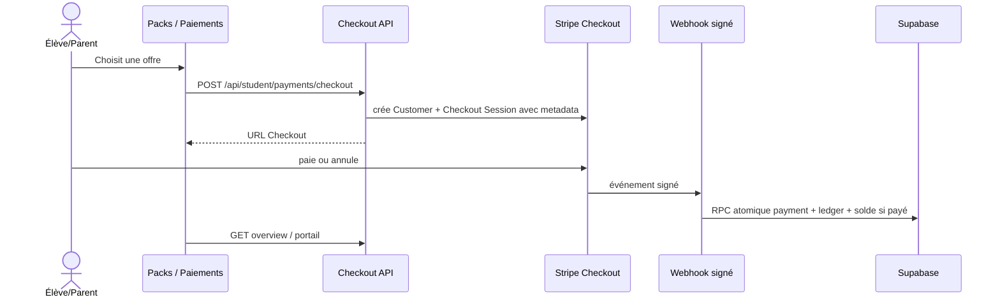
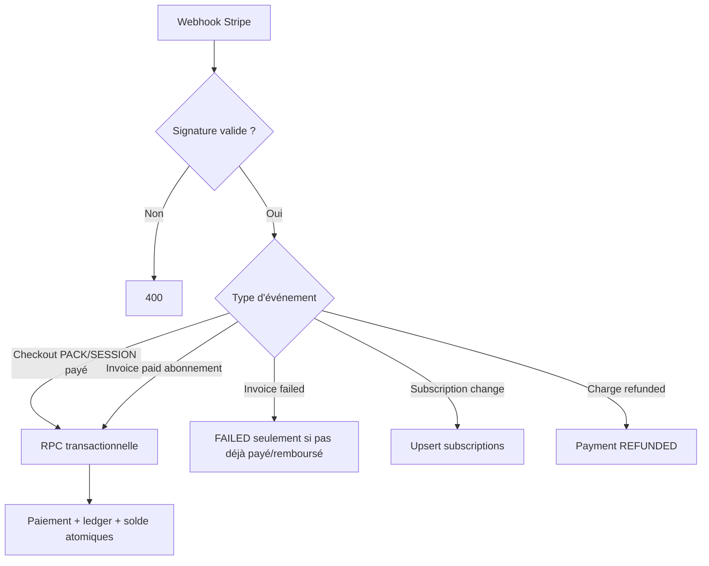

# 04 — Paiement, crédits et revenus

## Objectif

Acheter une séance, un pack ou un abonnement, suivre les crédits, présenter les factures et rendre visibles les revenus tuteur/admin.

## Checkout et crédits

- `POST /api/student/payments/checkout` exige un élève ou parent disposant d’un élève effectif et utilise le catalogue `lib/payments-catalog.ts`.
- Les cartes publiques et `lib/stripe.ts` consomment ce même catalogue : montant TTC, coût par séance et économie calculée face aux séances à l’unité du même niveau. Une erreur de préparation est annoncée et permet de réessayer ; un visiteur anonyme est renvoyé vers la connexion avec retour à `/packs` ou `/book-online`. La recette frontend intercepte les paiements ; elle ne confirme pas le bon fonctionnement du compte Stripe réel.
- La session Stripe transporte les métadonnées d’élève, plan, type, niveau et nombre de séances. Elles sont indispensables à la réconciliation webhook.
- `checkout.session.completed` et `checkout.session.async_payment_succeeded` créditent `PACK`/`SESSION` uniquement quand `payment_status = paid`. Pour `SUBSCRIPTION`, la facture payée est la seule source comptable, y compris au premier achat : le checkout ne crée pas de paiement supplémentaire.
- `student_credit_ledger` garde la trace des variations ; `student_credits` porte le solde par niveau.

## Consultation et gestion

| Acteur | Routes | Résultat |
| --- | --- | --- |
| Élève/parent | `GET /api/student/payments/overview` | crédits, achats, abonnements et factures |
| Élève/parent | `POST /api/student/payments/portal` | URL vers le portail Stripe de gestion |
| Tuteur | `GET /api/tutor/payments/history`, `/annual`, `/payouts` | historique, récapitulatif annuel et décaissements |
| Admin | `GET /api/admin/payments` | supervision des données de paiement |

## Invariants et sécurité

- Le webhook Stripe est public mais refuse toute requête dont la signature HMAC est invalide.
- `apply_stripe_payment` verrouille la référence de source ; les index uniques du ledger sur l'événement et sur `checkout:…`/`invoice:…` empêchent les doubles crédits, y compris entre deux événements distincts d'une facture. L'addition du solde se fait en SQL sous verrou de ligne ; aucune lecture/écriture de compteur en JavaScript.
- Une erreur annule la transaction entière. Un paiement ancien déjà payé, dépourvu de référence de ledger fiable, échoue explicitement pour réconciliation. Ne pas rejouer automatiquement l'historique.
- Une erreur de handler renvoie `500` afin que Stripe réessaie ; surveiller les événements non traités.
- Ne jamais créditer une séance depuis le retour navigateur : seul le webhook confirmé fait foi.

## Tests de recette

Le 14 novembre 2026, `npm test` couvre les contrats webhook, statuts et permissions ;
`npm run test:db` vérifie sur Docker local concurrence, replay, facture double,
rollback forcé et retry. Les fixtures sont supprimées sans réinitialiser la base.
La migration `20261114154431_stripe_atomic_credits.sql` doit précéder le code webhook.
La recette Stripe de test et la règle de remboursement des crédits restent dans SK-001.

- Tester checkout réussi, annulé, paiement échoué, remboursement, abonnement créé/mis à jour/annulé.
- Rejouer un même événement Stripe et vérifier qu’aucun crédit n’est ajouté deux fois.
- Vérifier les droits parent, élève, tuteur et admin sur chaque écran de paiement.
